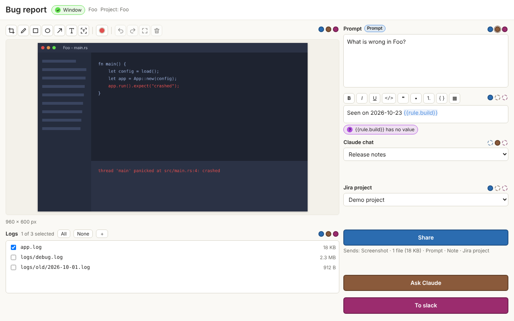
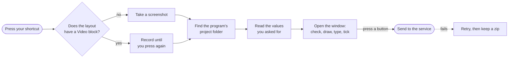
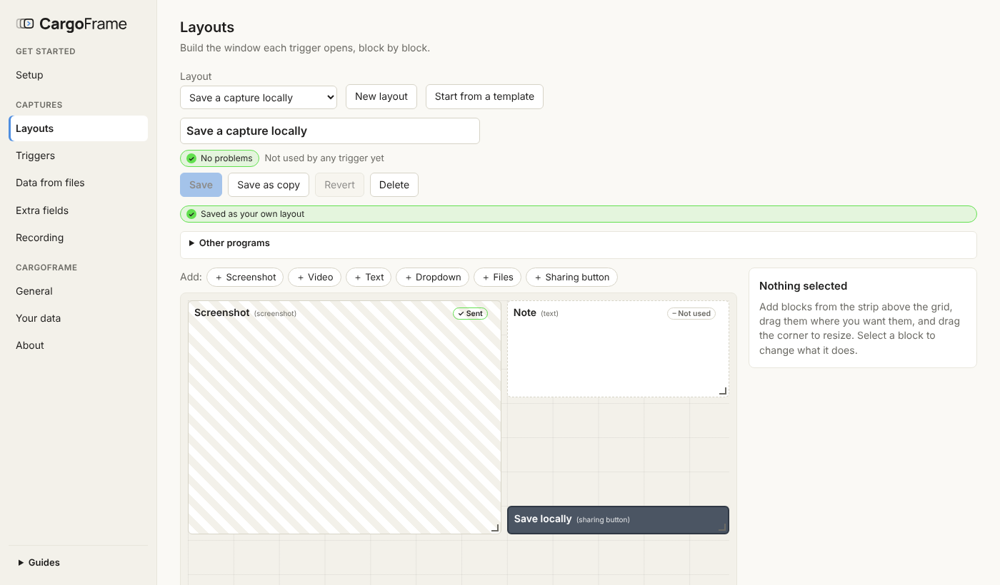
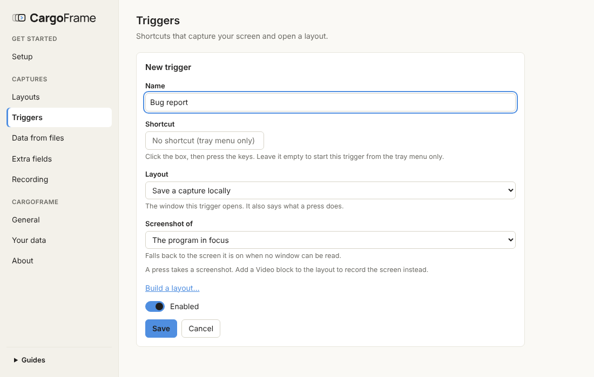
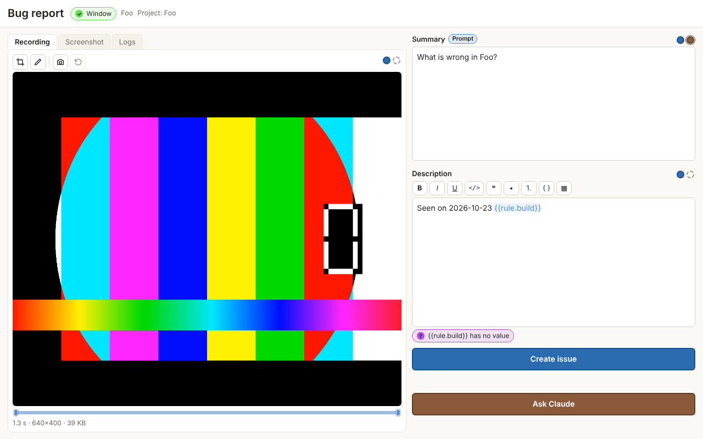

<p align="center">
  <picture>
    <source media="(prefers-color-scheme: dark)" srcset="assets/brand/convoy-logo-dark.svg">
    
  </picture>
</p>

<p align="center"><b>Share what is on your screen, with the context around it, in one shortcut.</b><br>
Windows 11 and Linux · version 0.4.1 (beta)</p>

<p align="center">
  <picture>
    <source media="(prefers-color-scheme: dark)" srcset="docs/images/capture-dark.png">
    
  </picture>
</p>

> **Beta.** Everything is built and tested, and the Windows installer has been tried, but not every service has
> been used with a real account and the installer is not signed yet. [What is verified](docs/status.md).

**On this page:** [What it is](#what-it-is) · [What it does](#what-it-does) · [How to use it](#how-to-use-it) ·
[Problems](#problems) · [For companies](#for-companies) · [For developers](#for-developers)

---

## What it is

CargoFrame is a small program that waits in the tray. When you press one of your shortcuts it captures the program you
are in, gathers what is around it (its project folder, a version number, a log line, the files you tick), and opens
**one window** where you check everything and press **one button** to send it to the service you chose.

| It is… | Which means… |
|--------|--------------|
| **Quick** | Under 40 MB while it waits, and the window is ready in a blink |
| **Yours to shape** | You decide which shortcuts exist, what the window looks like, and where each button sends |
| **Careful** | Nothing leaves your computer until you press a button; tokens live in your system's password store |
| **Safe when things fail** | A failed send is retried, then kept as a zip, so nothing is lost |

## What it does



**Where it can send**

| Service | Sends | Video |
|---------|-------|:-----:|
| **Jira** (Cloud, Server, Data Center) | A new issue or a comment, with pictures and files | ✓ |
| **GitHub** (and Enterprise Server) | A new issue or a comment; pictures and files shown from a branch of the repository | ✓ |
| **Google** | A file in Drive, and optionally a row in a spreadsheet | ✓ |
| **Slack** | A message in a channel or a thread | ✓ |
| **Discord** | A message, a forum post, or a reply in a thread | ✓ |
| **Teams** | A message in a chat or a channel | |
| **Reddit** | A post with the picture | |
| **Claude** | Opens a chat and pastes the picture and your prompt | |
| **X**, **Bluesky**, **Instagram** | A post with the screenshot and a short text | |
| **Custom API** | Any web service with an API | |
| **Save locally** | A zip on your computer, no account needed | ✓ |

---

## How to use it

### 1. Install

**Windows 11:** download **CargoFrame-Setup.exe** from **Releases**, double-click it and press **Install**. No
administrator password is needed. Windows may say the publisher is unknown (the installer is not signed yet): choose
**More info**, then **Run anyway**. CargoFrame then opens on its **Setup** page.

**Linux (x64):** download **CargoFrame-<version>-linux-x64.tar.gz** from **Releases**, unpack it and run
`./install.sh`.

Each release also has **SHA256SUMS.txt** to check the download. To update, run the new installer over the old one
(your settings stay), or press **Check for updates** in *Settings, About*.

<details>
<summary><b>Linux details, silent install, uninstall, video</b></summary>

- **Linux:** `./install.sh --no-startup` keeps it from starting at sign-in. The tray needs a system tray: KDE has
  one, GNOME needs the AppIndicator extension. Uninstall with `./uninstall.sh` (`--delete-data` also removes your
  settings).
- **Wayland** (GNOME, KDE, sway, Hyprland) works too: CargoFrame hands each shortcut to the desktop (on GNOME it
  appears in *Settings, Keyboard, Custom Shortcuts*). *Settings, Setup* lists what Wayland needs: the desktop portal
  (or `grim`), GStreamer with its PipeWire plugin for video, `wtype` on sway and Hyprland. How each desktop is handled:
  [design](docs/design.md#2-what-it-does).
- **Silent install (Windows):** `CargoFrame-Setup.exe /S`, add `/NOSTARTUP` to leave "start when I sign in" off.
- **Uninstall (Windows):** *Settings, Apps*. It asks whether to delete your settings too.
- **Video needs ffmpeg** (screenshots do not). *Settings, Setup* installs it on Windows with one button; on Linux it
  shows the one command to copy.

</details>

### 2. Set it up once

The app starts empty. Open **Settings** by left-clicking the tray icon, then:

| Step | Where | What you do |
|:----:|-------|-------------|
| 1 | **Setup, Connections** | Add the service you share to. A button beside each token field opens the page where you get it. Skip this to start with **Save locally** |
| 2 | **Layouts** | Press **Start from a template**, then **Use**, change what you like, **Save**. A layout is the window a capture opens. Bigger templates keep the screenshot and the logs in tabs |
| 3 | **Triggers** | Name it, click **Shortcut** and press the keys, pick your layout, **Save** |

<table>
<tr>
<td width="50%"></td>
<td width="50%"></td>
</tr>
<tr>
<td><b>Layouts.</b> Add blocks, drag them, resize them, group them in tabs. A <b>Video</b> block makes the shortcut record.</td>
<td><b>Triggers.</b> A shortcut and the layout it opens. That is all a trigger needs.</td>
</tr>
</table>

> **Looking for a setting?** Type in the search box at the top of the Settings menu (Ctrl+F): the menu lists only
> what has your words, and the rest of the page shown is greyed out. The × clears it.

> **Stuck?** **Guides**, at the bottom of the Settings menu, walks you through any setup: it opens the right page,
> outlines the field and says in one sentence what goes in it.

### 3. Press the shortcut

In any program, press your shortcut. Check the window, draw on the picture, type your note, pick where to post, and
press the sharing button. A layout with a Video block starts recording on the first press and stops on the second;
while it records, a red outline and a blinking dot say so (they are not in the recording).

Need the text that is on the screenshot? Pick **Read text** and drag over it: the lines found are marked, copy them all
or click the ones you want. *Try again* reads it another way. It is read on your computer (on Linux, install
`tesseract-ocr` first).

<details>
<summary><b>The words to know</b></summary>

| Word | Meaning |
|------|---------|
| **Trigger** | A shortcut, and the layout it opens |
| **Layout** | The window a capture opens: blocks on a grid of 12 columns, or more (up to 24) for a wider window |
| **Block** | One piece of the window: Screenshot, Video, Text, Dropdown, Files, Tags, Log viewer, Tabs, or a sharing button |
| **Connection** | A service you signed in to (Jira, Slack…) |
| **Where to post** | One dropdown that goes as deep as the service does: project, or server, channel, thread |
| **Data & fields** | *Read from files*: if a file is found in the program's folder, add it to the files and read values from it (`{{rule.gpu}}`). *Fill fields*: fill a field of the service on each share, with steps such as "if `{{rule.gpu}}` is found, add the label `gpu-{{rule.gpu}}`" |
| **Template** | A ready-made layout to start from; it becomes yours when you save it |

</details>

<details>
<summary><b>In the window: which button sends what</b></summary>

A window can have up to five sharing buttons. Each block shows one small dot per button, in that button's colour, at
the end of its title row: full means the button sends the block, an empty ring leaves it out; click a dot to switch it.
A dashed dot means the service cannot take it; an outer ring means the button needs it. Pointing at a button outlines
everything it sends (the picture itself for a screenshot or a recording).

</details>

<details>
<summary><b>In the window: recording, trimming, marking</b></summary>



Only the last seconds are kept (10 by default, *Settings, Recording*). Drag the two handles under it to trim; the
icons above it, as on a screenshot, **crop** (drag a frame, then *Apply crop*) and draw **marks** with the screenshot's
tools (pen, square, circle, arrow, text). Rest the mouse on an icon to see its name.
If you switch programs while recording, the one you used longest names the capture and gives the project folder.

**Continuous recording** (turn it on in *Settings, Recording*): hold a shortcut for 2 seconds to start recording all
the time. Each press of a video shortcut then opens its window with the last seconds while the recording goes on; hold
a shortcut 2 seconds again to stop. The tray menu does the same (on Wayland it is the way to start and stop).

**Keys pressed:** turn on *Show the keys pressed on the recording* on a Video block, and each key shows over the clip
when it was pressed ("Ctrl+S", "hello ⏎"). Drag the keys where you want them, take them off with their ×, and bring
them back with the keyboard icon. Every key typed while it records shows, passwords too; not on Wayland.

**The time:** the clock icon shows the time of each moment over the recording (2026-11-12 14:03:27), the way logs
write it; it is sent as you see it. To find the log lines of that moment, see *Log viewer* below.

**A window that is moved:** with *Follow the window when it is moved* on (*Settings, Recording*), the whole screen is
recorded and the crop follows the window as it moves.

Click the Video block in the layout builder to choose the screen or the window in
focus, the computer's sound (on by default) and a microphone (off). With a Screenshot block in the layout too, tick
*Also take a screenshot when the recording ends* to start it with that picture, or take one from the recording with the
camera icon. Recordings go to Jira, GitHub, Google, Slack, Discord and Save locally; the other services get the still.

</details>

<details>
<summary><b>In the window: formatting, values from files, filled fields</b></summary>

- **Formatting:** in the layout builder, choose in *Sent in* the field each sharing button sends a Text block in (a
  Jira summary or description, a Slack message…). When it is a message, the box shows bold, italic, underline, code,
  quotes, lists, code blocks and tables as they look, with buttons and shortcuts above it (Ctrl+B, Ctrl+I, Ctrl+U,
  Ctrl+E for code, Ctrl+Shift+9 quote, Ctrl+Shift+8 bullets, Ctrl+Shift+7 numbers), only the ones that service can
  show. A table is a grid: type in its cells, ＋ adds a row or a column, × removes one. The block's starting text in
  the layout builder has the same buttons, and every value is listed on its right with a search box, so
  `Seen in `{{app.exe}}` **({{project.name}})**` is written formatted once and filled in on every capture.
  CargoFrame writes the marks the way each service wants.
- **Pictures in the text:** for Jira, GitHub and Teams, put *Screenshot* or *Recording* from the values list (or the
  *Repro | Highlight* table) in the text, and the picture shows right there instead of as an attachment at the end.
- **Read from files** (*Settings, Data & fields*): *If this file is found* (its name or part of it, no format to choose), *add it to the
  files* and/or *read* values: the value written after a name (`GPU: …`), the text between two pieces (or to the end of
  the line), or the whole line with a word; the first, the last or all of them. Each value is a variable such as
  `{{rule.gpu}}` for the title or description. Only files your rules name are read, and only inside the project folder.
- **Fill fields** (*Settings, Data & fields*): a field of the service and the steps that fill it on each share: *If*
  a value (from a file, the program, the project) *is found / is / contains…*, *add* or *set* a text, *and* more. Add
  puts one more label in a list, a new line in a description. For every layout that shares there, or only some. A
  block of the window is still sent in a field from the sharing button.
- **Files from several folders:** a Files block can look in several subfolders, separated by commas (`logs, build/out`).
  Missed one? **＋** adds files by hand; they are copied into the capture and ticked.
- **Tags:** a Tags block works like Jira's labels: type a tag and press Enter, up to 25. Its starting list can use
  values (`{{rule.gpu}}` tags the graphics card when it is found), the last five used are offered, and Jira's or a
  repository's labels are suggested while typing. Send them as Jira or GitHub labels, hashtags on X, Bluesky and
  Instagram, or a *Tags* line in Slack, Teams and Discord.
- **Log viewer:** a block that shows a file of the window line by line. Type `error` in its search to see only those
  lines, pick one to read it whole and copy it, or *Copy all*. The expand icon opens it large in the middle of the
  window; the cross or Escape closes it.
- **Log lines by time:** the clock button at the start of the log viewer's search row turns it to a time search: the
  lines written during the recording, around the screenshot, or between two times you type (the magnifier turns it
  back). Logs write their time in many ways: type the one yours uses in the format box (`[YYYY_MM_DD] HH:mm -`,
  `MM_DD_HH_mm_ss`) and the missing day or year is taken from the capture; or let a data rule set it for the file it
  finds. The last format used for a file comes back next time.
- **Tabs:** a Tabs block is a binder: 2 to 5 tabs (named, with the names on the top, bottom, left or right), each
  holding blocks. In the layout builder, click a tab's name and drop blocks inside; drag the grip at its top right to
  move it with its blocks. In the window, click a tab to see its blocks. What is in the other tabs is kept and sent.
- **Values made from other values:** in *Data & fields*, *Make a value from other values*: for example a build id
  `{{rule.stream}}_{{rule.change}}_{{rule.shelf}}_{{rule.config}}` when a shelf is found, else without it.
- **One-line text:** tick *One line high* on a Text block to keep its box one line tall; any Text block keeps at least
  one line, however small the window.
- **Last choices:** each dropdown starts on what you used last and lists the last five.
- **Several windows:** a shortcut pressed while a window is open opens another, up to ten.

</details>

<details>
<summary><b>Templates, clean-up and your data</b></summary>

Templates are offered for the services you connected: *Save a capture locally*, *Save a recording locally*, Jira
*Bug report* (also with a recording) and *Comment on an issue*, GitHub *Issue* and *Comment on an issue*, Google
*Drive upload* (also a recording) and *Sheet row*, Slack *Message* (also with a recording), *Ask Claude about a
capture*, and a *Message* or *Post* for each other service. The ones with much to fill in (Jira bug report, GitHub
issue, Slack, Discord, Ask Claude) keep the screenshot and a *Logs* tab (files and a log viewer) in tabs; with a
recording, a *Recording* tab comes first.

| Remove | How | Gentler |
|--------|-----|---------|
| A layout, trigger, rule or field | **Delete**, then **Delete for good** | Switch off **Enabled** (triggers) |
| A connection | **Delete**, then **Delete for good**; its tokens leave the password store | **Sign out** |
| Everything | *Your data*, **Reset CargoFrame** (keeps the program and your saved zips) | *Your data*, **Export** first |

*Settings, Your data* lists what is kept on this computer, with its size and a **Clear** button for each kind.
*Pause triggers* in the tray menu turns every shortcut off for a while.

</details>

<details>
<summary><b>Service setup notes</b></summary>

| Service | What you need |
|---------|---------------|
| Jira | Address, plus an API token and your e-mail (Cloud) or a personal access token (Server, Data Center) |
| GitHub | The repository (owner/name) and a fine-grained token for it: Issues, and Contents for the pictures, read and write |
| Google | A Client ID from your own Google Cloud project ("Desktop app") |
| Slack | A bot token (`xoxb-`) from an app in your workspace; invite it to each channel |
| Discord | A webhook link per channel (*channel settings, Integrations, Webhooks*); no bot needed |
| Teams | An app ID from your own Microsoft Entra app (work or school accounts) |
| Reddit | A Client ID from an "installed app" at reddit.com/prefs/apps |
| Claude | Nothing: the desktop app or the browser |
| X | A Client ID from your own app in the X developer portal |
| Bluesky | Your handle and an app password |
| Instagram | A token from your Meta app, and a picture server you own (Instagram only takes pictures from a web address) |
| Custom API | An address and how to sign in |

</details>

---

## Problems

| What you see | What to do |
|--------------|------------|
| No tray icon (Linux) | GNOME needs the AppIndicator extension. Meanwhile, start CargoFrame again to open Settings |
| "Unknown publisher" (Windows) | The installer is not signed yet: **More info**, **Run anyway** |
| No video | *Settings, Setup*: install ffmpeg (and, on Wayland, GStreamer's PipeWire plugin) |
| A shortcut does nothing (Wayland) | *Settings, Triggers* says how this desktop takes shortcuts; where it cannot, it shows the command to add to your desktop's keyboard shortcuts, with a **Copy** button |
| The whole screen was captured, not the program (Wayland) | GNOME does not tell programs which window is in focus (except older X11 programs). The window's note says so |
| A video without sound | Click the Video block in your layout and check **Sound of the computer**. The notification after a recording says why a sound was left out |
| Notifications appear in recordings | *Settings, General, Notifications*: switch off *Say when something happens* |
| Claude opened but nothing was pasted | Leave Claude in front a few seconds; raise **Extra seconds to wait** in the Claude connection. On GNOME and KDE Wayland, programs cannot paste for you: the message is on the clipboard, press Ctrl+V |
| A send failed | Nothing is lost: CargoFrame retried, kept a zip and said where. The message says what the service answered |

---

## For companies

| Need | How |
|------|-----|
| Install for many people without an administrator | Per-user installer; `/S` and `/NOSTARTUP` for Intune or a login script |
| Ship only the services you use | `set CF_SERVICES=jira,teams,custom` before `scripts\windows\build.cmd`; the others are not in the program at all |
| Let your own tools fill a layout | Turn on *Other programs can fill this* in the layout, then `cargoframe open --trigger bug --set summary="It crashed"`. Nothing is sent until the person presses a button |
| Your network | Trusts the certificates your computers trust; uses the system proxy |
| Your sign-in | Teams with Microsoft Entra; each person's tokens stay in their own password store |
| Central settings for everyone | Planned: a read-only managed folder. See [the design](docs/design.md#5-for-companies) |

---

## For developers

Rust (stable, see `rust-toolchain.toml`) and Node 22.

```sh
cd ui && npm ci && npm run build && cd ..   # build the windows once
scripts/dev/check.sh quick                  # format, clippy, tests, svelte-check, UI tests
scripts/dev/check.sh all                    # everything, with size budgets and a real capture on a virtual screen
```

On Windows `scripts\windows\build.cmd` builds the program and the installer. To try the windows in a browser with demo
data, run `npm run dev` in `ui/` and open `settings.html` or `capture.html`.

| Document | What it holds |
|----------|---------------|
| [Design](docs/design.md) | What the app is, does, how it is used and built; branding |
| [Development plan](docs/development-plan.md) | How to make the app: stack, architecture, modules, build order, quality gates |
| [Connectors](docs/connectors.md) | How each service flows, and what to improve next |
| [Decisions](docs/decisions.md) | What was decided, and why |
| [Status](docs/status.md) · [Security](docs/security.md) · [Performance](docs/performance.md) | What is verified; the security review; budgets and measures |
| [Spikes](docs/spikes.md) · [Signing](docs/signing.md) · [Installers](installers/README.md) | Real-machine checks; certificates; what the packages do |
