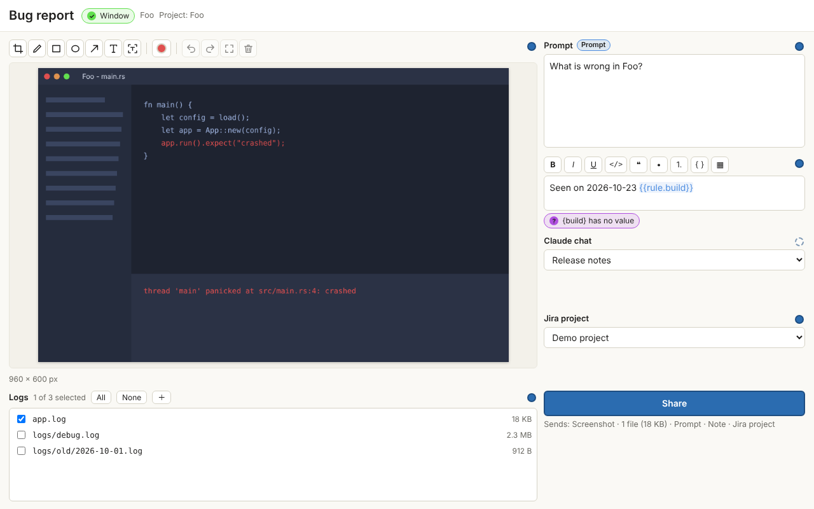
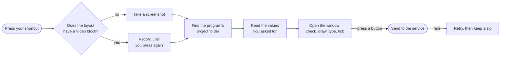
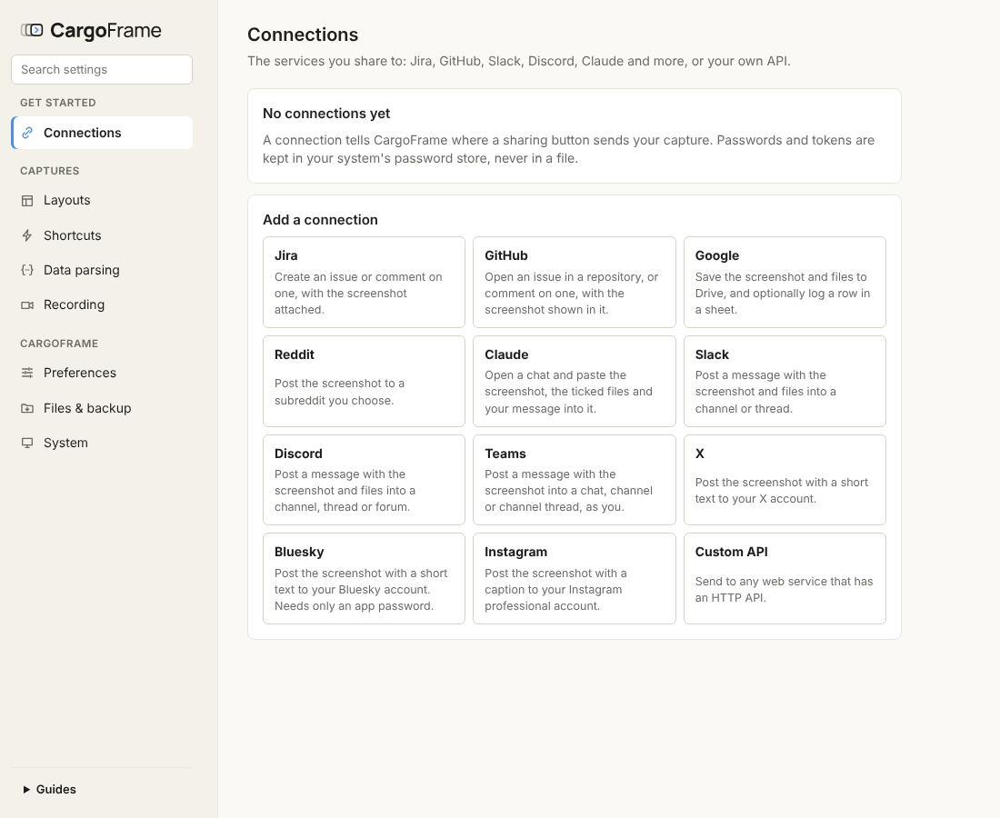
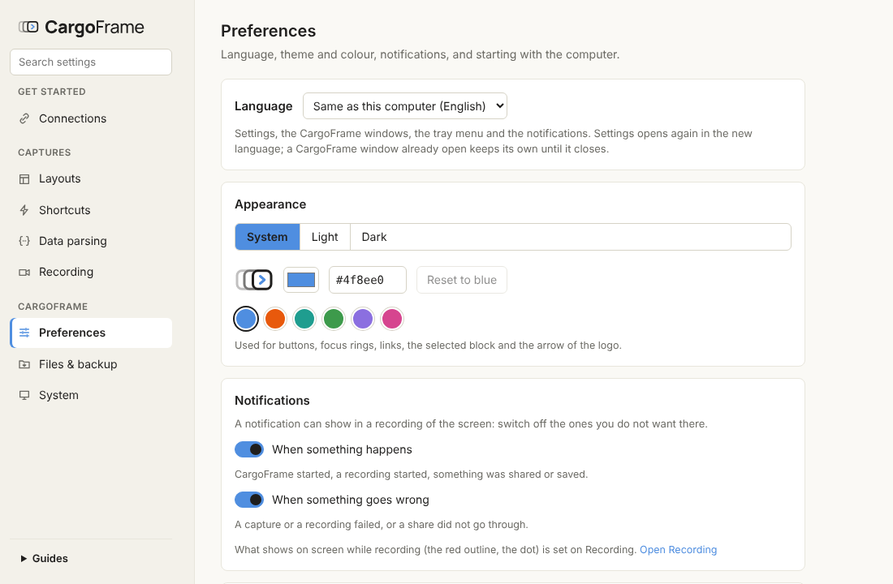
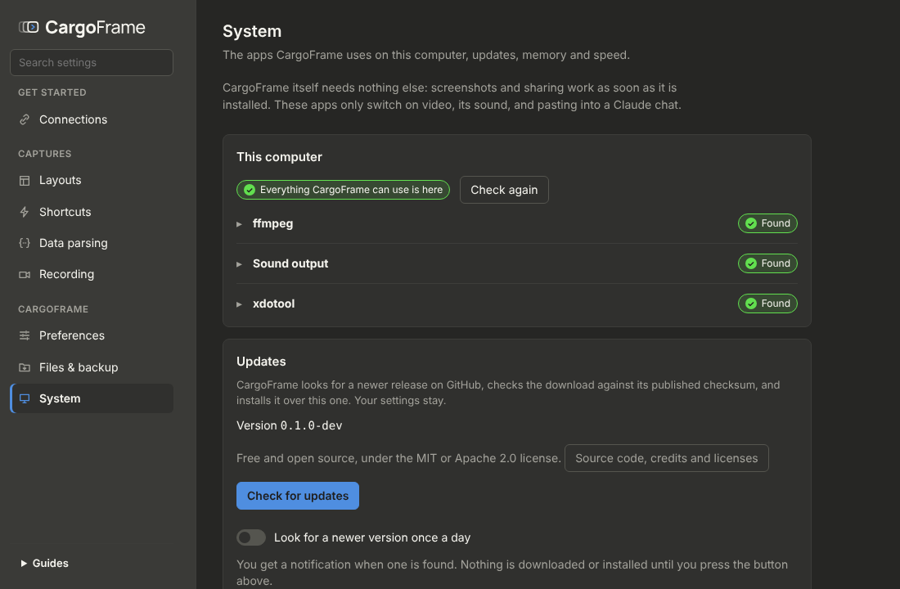
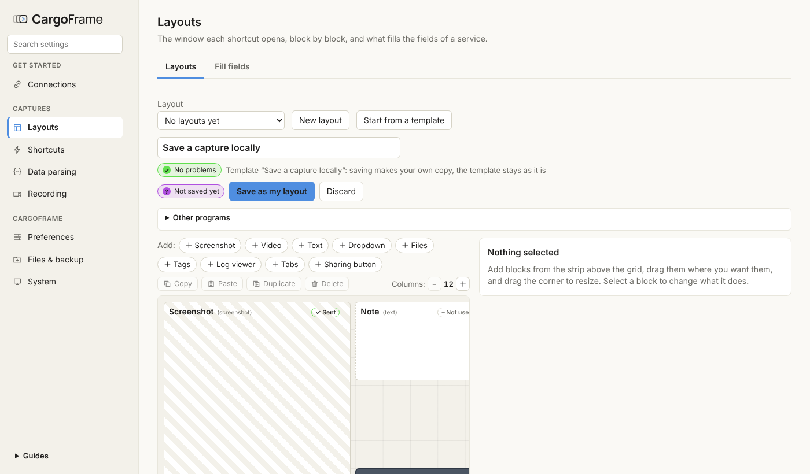
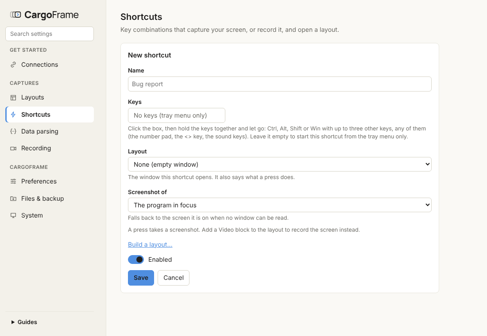
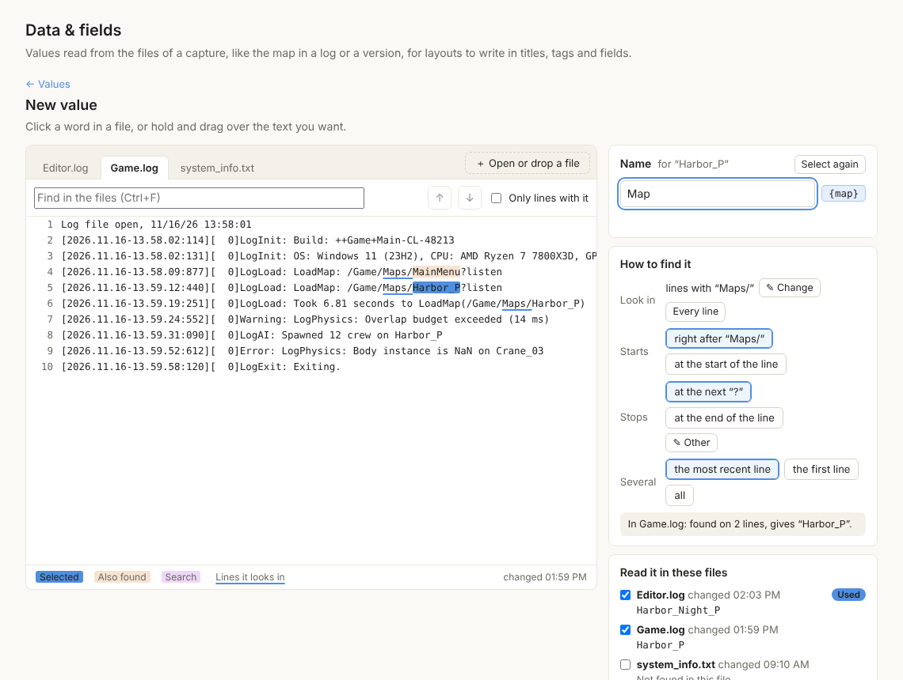
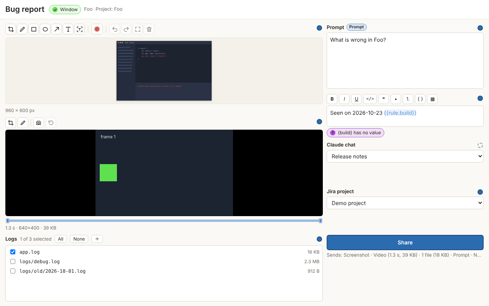
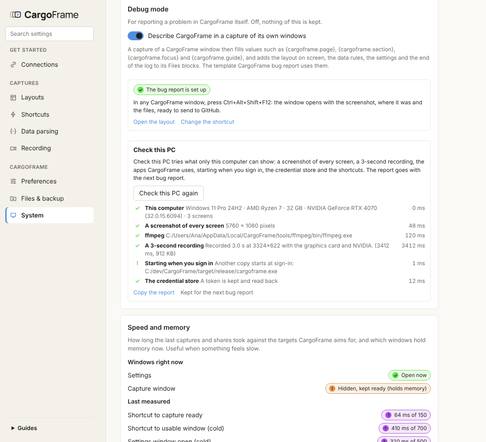

<p align="center">
  <picture>
    <source media="(prefers-color-scheme: dark)" srcset="assets/brand/convoy-logo-dark.svg">
    
  </picture>
</p>

<p align="center"><b>Share what is on your screen, with the context around it, in one shortcut.</b><br>
Windows 11 and Linux · version 0.7.3 (beta) · English, Français, Español, Italiano, Deutsch · free and open source</p>

<p align="center">
  <picture>
    <source media="(prefers-color-scheme: dark)" srcset="docs/images/capture-dark.png">
    
  </picture>
</p>

> **Beta.** Used every day on Windows 11 with Jira, GitHub and Discord, and checked by about 1,780 tests on every
> change. The other services are tested against their documented APIs but not yet with a real account, Linux
> desktops only on virtual screens, and the installer is not signed yet. [What is verified](docs/status.md).

**On this page:** [What it is](#what-it-is) · [What it does](#what-it-does) · [How to use it](#how-to-use-it) ·
[Problems](#problems) · [For companies](#for-companies) · [For developers](#for-developers) · [License](#license)

---

## What it is

CargoFrame is a small program that waits in the tray. When you press one of your shortcuts it captures the program you
are in, gathers what is around it (its project folder, a version number, a log line, the files you tick), and opens
**one window** where you check everything and press **one button** to send it to the service you chose.

| It is… | Which means… |
|--------|--------------|
| **Quick** | Under 40 MB while it waits, and the window is ready in a blink |
| **Yours to shape** | You decide which shortcuts exist, what the window looks like, and where each button sends |
| **Careful** | Nothing leaves your computer until you press a button; tokens live in your system's password store |
| **Safe when things fail** | A failed send is retried, then kept as a zip, so nothing is lost |

## What it does



**Where it can send**

| Service | Sends | Video |
|---------|-------|:-----:|
| **Jira** (Cloud, Server, Data Center) | A new issue, or an update of one (fields replaced or added to, a comment, a vote), with pictures and files | ✓ |
| **GitHub** (and Enterprise Server) | A new issue, or an update of one (fields replaced or added to, a comment, a 👍); pictures and files shown from a branch of the repository | ✓ |
| **Google** | A file in Drive, and optionally a row in a spreadsheet | ✓ |
| **Slack** | A message in a channel or a thread | ✓ |
| **Discord** | A message, a forum post, or a reply in a thread | ✓ |
| **Teams** | A message in a chat or a channel; the recording and files in the channel's Files (or your OneDrive for a chat) | ✓ |
| **Reddit** | A post with the picture | |
| **Claude** | Opens a chat and pastes the picture and your prompt | |
| **X**, **Bluesky**, **Instagram** | A post with the screenshot, or the recording as its video (a reel on Instagram), and a short text | ✓ |
| **Custom API** | Any web service with an API | |
| **Save locally** | A zip on your computer, no account needed | ✓ |

<table>
<tr>
<td width="33%"></td>
<td width="33%"></td>
<td width="33%"></td>
</tr>
<tr>
<td><b>Connections.</b> Add a service; a button beside each token field opens the page where you get it.</td>
<td><b>Preferences.</b> Language, theme and accent colour, which notifications show.</td>
<td><b>System.</b> What CargoFrame uses on this computer, installed with one button; updates; speed and memory.</td>
</tr>
</table>

---

## How to use it

### 1. Install

**Windows 11:** download **CargoFrame-Setup.exe** from **Releases**, double-click it and press **Install**. No
administrator password is needed. Windows may say the publisher is unknown (the installer is not signed yet): choose
**More info**, then **Run anyway**. CargoFrame then opens Settings on a short **tour** of where everything is (skip it
whenever you like; *Guides* starts it again).

**Linux (x64):** download **CargoFrame-<version>-linux-x64.tar.gz** from **Releases**, unpack it and run
`./install.sh`.

Each release also has **SHA256SUMS.txt** to check the download. To update, run the new installer over the old one
(your settings stay), or press **Check for updates** in *Settings, System*.

<details>
<summary><b>Linux details, silent install, uninstall, video</b></summary>

- **Linux:** `./install.sh --no-startup` keeps it from starting at sign-in. The tray needs a system tray: KDE has
  one, GNOME needs the AppIndicator extension. Uninstall with `./uninstall.sh` (`--delete-data` also removes your
  settings).
- **Wayland** (GNOME, KDE, sway, Hyprland) works too: CargoFrame hands each shortcut to the desktop (on GNOME it
  appears in *Settings, Keyboard, Custom Shortcuts*). *Settings, System* lists what Wayland needs: the desktop portal
  (or `grim`), GStreamer with its PipeWire plugin for video, `wtype` on sway and Hyprland. How each desktop is handled:
  [design](docs/design.md#2-what-it-does).
- **Silent install (Windows):** `CargoFrame-Setup.exe /S`, add `/NOSTARTUP` to leave "start when I sign in" off.
- **An older copy starting at sign-in instead of this one** (one built by hand and run as administrator) is removed
  by the installer and by CargoFrame when Windows allows it; otherwise *Settings, Preferences* names it, with
  *Stop the older copy*.
- **Uninstall (Windows):** *Settings, Apps*. It asks whether to delete your settings too.
- **Video needs ffmpeg** (screenshots do not). *Settings, System* downloads it with one button (Windows and Linux,
  no administrator needed, checked against its published checksums) and offers the newer one when there is one. Recording uses the graphics card where it can (its copy of the screen and its encoder)
  and runs below the programs in use, so the program you record stays smooth. A recording of several screens is
  made about the size of your main screen (at most 4K), so three screens cost what one does, on a fast PC or a slow one.

</details>

### 2. Set it up once

The app starts empty. Open **Settings** by left-clicking the tray icon, then:

| Step | Where | What you do |
|:----:|-------|-------------|
| 1 | **Connections** | Add the service you share to. A button beside each token field opens the page where you get it. Skip this to start with **Save locally** |
| 2 | **Layouts** | Press **Start from a template**, then **Use**, change what you like, **Save**. A layout is the window a capture opens. Bigger templates keep the screenshot and the logs in tabs |
| 3 | **Shortcuts** | Name it, click **Keys** and hold the keys together (Ctrl, Alt, Shift or Win with up to three others, any of them), pick your layout, **Save** |
| 4 | **Data parsing** *(optional)* | After a first capture, **New value: select it in a file**: click the map in a log, name it, **Save**. Write `{map}` in a layout's title, text or tags |

<table>
<tr>
<td width="50%"></td>
<td width="50%"></td>
</tr>
<tr>
<td><b>Layouts.</b> Add blocks, drag them, resize them, group them in tabs. A <b>Video</b> block makes the shortcut record.</td>
<td><b>Shortcuts.</b> The keys and the layout they open. That is all a shortcut needs.</td>
</tr>
</table>

<p></p>
<p><b>Data parsing.</b> Select a value once in a file of a capture; CargoFrame finds it again in every capture, in every log you tick, the newest winning.</p>

> **Looking for a setting?** Type in the search box at the top of the Settings menu (Ctrl+F): the menu lists only
> what has your words, and the rest of the page shown is greyed out. The × clears it.

> **Another language?** CargoFrame follows your computer's language (English, French, Spanish, Italian or German).
> To choose another, open **Preferences, Language**. Texts you write yourself stay as you wrote them.

> **Stuck?** **Guides**, at the bottom of the Settings menu, has the tour again and walks you through any setup: it opens the right page,
> outlines the field and says in one sentence what goes in it.

### 3. Press the shortcut

In any program, press your shortcut. Check the window, draw on the picture, type your note, pick where to post, and
press the sharing button. A layout with a Video block starts recording on the first press and stops on the second;
while it records, a red outline and a blinking dot say so (they are not in the recording).

Need the text that is on the screenshot? Pick **Read text** and drag over it: the lines found are marked, copy them all
or click the ones you want. *Try again* reads it another way. It is read on your computer (on Linux, install
`tesseract-ocr` first).

<details>
<summary><b>The words to know</b></summary>

| Word | Meaning |
|------|---------|
| **Shortcut** | Keys (or the tray menu), and the layout they open |
| **Layout** | The window a capture opens: blocks on a grid of 12 columns, or more (up to 24) for a wider window |
| **Block** | One piece of the window: Screenshot, Video, Text, Dropdown, Files, Tags, Log viewer, Tabs, or a sharing button |
| **Connection** | A service you signed in to (Jira, Slack…) |
| **Where to post** | One dropdown that goes as deep as the service does: project, or server, channel, thread |
| **Value** | Something read in the files of each capture, like the map in a game's log: select it once in a file, then write `{map}` in a title, a description, a tag or a field (*Data parsing*) |
| **Fill fields** | A field of the service filled on each share, with steps such as "if `{gpu}` is found, add the label `gpu-{gpu}`" (a tab of *Layouts*) |
| **Template** | A ready-made layout to start from; it becomes yours when you save it |

</details>

<details>
<summary><b>In the window: which button sends what</b></summary>

A window can have up to five sharing buttons. Each block shows one small dot per button, in that button's colour, at
the end of its title row: full means the button sends the block, an empty ring leaves it out; click a dot to switch it.
A dashed dot means the service cannot take it; an outer ring means the button needs it. Pointing at a button outlines
everything it sends (the picture itself for a screenshot or a recording).

</details>

<details>
<summary><b>In the window: recording, trimming, marking</b></summary>



Only the last seconds are kept (15 by default, *Settings, Recording*). Drag the two handles under it to trim; the
icons above it, as on a screenshot, **crop** (drag a frame, then *Apply crop*) and draw **marks** with the screenshot's
tools (pen, square, circle, arrow, text). Rest the mouse on an icon to see its name.
If you switch programs while recording, the one you used longest names the capture and gives the project folder.

**Continuous recording** (turn it on in *Settings, Recording*): hold a shortcut for 2 seconds to start recording all
the time. Each press of a video shortcut then opens its window with the last seconds while the recording goes on; hold
a shortcut 2 seconds again to stop. The tray menu does the same (on Wayland it is the way to start and stop).

**Keys pressed:** turn on *Show the keys pressed on the recording* on a Video block, and each key shows over the clip
when it was pressed ("Ctrl+S", "hello ⏎"). Drag the keys where you want them, take them off with their ×, and bring
them back with the keyboard icon. Every key typed while it records shows, passwords too; not on Wayland.

**The time:** the clock icon shows the time of each moment over the recording (2026-11-12 14:03:27), the way logs
write it; it is sent as you see it. To find the log lines of that moment, see *Log viewer* below.

**A window that is moved:** with *Follow the window when it is moved* on (*Settings, Recording*), the screen the window
is on is recorded and the crop follows the window as it moves; its outline hides while it moves.

Click the Video block in the layout builder to choose the screen or the window in
focus, the computer's sound (on by default) and a microphone (off). With a Screenshot block in the layout too, tick
*Also take a screenshot when the recording ends* to start it with that picture, or take one from the recording with the
camera icon. Recordings go to Jira, GitHub, Google, Slack, Discord and Save locally; the other services get the still.

</details>

<details>
<summary><b>In the window: formatting, values from files, filled fields</b></summary>

- **Formatting:** in the layout builder, choose in *Sent in* the field each sharing button sends a Text block in (a
  Jira summary or description, a Slack message…). When it is a message, the box shows bold, italic, underline, code,
  quotes, lists, code blocks and tables as they look, with buttons and shortcuts above it (Ctrl+B, Ctrl+I, Ctrl+U,
  Ctrl+E for code, Ctrl+Shift+9 quote, Ctrl+Shift+8 bullets, Ctrl+Shift+7 numbers), only the ones that service can
  show. A table is a grid: type in its cells, ＋ adds a row or a column, × removes one (every row and column has one, the
  header row too; removing the last one removes the table). The block's starting text in
  the layout builder has the same buttons, and every value is listed on its right with a search box (or type `{` to
  pick one), so `Seen in `{app.exe}` **({project.name})**` is written formatted once and filled in on every capture.
  *Values* above the box shows the text as the last capture fills it in. CargoFrame writes the marks the way each
  service wants.
- **Pictures in the text:** for Jira, GitHub and Teams, put *Screenshot* or *Recording* from the values list (or the
  *Repro | Highlight* table) in the text, and the picture shows right there instead of as an attachment at the end.
- **Values from files** (*Settings, Data parsing*): *New value: select it in a file* shows the text files of the last
  capture (or ones you open or drop; they stay, and a tab's × closes it, until Settings closes). Click a word, or drag over the text you want: CargoFrame suggests how to find it
  again (in the lines with the label just before it, up to the next sign, a space or the end of the line, the most
  recent line), shows what each file gives, and you name it. Tick the files to read it in: when several have it, the
  newest file wins, or all their different values. A value no file has stays empty, or gives a text you choose. The
  *Values* tab lists each one with what the last capture gave and the layouts using it; *Files* lists the files read,
  whether each is added to the window's files and how its lines write their time. Write a value as `{map}`; the older
  `{{rule.map}}` keeps working. Only files you name are read, and only inside the project folder. The grips at
  the two ends of a selection widen or narrow it a character at a time (the text before the value gets them while
  you change it). **＋ Add a next part** joins a text found after the value to it, such as ffmpeg's
  `Stream #0:1: Audio: aac…` and the `encoder : Lavc58…` written below it, with ` - `, `, `, a space, a new line or
  your own text between them.
- **Fill fields** (*Settings, Layouts, Fill fields*): a field of the service and the steps that fill it on each share: *If*
  a value (from a file, the program, the project) *is found / is / contains…*, *add* or *set* a text, *and* more. Add
  puts one more label in a list, a new line in a description. For every layout that shares there, or only some. A
  block of the window is still sent in a field from the sharing button.
- **Files from several folders:** a Files block can look in several subfolders, separated by commas (`logs, build/out`).
  Missed one? **＋** adds files by hand; they are copied into the capture and ticked.
- **Tags:** a Tags block works like Jira's labels: type a tag and press Enter, up to 25. Its starting list can use
  values (`{gpu}` or `gpu-{gpu}` tags the graphics card when it is found), the last five used are offered, and with a
  list of the service (Jira's labels, components or versions, a repository's labels) the box opens it when clicked:
  pick several, one after the other, or type to narrow it. Send them as Jira or GitHub labels, hashtags on X, Bluesky and
  Instagram, or a *Tags* line in Slack, Teams and Discord.
- **Log viewer:** a block that shows a file of the window line by line. Type `error` in its search to see only those
  lines, pick one to read it whole and copy it, or *Copy all*. The expand icon opens it large in the middle of the
  window; the cross or Escape closes it.
- **Log lines by time:** the clock button at the start of the log viewer's search row turns it to a time search: the
  lines written during the recording, around the screenshot, or between two times (type them, or pick a line and press
  *Start here* or *End here*; the magnifier turns it back). Logs write their time in many ways: **select the time in a
  line**, as it is written (`[2026.11.18-14.32.05:123]`), and CargoFrame reads every line's time that way; or type the
  format (`[YYYY_MM_DD] HH:mm -`) behind the button that shows how times are read, or let a data rule set it for the
  file it finds. The missing day or year is taken from the capture, and the last format used for a file comes back.
- **Logs that follow the clip:** while a recording plays, the log viewer shows the lines written up to the moment on
  screen, the newest coming in at the bottom as it plays. Untick *Following the clip* to see every line.
- **Tabs:** a Tabs block is a binder: 2 to 5 tabs (named, with the names on the top, bottom, left or right), each
  holding blocks. In the layout builder, click a tab's name and drop blocks inside; drag the grip at its top right to
  move it with its blocks; the lock beside a tab's name in the block's properties keeps its blocks where they are
  (the tab is greyed on the grid and still opens). In the window, click a tab to
  see its blocks. What is in the other tabs is kept and sent.
- **Copy, paste, duplicate, delete:** in the layout builder, the buttons over the grid (or Ctrl+C, Ctrl+V, Ctrl+D and
  Delete) work on the block chosen. A copy can be pasted in another layout while Settings is open.
- **This computer's details:** `{system.os}`, `{system.cpu}`, `{system.ram}`, `{system.gpu}`, `{system.gpu_driver}`,
  `{system.screens}` and `{system.computer}` fill in like the date and time (*Data parsing* lists them with what they are
  here). They are only sent when a layout puts them in a text.
- **Debug mode** (*Settings, System*, off by default): for reporting a problem in CargoFrame itself. A capture of a
  CargoFrame window then fills `{cargoframe.where}` (like *CargoFrame settings - Layouts - Fill fields - Fill a
  field*), `{cargoframe.focus}`, `{cargoframe.guide}`, `{cargoframe.layout}`… and adds the layout on screen, the data
  rules, the settings and the end of the log to its Files block. **Set up the bug report**, under the switch, makes the
  *CargoFrame bug report* layout for your GitHub connection and a shortcut, Ctrl+Alt+Shift+F12: press it in any
  CargoFrame window and the issue is filled in (where it was, what was in focus, the system, the graphics driver, the
  screens…), with the version among its labels. **Check this PC**, below it, tries the screenshot, a 3-second
  recording, the apps, starting at sign-in, the credential store and the shortcuts on your PC, marks each ✓, ! or ✗,
  and the next bug report attaches what it found.

  
- **Values made from other values:** in *Data parsing*, *Made from other values*: for example a build id
  `{stream}_{change}_{shelf}_{config}` when a shelf is found, else without it.
- **One-line text:** tick *One line high* on a Text block to keep its box one line tall; any Text block keeps at least
  one line, however small the window.
- **Last choices:** each dropdown starts on what you used last and lists the last five.
- **Several windows:** a shortcut pressed while a window is open opens another, up to ten.

</details>

<details>
<summary><b>Templates, clean-up and your data</b></summary>

Templates are offered for the services you connected: *Save a capture locally*, *Save a recording locally*, *Jira ticket* and *Jira ticket with recording*, *GitHub issue* and *GitHub issue with recording*, Google *Drive upload* (also a recording) and *Sheet row*, Slack and Discord *Message* (also with a
recording), *Ask Claude about a capture*, and a *Message* or *Post* for each other service. Most keep the screenshot
and a *Logs* tab (files and a log viewer) in tabs; with a recording, a *Recording* tab comes first, and the
recording is of the window in focus. A report's starting text says where it was seen (program, project, date and
time) and, for Jira and GitHub, shows the recording beside the screenshot in a table.

**Create or update, with one button:** the Jira and GitHub templates' button (*Send to Jira*, *Send to GitHub*)
creates a new ticket when *Ticket to update* (GitHub: *Issue to update*) is left empty, or updates the one picked:
the title stays, the description is added below the one there, the labels are added, and the optional *Comment* goes
with it. A new Jira ticket is assigned to you unless you pick someone else in *Assignee*; people and teams are found by
typing their name. In the layout builder, the sharing
button says for each block what it does to an issue that is there (replace, add below, add one line, add to the
list, count up, leave it), and can also vote (Jira) or react 👍 (GitHub).

**Must be filled:** under *Before sharing*, tick the blocks a button waits for; in the window the button stays grey
and lists what is still empty. What a service refuses to send without is held back the same way: the Slack, Discord
or Teams channel, the subreddit, the Jira project and issue type (marked *(required)* in the builder's field list).
CargoFrame also asks the service what your choice requires: for a new Jira ticket, the fields of the issue type you
picked (*Jira needs "Component/s" for this issue type, and no block sends it*); for Reddit, what the subreddit's
moderators require (a flair, a text). In the layout builder, a block that no button sends gets a warning, since
whatever is put in it would go nowhere.

| Remove | How | Gentler |
|--------|-----|---------|
| A layout, shortcut, rule or field | **Delete**, then **Delete for good** | Switch off **Enabled** (shortcuts) |
| A connection | **Delete**, then **Delete for good**; its tokens leave the password store | **Sign out** |
| Several layouts, values or field fills | *Files & backup*: tick them, **Delete N items…**, then **Delete for good** | **Export** them first |
| Everything | *Files & backup*, **Reset CargoFrame** (keeps the program and your saved zips) | *Files & backup*, **Export** first |

*Settings, Files & backup* lists what is kept on this computer, with its size and a **Clear** button for each kind.
*Pause shortcuts* in the tray menu turns every shortcut off for a while.

</details>

<details>
<summary><b>Service setup notes</b></summary>

| Service | What you need |
|---------|---------------|
| Jira | Address, plus an API token and your e-mail (Cloud) or a personal access token (Server, Data Center) |
| GitHub | The repository (owner/name) and a fine-grained token for it: Issues, and Contents for the pictures, read and write |
| Google | A Client ID from your own Google Cloud project ("Desktop app") |
| Slack | A bot token (`xoxb-`) from an app in your workspace; invite it to each channel |
| Discord | A webhook link per channel (*channel settings, Integrations, Webhooks*); no bot needed |
| Teams | An app ID from your own Microsoft Entra app (work or school accounts) |
| Reddit | A Client ID from an "installed app" at reddit.com/prefs/apps |
| Claude | Nothing: the desktop app or the browser |
| X | A Client ID from your own app in the X developer portal |
| Bluesky | Your handle and an app password |
| Instagram | A token from your Meta app, and a picture server you own (Instagram only takes pictures from a web address) |
| Custom API | An address and how to sign in |

</details>

---

## Problems

| What you see | What to do |
|--------------|------------|
| No tray icon (Linux) | GNOME needs the AppIndicator extension. Meanwhile, start CargoFrame again to open Settings |
| "Unknown publisher" (Windows) | The installer is not signed yet: **More info**, **Run anyway** |
| No video | *Settings, System*: install ffmpeg (and, on Wayland, GStreamer's PipeWire plugin) |
| A shortcut does nothing (Wayland) | *Settings, Shortcuts* says how this desktop takes shortcuts; where it cannot, it shows the command to add to your desktop's keyboard shortcuts, with a **Copy** button |
| The whole screen was captured, not the program (Wayland) | GNOME does not tell programs which window is in focus (except older X11 programs). The window's note says so |
| A video without sound | Click the Video block in your layout and check **Sound of the computer**. The notification after a recording says why a sound was left out |
| Notifications appear in recordings | *Settings, Preferences, Notifications*: switch off *When something happens* |
| Claude opened but nothing was pasted | Leave Claude in front a few seconds; raise **Extra seconds to wait** in the Claude connection. On GNOME and KDE Wayland, programs cannot paste for you: the message is on the clipboard, press Ctrl+V |
| A send failed | Nothing is lost: CargoFrame retried, kept a zip and said where. The message says what the service answered |

---

## For companies

| Need | How |
|------|-----|
| Install for many people without an administrator | Per-user installer; `/S` and `/NOSTARTUP` for Intune or a login script |
| Ship only the services you use | `set CF_SERVICES=jira,teams,custom` before `scripts\windows\build.cmd`; the others are not in the program at all |
| Let your own tools fill a layout | Turn on *Other programs can fill this* in the layout, then `cargoframe open --trigger bug --set summary="It crashed" --file /path/to/crash.dmp`. A layout that records starts recording and is filled when it stops. Nothing is sent until the person presses a button. More ways to plug it into your tools, add a company sign-in or hide values: [customizing](docs/customizing.md) |
| Your network | Trusts the certificates your computers trust; uses the system proxy |
| Your sign-in | Teams with Microsoft Entra; Jira Data Center through an incoming application link (OAuth 2.0); your own API through your identity provider (OAuth 2.0 in the browser, or client credentials for a service account). Each person's tokens stay in their own password store |
| Central settings for everyone | Planned: a read-only managed folder. See [the design](docs/design.md#5-for-companies) |

---

## For developers

Rust (stable, see `rust-toolchain.toml`) and Node 22.

```sh
cd ui && npm ci && npm run build && cd ..   # build the windows once
scripts/dev/check.sh quick                  # format, clippy, tests, svelte-check, UI tests
scripts/dev/check.sh all                    # everything, with size budgets and a real capture on a virtual screen
```

On Windows `scripts\windows\build.cmd` builds the program and the installer. To try the windows in a browser with demo
data, run `npm run dev` in `ui/` and open `settings.html` or `capture.html`.

| Document | What it holds |
|----------|---------------|
| [Design](docs/design.md) | What the app is, does, how it is used and built; branding |
| [Development plan](docs/development-plan.md) | How to build a tool like this, in order of priority: requirements, architecture, milestones, quality, metrics, risks, effort |
| [Customizing](docs/customizing.md) · [AGENTS.md](AGENTS.md) | Recipes to change it (remove a service, plug it into another tool, add a sign-in, hide values, restyle, rename a fork); the rules for AI agents |
| [Connectors](docs/connectors.md) | How each service flows, and what to improve next |
| [Changelog](docs/changelog.md) | What each version changed |
| [Decisions](docs/decisions.md) | What was decided, and why |
| [Languages](docs/i18n.md) | How texts are translated, the glossary, and keeping the packs in step on each push |
| [Status](docs/status.md) · [Security](docs/security.md) · [Performance](docs/performance.md) | What is verified; the security review; budgets and measures |
| [Signing](docs/signing.md) · [Installers](installers/README.md) | Certificates; what the packages do |
| [Contributing](.github/CONTRIBUTING.md) | Checks to run, translations, and the license of contributions |

## License

CargoFrame is free and open source: use it, copy it, change it and share it, at no cost, under
either of

- the MIT License ([LICENSE-MIT](LICENSE-MIT)), or
- the Apache License, Version 2.0 ([LICENSE-APACHE](LICENSE-APACHE)),

at your option. The one thing asked in return is credit: keep the copyright notice and
[NOTICE](NOTICE) with your copy, or a line such as *Based on CargoFrame
(https://github.com/SotharL/CargoFrame)*, so that others can find the original.

The name **CargoFrame** and the Convoy logo are not covered by these licenses: a changed copy shared
with others takes a name of its own ([the name and logo](docs/trademarks.md)). CargoFrame is not affiliated
with the Rust Foundation; "Cargo" is the Rust Foundation's trademark, and here simply the English
word. The libraries it is built with keep their own licenses: [third-party licenses](docs/third-party-licenses.md).

