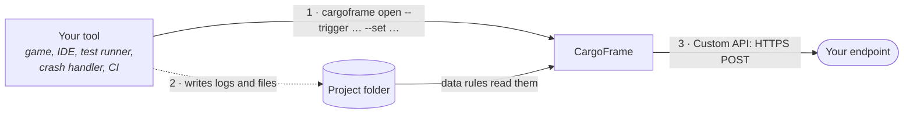

# Customizing CargoFrame

Recipes for changing CargoFrame: removing services, plugging it into another tool, adding a sign-in, hiding values,
restyling it, renaming a fork. Written so an AI agent can follow them step by step; a developer can too. Each recipe
names the files to touch, in order, and the check that proves the change.

Before any change, read [AGENTS.md](../AGENTS.md) (the rules) and §5 of the [development plan](development-plan.md#5-architecture)
(where things live). After any change: `CARGO_INCREMENTAL=0 scripts/dev/check.sh all`.

| I want to… | Recipe |
|------------|--------|
| Ship without some services | [1. Remove a service](#1-remove-a-service) |
| Add a service | [2. Add a service](#2-add-a-service) |
| Open CargoFrame from my tool, fill it, or receive its reports | [3. Plug CargoFrame into another tool](#3-plug-cargoframe-into-another-tool) |
| Sign in to a service, or make people sign in to CargoFrame | [4. Add authentication](#4-add-authentication) |
| Hide values, data rules, pages or blocks | [5. Hide values, rules, pages and blocks](#5-hide-values-rules-pages-and-blocks) |
| Change colours, texts, pages, templates | [6. Change the interface](#6-change-the-interface) |
| Change what is sent to a service | [7. Change what a service receives](#7-change-what-a-service-receives) |
| Add a language | [8. Add a language](#8-add-a-language) |
| Publish my own copy under another name | [9. Rename a fork](#9-rename-a-fork) |
| Set up every computer of an organisation, with locked items | [10. Set up every computer at once](#10-set-up-every-computer-at-once) |

---

## 1. Remove a service

### Without touching the code (recommended)

Every service is a Cargo feature (`jira google reddit claude slack discord teams custom x bluesky instagram github`).
A build without a feature has none of that service's code, form, template, guide or search entry; a saved
connection of a missing kind shows "not in this copy".

```sh
# Linux
cargo build --release -p cargoframe --no-default-features --features jira,github
```

```bat
rem Windows: build.cmd turns CF_SERVICES into the same flags
set CF_SERVICES=jira,github
scripts\windows\build.cmd installer
```

**Check:** the Connections page lists only those services; `cargoframe_connectors::available(kind)` is false for the
others.

### For good (delete the code)

Take `bluesky` as the example; do the same for any service. Search for the service's key first:
`git grep -il bluesky -- ':!docs/third-party-licenses.md'`.

1. **Rust, connector:** delete `core/connectors/src/bluesky/`; remove it from `core/connectors/src/lib.rs` (the
   `mod`, the registry), `model.rs` (its settings, its `Kind`), and the mentions in `media.rs`, `richtext.rs`, `custom.rs`.
2. **Features:** remove `bluesky` from `[features]` in `core/connectors/Cargo.toml` and `app/Cargo.toml` (the
   `default` list and its own line), and from the comment in `scripts/windows/build.cmd`.
3. **Rust, layout:** its capabilities in `core/layout/src/capabilities.rs`, its template in `templates.rs`, its
   checks in `validate.rs`.
4. **Rust, program:** `app/src/connections.rs` and `app/src/commands.rs`.
5. **Windows:** `ui/src/lib/types.ts` (the kind), `connector.ts`, `connectorHelp.ts` (get-token links), `tokens.css`
   (its colour), `demoReach.ts`, `memoryApi.ts`; `ui/src/settings/connections/ConnectionForm.svelte` (its section);
   `ui/src/settings/guide/tours.ts` (its guide); `ui/src/settings/search.ts`; the tests that name it
   (`Connections.test.ts`, `GuideMenu.test.ts`).
6. **Texts:** `node scripts/i18n/check.mjs --prune` removes translations no code uses any more.
7. **Docs:** its rows in `README.md`, `docs/design.md` (Where it sends), `docs/connectors.md`.

**Check:** `scripts/dev/check.sh all`; `git grep -il bluesky` finds only the changelog and decisions.

---

## 2. Add a service

1. `core/connectors/src/<service>/mod.rs` implementing `Connector` (see the [contract](development-plan.md#8-contracts)),
   and `tests.rs` against `MockServer`, following the service's documented API: sign-in, lists, send, a retry that
   never posts twice. Keep one real answer of the service as a test case when you can get one.
2. Its settings in `model.rs`, a `Kind`, a Cargo feature in `core/connectors` and `app`.
3. What it can take (`core/layout/src/capabilities.rs`): picture, video, files, text, dropdowns. The fields it refuses
   to send without: `.required(None)` on their `FieldSpec` (or `.required(Some("thread"))` when another field can
   stand in), copied in `demoNeeds` (`ui/src/lib/demoReach.ts`, compared by `mirrors.test.ts`). What it needs for a
   choice (Jira's issue type, a subreddit) is a `required:<choice>` list the window asks (`ui/src/capture/needs.ts`).
4. Its kind in `ui/src/lib/types.ts` and `connector.ts`, its form section in `ConnectionForm.svelte` (with `tour`
   names), its links in `connectorHelp.ts`, its colour in `tokens.css`.
5. A template in `core/layout/src/templates.rs`, a guide in `tours.ts`, its words in `search.ts`.
6. Its texts translated (`node scripts/i18n/check.mjs --missing`, then `--merge`).
7. A row in the design's service table, `docs/connectors.md` and the README.

The densest existing example is Jira (`core/connectors/src/jira/`); the simplest is the custom API (`custom.rs`).

---

## 3. Plug CargoFrame into another tool



### 3.1 Open CargoFrame from your tool, with values filled in

```sh
cargoframe open --trigger bug --set summary="Crash in level 3" --set build=1.4.2 --set seed=88123 \
                --file /home/me/game/crash.dmp --file /home/me/game/save.json
```

- `--trigger` is a shortcut's id (`triggers/<id>.json`); its layout must have **Other programs can fill this** on
  (`accepts_input: true`); `--set <block>=<text>` fills a text, dropdown or tags block by its id.
- `--file <full path>` adds a file to the layout's first Files block: copied into the capture at once and ticked,
  as the window's **＋** does. A path that is not full is refused (the running copy has its own working folder).
- A layout that **records** starts recording; what was sent waits until the recording stops (the shortcut again,
  or a second `open` of the same trigger, whose values and files are added) and then fills the window.
- It reaches the copy already running through the single-instance channel: same user only, no network port. At
  most 50 values of 20,000 characters and 20 files; the log records counts, never content or paths.
- Nothing is sent until the person presses a button: your tool proposes, the person decides.
- Typical callers: a game's crash handler, an editor's "report a bug" menu, a test runner after a failure.

Code: `app/src/cli.rs` (parsing, limits), `app/src/session.rs` (`Incoming`, `apply`), `app/src/triggers.rs`
(`run_with`; a recording keeps it in `AppState::keep_incoming` until it stops), `app/src/lib.rs`
(`open_from_another_program`).

### 3.2 Let CargoFrame read your tool's context

No code needed: write what matters to files in the project folder (a log line `build=1.4.2`, a JSON state file),
then in *Settings › Data parsing* select the value once. Every capture reads it again and it can go in any text as
`{build}`. Folder rules: [design, Project folder](design.md#2-what-it-does).

### 3.3 Receive CargoFrame's reports in your tool

Use the **Custom API** service: any HTTPS endpoint, a body template with `{{name}}` values, the picture and files as
multipart. Authentication: none, `Authorization: Bearer`, a named header, Basic, a query parameter, or OAuth 2.0 with
your identity provider, either in the browser (authorization code with PKCE) or as a service account (client
credentials) (`CustomAuth` in `core/connectors/src/model.rs`).

### 3.4 Use the libraries in your own Rust program

The `core/*` crates know nothing of the UI: `capture` (the program in focus and its picture), `rules` (values from
files), `connectors` (sending), `net` (the HTTP client) can be used directly. They are MIT OR Apache-2.0; keep the
notice ([NOTICE](../NOTICE)).

---

## 4. Add authentication

### 4.1 A service that needs a token or a key

- Ask for it as a secret field in the service's form; read it in the connector with `ctx.secret("token")`. It is
  kept in the system's credential store, keyed by connection, never in a settings file or a log.
- Send it only to the service's own address, through `core/net`.

### 4.2 A service that signs in with OAuth

Use `core/connectors/src/oauth.rs`: an `OAuthClient` (authorize and token addresses, client id, scopes, a local
redirect port), `authorize` (PKCE, the browser opens, the code comes back to `127.0.0.1`), `load_tokens`, refresh,
`sign_out`. Teams (`core/connectors/src/teams/mod.rs`, `fn client`) is the example: a public client with PKCE and no
secret. Google and Reddit follow the same pattern; Jira Data Center (`fn oauth_client` in `core/connectors/src/jira/`)
and the Custom API (`fn oauth_client` in `custom.rs`) take the client from the connection's settings, the client
secret, when there is one, from the credential store. `client_token` does the client credentials grant (a service
account), kept until it expires.

**Already there, nothing to build:** a company with Jira Data Center has its administrator make an incoming
application link (External application, Incoming, `WRITE`, the redirect URL the connection form shows) and gives
people its Client ID and secret; a company API behind Entra, Okta or Keycloak is a Custom API connection with *OAuth
2.0: sign in in the browser*, or *client credentials* for a shared service account.

### 4.3 Make people sign in to CargoFrame itself (a company requirement)

CargoFrame has no sign-in of its own. To add one:

1. **Identity provider:** an `OAuthClient` for the company's provider (Entra, Okta, Google Workspace), as in 4.2.
2. **Where it lives:** `app/src/auth.rs` with `signed_in()`, `sign_in()`, `sign_out()`; the tokens in the
   credential store through `app/src/secrets.rs`.
3. **Commands:** `sign_in`, `sign_out`, `auth_status` in `app/src/commands.rs`, listed in `app/build.rs`, granted to
   the Settings window only (`app/capabilities/settings.json`).
4. **Gate the sends, not the start:** check `signed_in()` at the top of the share in `app/src/share.rs`, and say
   "Sign in to share" in the button's reasons; the tray and captures keep working.
5. **A page or a section** in Settings (`ui/src/settings/pages/`, `nav.ts`, `search.ts`), its texts translated.
6. **Tests:** the provider against `MockServer`; the share refused while signed out.

Keep the principles: secrets only in the store, nothing sent without a press, no telemetry.

---

## 5. Hide values, rules, pages and blocks

| To hide… | Do this | Where |
|----------|---------|-------|
| A value from the builder's lists (still filled) | Filter it out of `variables()` | `app/src/tools.rs` |
| A value CargoFrame fills, for good | Remove it from `NAMES` and from what fills it; `mirrors.test.ts` checks both sides | `core/window/src/vars.rs`, `ui/src/lib/valueNames.ts` |
| The computer's details (`system.*`) | They are only sent when a layout uses them; to remove them, drop them from `vars.rs` and `app/src/sysinfo.rs` | as named |
| Debug values (`cargoframe.*`) | Already only in debug mode | `app/src/debug.rs` |
| A data rule from people | No switch exists yet: add a `hidden` field to `Rule` (with a default, so older files keep working) and leave such rules out of the Data parsing page; they still run on every capture | `core/rules` (`Rule`), `ui/src/settings/pages/DataFields.svelte` |
| A Settings page | Remove it from `nav.ts`, its `search.ts` entries and guide steps | `ui/src/settings/` |
| A block type from the builder | Leave it out of the **Add** row in `Canvas.svelte`; keep `BLOCK_TYPES` (compared with Rust by `mirrors.test.ts`) | `ui/src/settings/layout/Canvas.svelte` |
| A field of a service | Leave it out of the connector's `describe()` | `core/connectors/src/<service>/mod.rs` |
| A template | Remove it from `TEMPLATES` | `core/layout/src/templates.rs` |

---

## 6. Change the interface

| Change | Where | Then |
|--------|-------|------|
| Colours, accent, spacing | `ui/src/lib/tokens.css`; the default accent `DEFAULT_ACCENT` in `core/config/src/models.rs` | `cargo test -p cargoframe-config` writes it to `ui/src/lib/generated/defaults.json` |
| A text | The English text in the code (`t('…')`, `msg!("…")`) | `node scripts/i18n/check.mjs --missing`, translate, `--merge`, `--prune` |
| A page or section | `ui/src/settings/pages/*.svelte`; new page: `nav.ts` (group, icon), `search.ts`, `guide/tours.ts` | `npx svelte-check`, `npx vitest run` |
| A block's look | `ui/src/capture/blocks/*.svelte` | The overflow check (`ui/scripts/overflow-check.mjs`): add a view for a new state |
| Ready-made layouts | `core/layout/src/templates.rs` (built from shared pieces) | Template tests: every template clean and ready to send |
| Logo and icons | `assets/brand/` (SVG), `scripts/dev/render-icons.mjs` writes `app/icons/` | Look at the tray in light and dark |

Rules: every text through `t()`; every control labelled; nothing wider than its box at the smallest window size.

---

## 7. Change what a service receives

- **The fields offered:** `describe()` in the connector.
- **How a field is written:** `shape()` / `build_fields()` (Jira) or the service's equivalent; formatting per
  service in `core/connectors/src/richtext.rs`; picture sizes in `media.rs`.
- **What a button sends:** in the layout builder, per button (blocks, update mode, required blocks); in code,
  `app/src/share.rs`.
- **Fields filled on every share** (a label from a value): *Layouts › Fill fields* (`infotypes/`).

---

## 8. Add a language

1. `core/i18n/packs/<code>.json` and `ui/src/lib/i18n/packs/<code>.json` (English text → translation).
2. The code and name in `LANGUAGES` in `core/i18n/src/lib.rs` and `ui/src/lib/i18n/index.svelte.ts`.
3. `node scripts/i18n/check.mjs --missing` until it lists nothing; keep `{names}` as they are.
4. A glossary line in `docs/i18n.md`.

---

## 9. Rename a fork

The license lets anyone change and share CargoFrame; [trademarks.md](trademarks.md) asks a shared, changed copy
to take its own name and icon. Change:

| What | Where |
|------|-------|
| Product name, identifier | `app/tauri.conf.json` (`productName`, `identifier`, `copyright`) |
| Settings and data folders | `APP_DIR` in `core/config/src/paths.rs` (and `system_managed` for the managed folder) |
| Credential store entries | `SERVICE` in `app/src/secrets.rs` |
| Sign-in entry | `NAME` in `app/src/autostart.rs` |
| Where updates come from | `REPOSITORY` in `app/src/updates.rs` |
| Installer and asset names | `installers/windows/installer.nsi`, `.github/workflows/release.yml` |
| Logo and icons | `assets/brand/`, `app/icons/` |
| Texts that say "CargoFrame" | Search and replace in the code, then the packs (`check.mjs`) |

Keep the credit (the copyright notice and [NOTICE](../NOTICE)).

---

## 10. Set up every computer at once

An administrator puts the organisation's settings in one read-only folder, with Intune, Group Policy, a login
script or a package. CargoFrame reads it at start and never writes to it.

| System | Folder |
|--------|--------|
| Windows | `%ProgramData%\CargoFrame\managed` |
| Linux | `/etc/cargoframe/managed` |
| Anywhere | the folder named by `CARGOFRAME_MANAGED` (with `CARGOFRAME_HOME` set, only this one is read) |

It holds the same files as a person's settings folder (`layouts/`, `triggers/`, `connections/`, `rules/`,
`infotypes/`; export them from Settings → Your data, or copy them from a set-up computer), plus `policy.json`:

```json
{ "schema_version": 1,
  "services": ["jira", "teams", "custom"],
  "check_updates": false,
  "debug_mode": false,
  "own_connections": false }
```

- **Items.** A file in the managed folder wins over the person's file with the same id, shows *Set by your
  organisation* and cannot be edited or deleted; *Save as copy* still makes a layout of their own. A managed
  connection keeps its settings, but each person signs in or enters their own token (kept in their own password
  store: never put a token in these files).
- **`services`**: the only services people may use (keys as in `connections/*.json`: `jira`, `teams`, `slack`,
  `custom`…). Others are hidden from *Add a connection*, and a saved connection to one says *Not allowed by your
  organisation* and cannot send. Empty or absent: every service in this copy. To take the code out as well, build
  without it ([1. Remove a service](#1-remove-a-service)).
- **`check_updates`**: `true` or `false` decides the update check for everyone; absent, each person chooses.
- **`debug_mode`**: `false` keeps debug mode off (it attaches settings and logs to bug reports).
- **`own_connections`**: `false` means people use the organisation's connections only.
- Every rule is optional. A `policy.json` that cannot be read decides nothing and never stops CargoFrame from
  starting; a managed item that cannot be read is listed as a problem, like any other.

Check: put the folder in place, set `CARGOFRAME_MANAGED` to it and start CargoFrame; the managed items show the
chip, and the policy's switches are greyed out under System.

Code: `core/config/src/paths.rs` (`Dirs::managed`), `core/config/src/policy.rs`, `core/config/src/store.rs`
(`load_item`, `is_managed`, `list_ids`, `Document::under`), `app/src/items.rs` (`refused_by_organisation`),
`app/src/connections.rs` (`load`, the `not_allowed` state), `ui/src/lib/components/Managed.svelte`.
