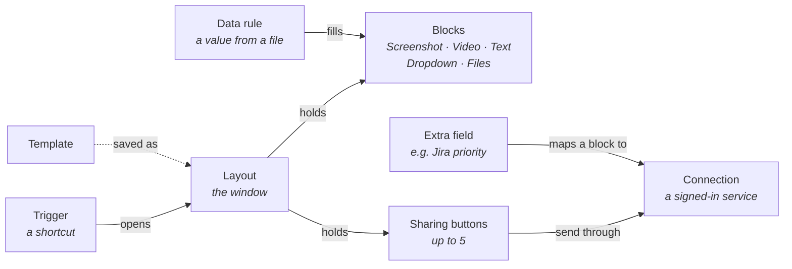
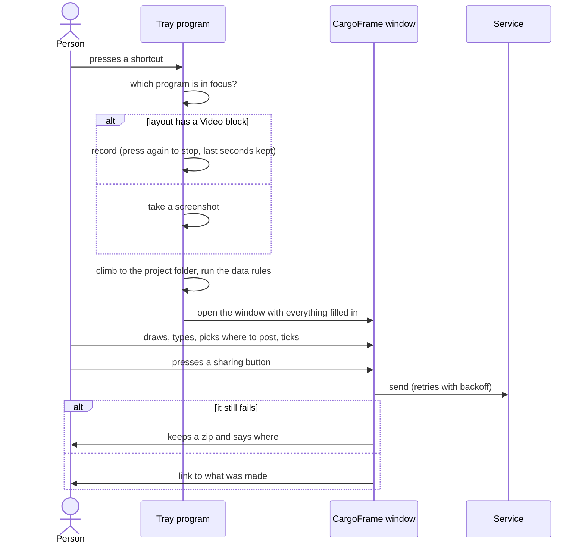
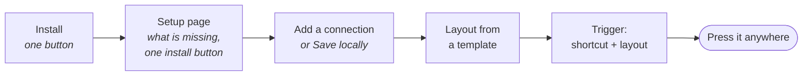

# Design

CargoFrame 0.2.0. What the app **is**, what it **does**, how it is **used** and how it is **built**, in that order.
How to make it step by step is in the [development plan](development-plan.md); why each choice was made is in
[decisions.md](decisions.md); what has been verified on real machines is in [status.md](status.md).

**Contents:** [1. What it is](#1-what-it-is) · [2. What it does](#2-what-it-does) · [3. How it is used](#3-how-it-is-used) ·
[4. How it is built](#4-how-it-is-built) · [5. For companies](#5-for-companies) · [6. Branding](#6-branding) ·
[7. Known limits](#7-known-limits)

---

## 1. What it is

A tray program for **Windows 11 and Linux**. A shortcut captures the program in focus (a screenshot or a recording),
finds that program's project folder, reads the few values the person asked for, and opens **one window** to check
everything and send it to a web service with **one button**. Nothing is sent without that button.

### Four rules

| Rule | In practice |
|------|-------------|
| **Cheap while idle** | The always-on process is tray-only: no web view, under 40 MB. Windows load on demand |
| **Easy for the person** | Every setup step has a button, a link or a short in-app guide. Nothing is edited by hand, and each thing is set in one place |
| **Little to maintain** | One place for each thing: one list of templates, one list of "get a token" links, one file per setting, one HTTP client. A service that changes breaks one folder |
| **Fit for a large company** | Per-user install without an administrator, builds without unused services, works behind the company's proxy and certificates, other programs can hand it data |

### The concepts

| Concept | One line | Stored as |
|---------|----------|-----------|
| **Trigger** | A shortcut and the layout it opens; for a screenshot, what it shows (program, screen, all screens) | `triggers/<id>.json` |
| **Layout** | Blocks on a 12-column grid. A **Video** block makes a press record; otherwise it takes a screenshot | `layouts/<id>.json` |
| **Block** | Screenshot, Video, Text, Dropdown, Files, or a sharing button | inside its layout |
| **Connection** | A service and its settings; tokens live in the system credential store | `connections/<id>.json` |
| **Data rule** | "In this file, read this value", used in text as `{{rule.<id>}}` | `rules/<id>.json` |
| **Extra field** | A service field beyond where to post, mapped to a block | `infotypes/<id>.json` |
| **Template** | A ready-made layout per service, never stored until saved | in the code |

---

## 2. What it does

### One press, from shortcut to sent

| Step | What happens | Code |
|------|--------------|------|
| Capture | Windows (a copy of the desktop, so menus are in the picture), X11, Wayland portal. With no window in focus, the screen under the mouse | `core/capture`, `core/window` |
| Project folder | Climb the program's path to a folder with the program's name, else one folder above. Nothing outside it is read | `core/context` |
| Data rules | Read one value from a text line, JSON, YAML, TOML, INI, CSV, XML or a regular expression | `core/rules` |
| Window | One serializable view of the session; the web view only draws it | `core/window`, `ui/src/capture` |
| Share | One `Payload` from the ticked blocks (picture, still, video, files zip, texts, choices), handed to the connector | `app/src/share.rs` |
| Fallback | Retry with backoff; then a zip of everything is kept. A button with no connection is **Save locally** | `core/safe`, `core/bundle` |

### Where it sends

One connector per service in `core/connectors/src/<service>`, all answering the same questions (describe, status,
connect, test, list options, send), so the share flow never names a service.

| Service | Sign-in | What it sends | Video |
|---------|---------|---------------|:-----:|
| Jira Cloud / Server | E-mail and API token / personal access token | An issue or a comment, with the picture, still, video and files | ✓ |
| Google | OAuth with the person's own Desktop client | A Drive upload, optional Sheets row | ✓ |
| Slack | Bot token (`xoxb-`) | A message with files, in a channel or thread | ✓ |
| Discord | A webhook link per channel (a bot token as a last resort) | A message, a new forum post, a reply in a thread | ✓ |
| Teams | OAuth through the person's own Entra app | A message | |
| Reddit | OAuth with the person's own app | A post with the picture | |
| Claude | None: opens a chat and pastes | The picture, files and prompt, into the desktop app or the browser | |
| X | OAuth (PKCE), the person's own Native App | Text (280 characters) and the screenshot, made smaller to fit | |
| Bluesky | Handle and an app password | Text (300 characters), the screenshot, links marked | |
| Instagram | Meta token; a picture server the person owns | A post with a caption; the picture is hosted first, because Instagram fetches from a web address | |
| Custom API | Header or token | Any HTTPS endpoint, with the fields you define | |

<b>How "where to post" works</b>

One dropdown per connection, as a **path**: server, category (optional), channel or forum, then a **thread or post**
inside it (*New* first, then the ones used before, the listed ones, or a pasted link). Long lists are searched. The
window starts on the last path used and lists the last five (values and labels only, kept per layout and block).
Discord webhooks cannot list threads, so a thread reply goes through the webhook of the thread's own channel.

<b>Video</b>

`core/video` runs **ffmpeg** (the one optional program) into a ring of short segments, so the last seconds are kept
(10 by default). The window plays the clip, trims it, crops it and puts one ring with a text on it; ffmpeg cuts the
export. Sound: on Linux PulseAudio's monitor of the default output; on Windows WASAPI loopback (everything played, or
only the program in focus) fed to ffmpeg locally. A missing device is left out and the notification says why.

---

## 3. How it is used

### From install to first share

### The Settings window

The sidebar follows that order. Each thing is set on one page only; **Guides** at the bottom walk through any setup by
opening the page, outlining the field and saying in one sentence what goes in it.

| Group | Page | What it holds |
|-------|------|---------------|
| Get started | **Setup** | What CargoFrame uses on this computer (ffmpeg, sound output, Claude app, `xdotool`) with one install button; then **Connections** |
| Captures | **Layouts** | The window a capture opens, block by block, and what each sharing button sends |
| | **Triggers** | Shortcuts and the layout each opens |
| | **Data from files** | Values read from files in the project folder |
| | **Extra fields** | Service fields beyond where to post (Jira priority) |
| | **Recording** | Where ffmpeg is, quality, a 5-second test |
| CargoFrame | **General** | Appearance, startup, notifications, what happens when a share fails, windows kept ready |
| | **Your data** | What is kept on this computer, clear or reset, export and import |
| | **About** | Version, updates, speed and memory numbers |

| Setup and Connections | Layout builder | Trigger |
|:---:|:---:|:---:|
|  |  |  |

### The CargoFrame window

| Element | Behaviour |
|---------|-----------|
| **Screenshot** | Pen, rectangle, ellipse, text, crop; colour and line width |
| **Video** | Trim handles, crop, one mark; *Also take a screenshot when the recording ends* |
| **Text** | Formatting buttons (bold, italic, underline, code, quote, lists) limited to what every target service shows; `{{variables}}` filled in |
| **Dropdown** | Lists from the service, optional, remembers the last five; "where to post" is a path |
| **Files** | The project folder's files; the ones matching the block's patterns (like `*.log`) are ticked in advance |
| **Sharing buttons** | Up to five, in the service's colour. Tick boxes on each block say which button sends it: dashed = cannot take it, ring = required |

Pressing a shortcut while a window is open opens another one (up to ten). *Pause triggers* in the tray turns them all
off without deleting anything.

---

## 4. How it is built

| Piece | Where | Job |
|-------|-------|-----|
| Tray program | `app/` | Tray, shortcuts, windows on demand, commands, secrets, `cargoframe open` |
| Windows | `ui/` | `settings.html` and `capture.html`, built once, loaded on demand |
| Logic | `core/*` (14 crates) | Everything testable without a display: capture rules, layout, config, rules, connectors, net, video, update… |
| Installers | `installers/` | Windows NSIS (one button), Linux AppImage and `install.sh` |
| CI | `.github/` | Linux on pull requests; Windows and Linux on `main`; installers; release draft; security audit |

Side effects (files, secrets, network, clock) sit behind traits, so tests use a mock server and an in-memory secret
store. `unsafe` is forbidden in every crate. The full module list is in the [development plan](development-plan.md#4-modules).

<b>Settings on disk</b>

`%AppData%\CargoFrame` or `~/.config/CargoFrame`: `general.json`, `safe.json`, `video.json`, and the folders
`triggers/`, `connections/`, `rules/`, `infotypes/`, `layouts/`. Every file has a `schema_version`, is checked when read,
and is migrated with a backup. **Secrets are never in these files**: they are in the system credential store.
`app/src/cleanup.rs` is the only code that deletes, and only inside CargoFrame's own folders.

<b>Safety, performance, testing</b>

| Area | Short version | Detail |
|------|---------------|--------|
| Safety | No telemetry. Secrets only in the credential store. Files read only inside the project folder where a rule allows. Every request is HTTPS to an address the person set. Text from a screen or file never reaches a command line | [security.md](security.md) |
| Performance | Tray-only under 40 MB; capture under 150 ms; each window under 250 KB of script. Three memory modes: balanced, low memory, always warm | [performance.md](performance.md) |
| Testing | Rust unit and integration tests, connectors against mock servers; UI tests on an in-memory backend; a real capture on a virtual X11 screen; installer install, upgrade, uninstall and click test; guides checked against real fields | [development plan](development-plan.md#7-testing-and-quality-gates) |

---

## 5. For companies

Meant for companies of thousands of people.

| Need | How | State |
|------|-----|-------|
| Only the services a company uses | One Cargo feature per connector; `set CF_SERVICES=jira,teams` before `scripts\windows\build.cmd`. The code is not in the program; forms, templates and guides are hidden; a saved connection of a missing kind shows "not in this copy" | Built |
| Other programs hand data in | `cargoframe open --trigger <id> --set <block>=<text>` reaches the running copy through the single-instance channel (same user, no network port), runs the trigger and fills text boxes and dropdowns. Only layouts with *Other programs can fill this*; nothing is sent until the person presses a button. At most 50 values of 20,000 characters; the log records counts only | Built (text, dropdowns) |
| Install and update centrally | Silent per-user install (`/S`, `/NOSTARTUP`); the update check can be off | Built |
| The company's network | The system certificate store and proxy setting | Built |
| The company's sign-in | OAuth with the company's identity provider: Teams with Entra today; Jira OAuth and generic OAuth 2.0 for Custom API next | Partly built |
| Set up for everyone | A read-only managed folder (`%ProgramData%\CargoFrame\managed`, `/etc/cargoframe/managed`) with the same JSON files plus `policy.json`; managed items show a lock | Planned |
| Accessible without thinking | Labels on every control, full keyboard use, visible focus, reduced motion, checked contrast, one obvious button per screen | Built; screen-reader pass open |

---

## 6. Branding

The mark is **Convoy**: three frames moving right, the lead one carrying an arrow. The frames are the captures, the
convoy is what travels with them, the arrow is the sharing.

| Element | Rule |
|---------|------|
| **Mark** | Flat shape and colour only: no tile, gradient or shadow. Light drawing on light surfaces, dark on dark. Below 48 px the small drawing, never the full one scaled down |
| **In the app** | Frames take the text colour, the arrow the **accent** colour, so the logo follows theme and accent |
| **Fixed surfaces** | Program icon and installer: grey frames `#8B8A84`, blue arrow `#4F8EE0` |
| **Name** | *Cargo* Manrope 800 + *Frame* Manrope 500, one word, letter-spacing -0.02em; outlined in the SVGs |
| **Colours** | Ink `#1F1E1D` / page `#F5F4EE` (light), reversed in dark; accent `#4F8EE0`, changeable with a contrast warning |
| **Destinations** | Each service has its own colour on its button and tick boxes, never the only signal: the label always says where |

| Icon | Small icon | Program icon | Tray |
|:---:|:---:|:---:|:---:|
|  |  |  |   |

| Light | Dark |
|:---:|:---:|
|  |  |
|  |  |

Sources: `assets/brand/` (SVG), `app/icons/` (drawn by `scripts/dev/render-icons.mjs`), `ui/src/lib/tokens.css`
(colours), `Logo.svelte` (the mark in the app). Screenshots come from the demo data (`npm run dev` in `ui/`).

---

## 7. Known limits

- Not yet run against every real account; the Windows sound capture and Discord threads need one run on a real PC.
  See [status.md](status.md).
- The installer and the program are not signed yet.
- Wayland "window in focus" is not possible on some compositors (falls back to the screen under the mouse).
- X, Bluesky and Instagram take pictures and plain text, not video. Instagram needs a picture server the person owns.
- Text colour is not offered: only Jira and Teams could show it.
- Next for the connectors (folding Extra fields into the layout, required fields shown before sending, company sign-in):
  [connectors.md](connectors.md).
