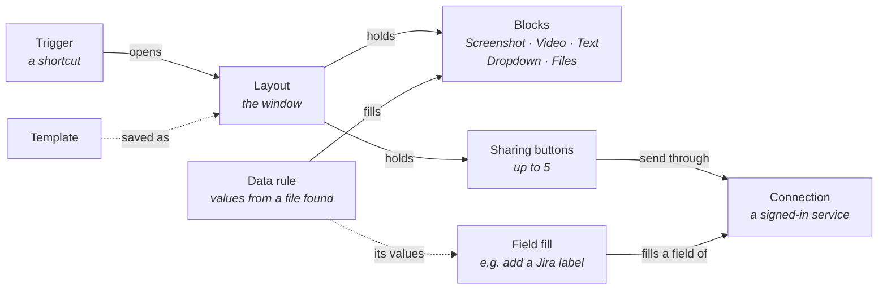
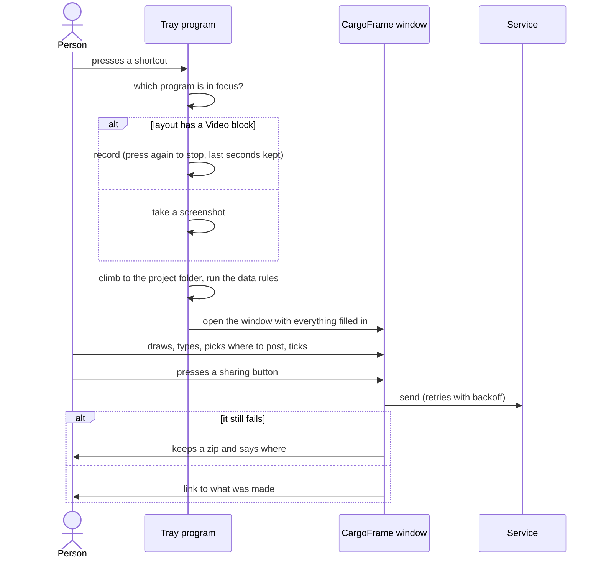
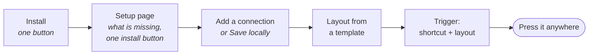
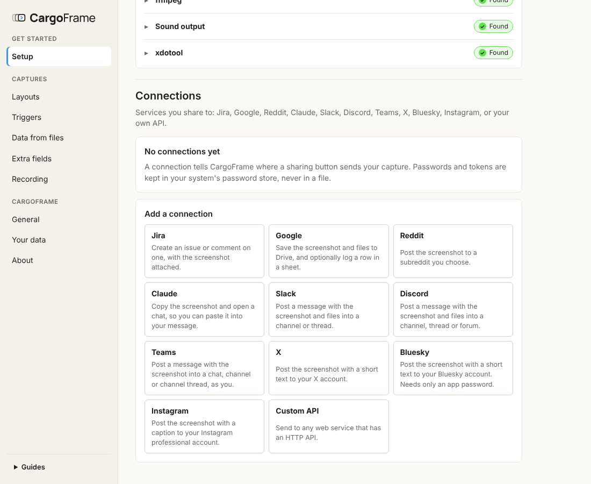
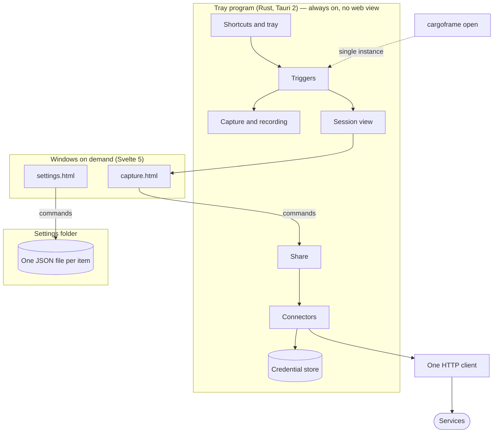
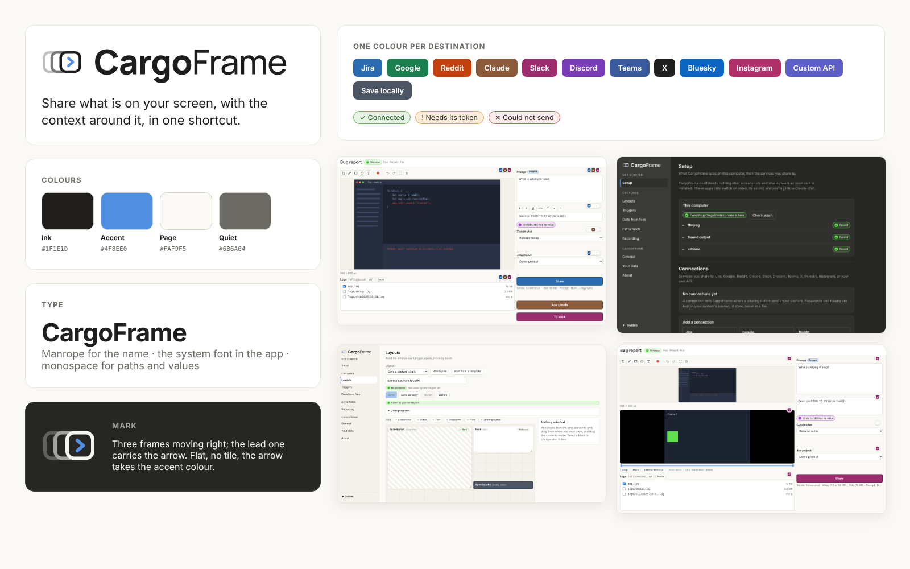
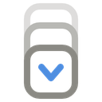
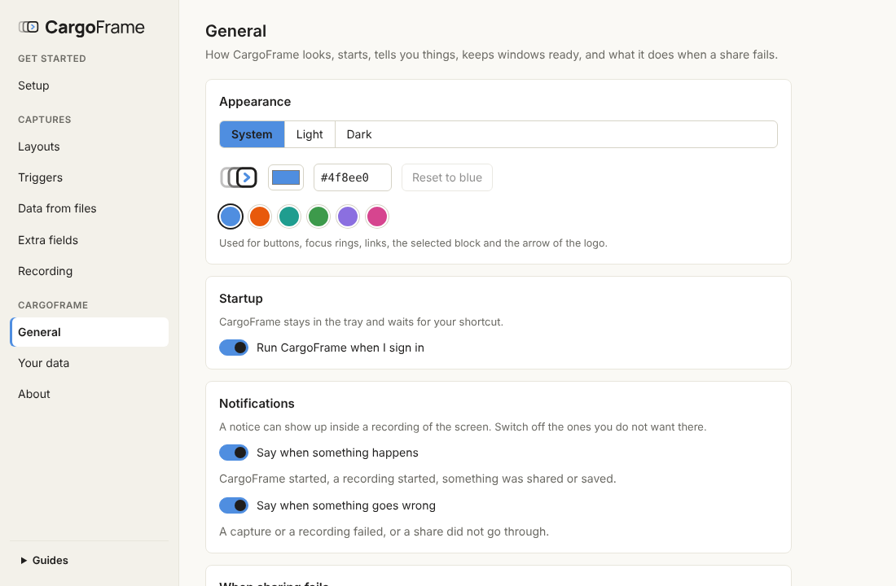
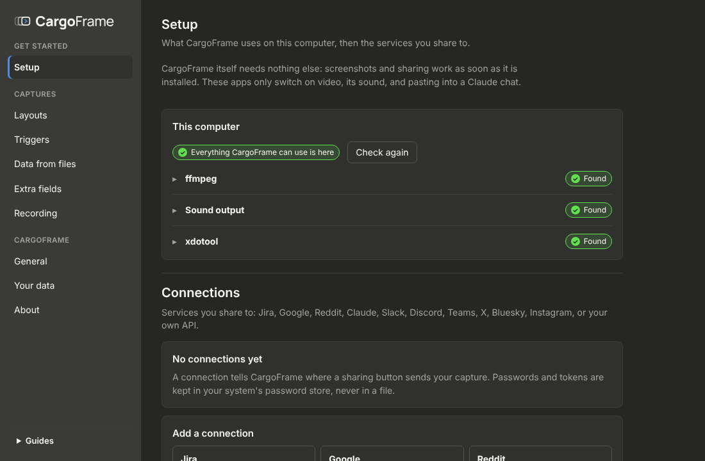
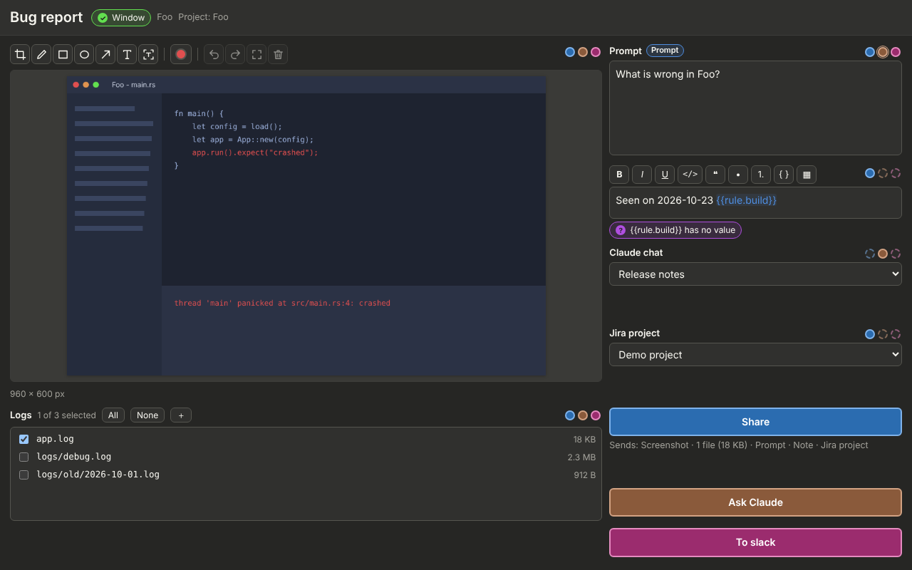

# Design

CargoFrame 0.3.1. What the app **is**, what it **does**, how it is **used** and how it is **built**, in that order.
How to make it step by step is in the [development plan](development-plan.md); why each choice was made is in
[decisions.md](decisions.md); what has been verified on real machines is in [status.md](status.md).

**Contents:** [1. What it is](#1-what-it-is) · [2. What it does](#2-what-it-does) · [3. How it is used](#3-how-it-is-used) ·
[4. How it is built](#4-how-it-is-built) · [5. For companies](#5-for-companies) · [6. Branding](#6-branding) ·
[7. Known limits](#7-known-limits)

---

## 1. What it is

A tray program for **Windows 11 and Linux**. A shortcut captures the program in focus (a screenshot or a recording),
finds that program's project folder, reads the few values the person asked for, and opens **one window** to check
everything and send it to a web service with **one button**. Nothing is sent without that button.

### Four rules

| Rule | In practice |
|------|-------------|
| **Cheap while idle** | The always-on process is tray-only: no web view, under 40 MB. Windows load on demand |
| **Easy for the person** | Every setup step has a button, a link or a short in-app guide. Nothing is edited by hand, and each thing is set in one place |
| **Little to maintain** | One place for each thing: one list of templates, one list of "get a token" links, one file per setting, one HTTP client. A service that changes breaks one folder |
| **Fit for a large company** | Per-user install without an administrator, builds without unused services, works behind the company's proxy and certificates, other programs can hand it data |

### The concepts



| Concept | One line | Stored as |
|---------|----------|-----------|
| **Trigger** | A shortcut and the layout it opens; for a screenshot, what it shows (program, screen, all screens) | `triggers/<id>.json` |
| **Layout** | Blocks on a 12-column grid. A **Video** block makes a press record; otherwise it takes a screenshot | `layouts/<id>.json` |
| **Block** | Screenshot, Video, Text, Dropdown, Files, or a sharing button | inside its layout |
| **Connection** | A service and its settings; tokens live in the system credential store | `connections/<id>.json` |
| **Data rule** | "If this file is found: add it to the files, read these values", each value used in text as `{{rule.<key>}}` | `rules/<id>.json` |
| **Field fill** | One field of a service and the steps that fill it on each share ("if `{{rule.gpu}}` is found, add `gpu-{{rule.gpu}}`"); also describes a custom field (its kind, its list) | `infotypes/<id>.json` |
| **Template** | A ready-made layout per service, never stored until saved | in the code |

---

## 2. What it does

### One press, from shortcut to sent



| Step | What happens | Code |
|------|--------------|------|
| Capture | Windows (a copy of the desktop, so menus are in the picture), X11, Wayland (see below). With no window in focus, the screen under the mouse. While recording, a red outline and a blinking dot say so (never in the recording itself), and a change of focus is followed: the program used longest names the capture | `core/capture`, `core/indicator`, `app/src/watch.rs` |
| Project folder | Climb the program's path to a folder with the program's name, else one folder above. Nothing outside it is read | `core/context` |
| Data rules | If a file named like this is found (newest, or all): add it to the Files blocks, read values (after a name, between two pieces, the line with a word; first, last or all). The kind of file is known from its name: JSON, YAML, TOML, INI and XML are read by key, the rest as text | `core/rules` |
| Window | One serializable view of the session; the web view only draws it | `core/window`, `ui/src/capture` |
| Share | One `Payload` from the ticked blocks (picture, still, video, files zip, texts, choices), handed to the connector | `app/src/share.rs` |
| Fallback | Retry with backoff; then a zip of everything is kept. A button with no connection is **Save locally** | `core/safe`, `core/bundle` |

### Where it sends

One connector per service in `core/connectors/src/<service>`, all answering the same questions (describe, status,
connect, test, list options, send), so the share flow never names a service.

| Service | Sign-in | What it sends | Video |
|---------|---------|---------------|:-----:|
| Jira Cloud / Server | E-mail and API token / personal access token | An issue or a comment, with the picture, still, video and files | ✓ |
| GitHub / Enterprise Server | A fine-grained token for the repository | An issue or a comment (with labels); the picture, video and zip go in a branch of the repository and are shown or linked in it, because GitHub's API cannot attach files | ✓ |
| Google | OAuth with the person's own Desktop client | A Drive upload, optional Sheets row | ✓ |
| Slack | Bot token (`xoxb-`) | A message with files, in a channel or thread | ✓ |
| Discord | A webhook link per channel (a bot token as a last resort) | A message, a new forum post, a reply in a thread | ✓ |
| Teams | OAuth through the person's own Entra app | A message | |
| Reddit | OAuth with the person's own app | A post with the picture | |
| Claude | None: opens a chat and pastes | The picture, files and prompt, into the desktop app or the browser | |
| X | OAuth (PKCE), the person's own Native App | Text (280 characters) and the screenshot, made smaller to fit | |
| Bluesky | Handle and an app password | Text (300 characters), the screenshot, links marked | |
| Instagram | Meta token; a picture server the person owns | A post with a caption; the picture is hosted first, because Instagram fetches from a web address | |
| Custom API | Header or token | Any HTTPS endpoint, with the fields you define | |

<details>
<summary><b>Formatting, tables and pictures in the text</b></summary>

A Text block that is a service's message is written with a few marks (`**bold**`, `` `code` ``, `> quote`, `- list`,
code blocks between ```` ``` ```` and tables as `| a | b |`), and `core/connectors/src/richtext.rs` writes them the way
each service wants: Jira wiki markup, HTML for Teams, Slack's mrkdwn, Markdown for Discord, Reddit and GitHub. A table
becomes a Jira or HTML table, a Markdown one, or aligned lines in a code block where the service has no tables
(Slack, Discord). In the window and in the builder a table is a grid to type in, with ＋ for a row or a column and ×
to take one out.

`{{capture.screenshot}}` and `{{capture.recording}}` put the picture or the recording **where they are in the text**
instead of as attachments at the end: Jira (`!name!`, the file attached once), GitHub (the picture shown from the
attachments branch) and Teams (the picture, inline). The builder offers a *Repro | Highlight* table with both. Other
services leave the two out of the text and attach the files as before.

</details>

<details>
<summary><b>How "where to post" works</b></summary>

One dropdown per connection, as a **path**: server, category (optional), channel or forum, then a **thread or post**
inside it (*New* first, then the ones used before, the listed ones, or a pasted link). Long lists are searched. The
window starts on the last path used and lists the last five (values and labels only, kept per layout and block).
Discord webhooks cannot list threads, so a thread reply goes through the webhook of the thread's own channel.

</details>

<details>
<summary><b>On Wayland</b></summary>

Wayland lets no program listen to keys, read the screen or ask which window is in focus, so CargoFrame goes through
the desktop for each. The program checks which desktop it is on and picks the way by itself.

| Desktop | Shortcut | Window in focus | Screenshot | Recording | Paste into Claude |
|---------|----------|-----------------|------------|-----------|-------------------|
| **GNOME** | Written into GNOME's keyboard settings (Custom Shortcuts) | XWayland programs only | Portal | Portal + GStreamer | Message left on the clipboard |
| **KDE Plasma** | The portal's shortcut service (KDE asks once) | A short KWin script | Portal | Portal + GStreamer | Message left on the clipboard |
| **sway** | Bound live over sway's IPC | sway's IPC | `grim`, else portal | Portal + GStreamer | `wtype` |
| **Hyprland** | Bound live over Hyprland's IPC | Hyprland's IPC | `grim`, else portal | Portal + GStreamer | `wtype` |
| **Others** | Settings shows the command to add | XWayland programs only | Portal | Portal + GStreamer | Message left on the clipboard |

- **Shortcut.** The desktop runs `cargoframe open --trigger <id>`, and the running copy takes it over. CargoFrame only
  changes the shortcuts it made (GNOME: the ones under `cargoframe-`); uninstalling removes them.
- **Focus.** Window places are scaled from the desktop's logical pixels to the picture (scaled screens). Without a
  focused window the whole screen is captured, and the window says why.
- **Recording.** The portal shares a screen (the desktop may ask which, once: the choice is remembered), GStreamer reads
  it (`pipewiresrc`), and ffmpeg records it as on other systems. The window in focus is cut out when it is on that screen.
- **What it needs** is listed on the Setup page: the desktop portal (or `grim`), GStreamer with its PipeWire plugin
  for video, and `wtype` on sway and Hyprland.

</details>

<details>
<summary><b>Video</b></summary>

`core/video` runs **ffmpeg** (the one optional program) into a ring of short segments, so the last seconds are kept
(10 by default). The window plays the clip, trims it, crops it (drag a frame, then *Confirm*, as for a screenshot)
and draws marks on it with the screenshot's tools (pen, square, circle, arrow, text; colour and size); ffmpeg cuts the
export and lays the marks over it.

While recording, a red outline around what is recorded and a red dot blinking once a second (in the corner chosen in
*Recording*) say so. They are drawn by the system itself, not a web page: on Windows they are left out of every screen
capture, on X11 they sit outside the recorded window; Wayland gives no way to draw them. If the focus moves to
another program during the recording, the program used longest names the capture and its project folder is the one
read; the window says which programs were used. Sound: on Linux PulseAudio's monitor of the default output; on Windows WASAPI loopback (everything played, or
only the program in focus) fed to ffmpeg locally. A missing device is left out and the notification says why.

</details>

---

## 3. How it is used

### From install to first share



### The Settings window

The sidebar follows that order. Each thing is set on one page only; **Guides** at the bottom walk through any setup by
opening the page, outlining the field and saying in one sentence what goes in it; the guides for connecting each
service are grouped under *Connect a service*, below the others.

| Group | Page | What it holds |
|-------|------|---------------|
| Get started | **Setup** | What CargoFrame uses on this computer (ffmpeg, sound output, Claude app, `xdotool`) with one install button; then **Connections** |
| Captures | **Layouts** | The window a capture opens, block by block, on a grid of 12 columns or more (up to 24: *Columns ＋* adds one on the side and the window opens wider), and what each sharing button sends; a Text block's starting text is written with every value listed on its right, searchable, the most used first |
| | **Triggers** | Shortcuts and the layout each opens |
| | **Data & fields** | Two tabs: *Read from files* (values read from files in the project folder) and *Fill fields* (steps that fill a field of the service on each share) |
| | **Recording** | Where ffmpeg is, quality, a 5-second test, the outline and dot shown while recording |
| CargoFrame | **General** | Appearance, startup, notifications, what happens when a share fails, windows kept ready |
| | **Your data** | What is kept on this computer, clear or reset, export and import |
| | **About** | Version, updates, speed and memory numbers |

| Setup and Connections | Layout builder | Trigger |
|:---:|:---:|:---:|
|  |  |  |

### The CargoFrame window

| Element | Behaviour |
|---------|-----------|
| **Screenshot** | Pen, square, circle, arrow, text (bold, italic, on a box; click a text to change it), crop; colour and size. *Read text*: drag over text on the picture, the lines found are marked; copy them all or click the ones to copy, or *Try again* to read it another way |
| **Video** | Trim handles, crop (drag a frame, *Confirm*), marks drawn with the screenshot's tools; *Also take a screenshot when the recording ends* |
| **Text** | A box that is a service's message (set in the builder, *Sent in*) shows its formatting as it looks: bold, italic, underline, code, quote, lists, code blocks and tables as grids, with buttons and shortcuts limited to what those services show; `{{variables}}` filled in |
| **Dropdown** | Lists from the service, optional, remembers the last five; "where to post" is a path |
| **Files** | The project folder's files, or the subfolders of it the block names (several, separated by commas: `logs, build/out`); the ones matching the block's patterns (like `*.log`) are ticked in advance |
| **Sharing buttons** | Up to five, in the service's colour. Tick boxes on each block say which button sends it: dashed = cannot take it, ring = required |


Pressing a shortcut while a window is open opens another one (up to ten). *Pause triggers* in the tray turns them all
off without deleting anything.

---

## 4. How it is built



| Piece | Where | Job |
|-------|-------|-----|
| Tray program | `app/` | Tray, shortcuts, windows on demand, commands, secrets, `cargoframe open` |
| Windows | `ui/` | `settings.html` and `capture.html`, built once, loaded on demand |
| Logic | `core/*` (17 crates) | Everything testable without a display: capture rules, layout, config, rules, connectors, net, video, update… |
| Installers | `installers/` | Windows NSIS (one button), Linux AppImage and `install.sh` |
| CI | `.github/` | Linux on pull requests; Windows and Linux on `main`; installers; release draft; security audit |

Side effects (files, secrets, network, clock) sit behind traits, so tests use a mock server and an in-memory secret
store. `unsafe` is forbidden in every crate. The full module list is in the [development plan](development-plan.md#4-modules).

<details>
<summary><b>Settings on disk</b></summary>

`%AppData%\CargoFrame` or `~/.config/CargoFrame`: `general.json`, `safe.json`, `video.json`, and the folders
`triggers/`, `connections/`, `rules/`, `infotypes/`, `layouts/`. Every file has a `schema_version`, is checked when read,
and is migrated with a backup. **Secrets are never in these files**: they are in the system credential store.
`app/src/cleanup.rs` is the only code that deletes, and only inside CargoFrame's own folders.

</details>

<details>
<summary><b>Safety, performance, testing</b></summary>

| Area | Short version | Detail |
|------|---------------|--------|
| Safety | No telemetry. Secrets only in the credential store. Files read only inside the project folder where a rule allows. Every request is HTTPS to an address the person set. Text from a screen or file never reaches a command line | [security.md](security.md) |
| Performance | Tray-only under 40 MB; capture under 150 ms; each window under 250 KB of script. Three memory modes: balanced, low memory, always warm | [performance.md](performance.md) |
| Testing | Rust unit and integration tests, connectors against mock servers; UI tests on an in-memory backend; a real capture on a virtual X11 screen; installer install, upgrade, uninstall and click test; guides checked against real fields | [development plan](development-plan.md#7-testing-and-quality-gates) |

</details>

---

## 5. For companies

Meant for companies of thousands of people.

| Need | How | State |
|------|-----|-------|
| Only the services a company uses | One Cargo feature per connector; `set CF_SERVICES=jira,teams` before `scripts\windows\build.cmd`. The code is not in the program; forms, templates and guides are hidden; a saved connection of a missing kind shows "not in this copy" | Built |
| Other programs hand data in | `cargoframe open --trigger <id> --set <block>=<text>` reaches the running copy through the single-instance channel (same user, no network port), runs the trigger and fills text boxes and dropdowns. Only layouts with *Other programs can fill this*; nothing is sent until the person presses a button. At most 50 values of 20,000 characters; the log records counts only | Built (text, dropdowns) |
| Install and update centrally | Silent per-user install (`/S`, `/NOSTARTUP`); the update check can be off | Built |
| The company's network | The system certificate store and proxy setting | Built |
| The company's sign-in | OAuth with the company's identity provider: Teams with Entra today; Jira OAuth and generic OAuth 2.0 for Custom API next | Partly built |
| Set up for everyone | A read-only managed folder (`%ProgramData%\CargoFrame\managed`, `/etc/cargoframe/managed`) with the same JSON files plus `policy.json`; managed items show a lock | Planned |
| Accessible without thinking | Labels on every control, full keyboard use, visible focus, reduced motion, checked contrast, one obvious button per screen | Built; screen-reader pass open |

---

## 6. Branding



The mark is **Convoy**: three frames moving right, the lead one carrying an arrow. The frames are the captures, the
convoy is what travels with them, the arrow is the sharing.

| Element | Rule |
|---------|------|
| **Mark** | Flat shape and colour only: no tile, gradient or shadow. Light drawing on light surfaces, dark on dark. Below 48 px the small drawing, never the full one scaled down |
| **In the app** | Frames take the text colour, the arrow the **accent** colour, so the logo follows theme and accent |
| **Fixed surfaces** | Program icon and installer: grey frames `#8B8A84`, blue arrow `#4F8EE0`. The installer's icon is the same mark turned a quarter clockwise, so the arrow points down |
| **Name** | *Cargo* Manrope 800 + *Frame* Manrope 500, one word, letter-spacing -0.02em; outlined in the SVGs |
| **Colours** | Ink `#1F1E1D` / page `#F5F4EE` (light), reversed in dark; accent `#4F8EE0`, changeable with a contrast warning |
| **Destinations** | Each service has its own colour on its button and tick boxes, never the only signal: the label always says where |

| Icon | Small icon | Program icon | Installer icon | Tray |
|:---:|:---:|:---:|:---:|:---:|
|  |  |  |  |   |

| Light | Dark |
|:---:|:---:|
|  |  |
|  |  |

Sources: `assets/brand/` (SVG), `app/icons/` (drawn by `scripts/dev/render-icons.mjs`), `ui/src/lib/tokens.css`
(colours), `Logo.svelte` (the mark in the app). Screenshots come from the demo data (`npm run dev` in `ui/`).

---

## 7. Known limits

- Not yet run against every real account; the Windows sound capture and Discord threads need one run on a real PC.
  See [status.md](status.md).
- The installer and the program are not signed yet.
- Wayland: GNOME tells no program which Wayland window is in focus (XWayland programs are found), and GNOME and KDE
  let no program press keys, so a Claude message is left on the clipboard. Verified on a headless sway desktop (also
  run as a GNOME-like desktop); real GNOME, KDE and Hyprland sessions are still to be tried.
- X, Bluesky and Instagram take pictures and plain text, not video. Instagram needs a picture server the person owns.
- GitHub's API cannot attach a file to an issue: pictures and files go in a branch of the repository (or are left out),
  so the token needs Contents write as well as Issues.
- Text colour is not offered: only Jira and Teams could show it.
- *Read text* uses Windows' own reader (in the languages of the person's profile); on Linux it needs `tesseract`
  installed, and reads English unless more of its languages are installed.
- The recording sign cannot be drawn on Wayland; on X11 a full-screen recording can include it.
- Pictures in the text: Jira, GitHub and Teams (the recording in Jira and GitHub only).
- Next for the connectors (required fields shown before sending, company sign-in):
  [connectors.md](connectors.md).
