# Design

CargoFrame 0.7.3. What the app **is**, what it **does**, how it is **used** and how it is **built**, in that order.
How to make it step by step is in the [development plan](development-plan.md); why each choice was made is in
[decisions.md](decisions.md); what has been verified on real machines is in [status.md](status.md).

**Contents:** [1. What it is](#1-what-it-is) · [2. What it does](#2-what-it-does) · [3. How it is used](#3-how-it-is-used) ·
[4. How it is built](#4-how-it-is-built) · [5. For companies](#5-for-companies) · [6. Branding](#6-branding) ·
[7. Known limits](#7-known-limits)

---

## 1. What it is

A tray program for **Windows 11 and Linux**. A shortcut captures the program in focus (a screenshot or a recording),
finds that program's project folder, reads the few values the person asked for, and opens **one window** to check
everything and send it to a web service with **one button**. Nothing is sent without that button.

It is **free and open source**: MIT OR Apache-2.0, at the user's choice, asking only that the source be named
([NOTICE](../NOTICE)); the name and logo stay with the official copy ([TRADEMARKS.md](../TRADEMARKS.md)).

### Four rules

| Rule | In practice |
|------|-------------|
| **Cheap while idle** | The always-on process is tray-only: no web view, under 40 MB. Windows load on demand |
| **Easy for the person** | Every setup step has a button, a link or a short in-app guide. Nothing is edited by hand, and each thing is set in one place |
| **Little to maintain** | One place for each thing: one list of templates, one list of "get a token" links, one file per setting, one HTTP client. A service that changes breaks one folder |
| **Fit for a large company** | Per-user install without an administrator, builds without unused services, works behind the company's proxy and certificates, other programs can hand it data |

### The concepts

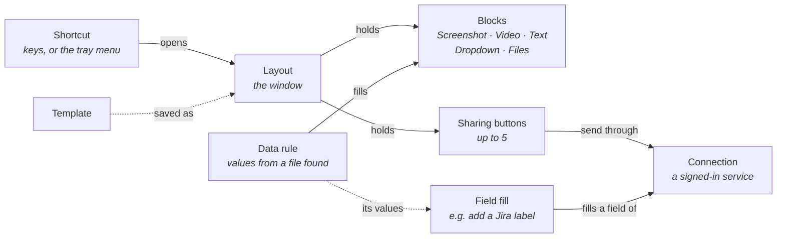

| Concept | One line | Stored as |
|---------|----------|-----------|
| **Shortcut** | Keys (or none: the tray menu only) and the layout they open; for a screenshot, what it shows (program, screen, all screens). Keys are Ctrl, Alt, Shift or Win with up to three other keys, any of them (or F1–F24, Pause or a media key alone), named by their place on the keyboard. Called a trigger in the code and the files | `triggers/<id>.json` |
| **Layout** | Blocks on a 12-column grid. A **Video** block makes a press record; otherwise it takes a screenshot | `layouts/<id>.json` |
| **Block** | Screenshot, Video, Text, Dropdown, Files, or a sharing button | inside its layout |
| **Connection** | A service and its settings; tokens live in the system credential store | `connections/<id>.json` |
| **Data rule** | "If this file is found: add it to the files, read these values" (a value may be made of parts found one after the other, joined; beside the values CargoFrame fills in itself: the capture's, the program's, and the computer's, `{system.os}`, `{system.cpu}`, `{system.ram}`, `{system.gpu}`, `{system.gpu_driver}`, `{system.screens}`, `{system.computer}`), each value used in text as `{<key>}` (or `{{rule.<key>}}`). The same key can be read by the rules of several files: the newest file's value wins, or every different value | `rules/<id>.json` |
| **Field fill** | One field of a service and the steps that fill it on each share ("if `{gpu}` is found, add `gpu-{gpu}`"); also describes a custom field (its kind, its list) | `infotypes/<id>.json` |
| **Template** | A ready-made layout per service, never stored until saved. Most hold the capture in a Tabs block: Screenshot and Logs (the files and a log viewer), with Recording first for a recording (the time of each moment shown over it, the log starting on the lines written while it recorded). Every connection that takes a video has a recording variant, and a template's recording is of the **window in focus**. A report's starting text says where it was seen with the values (`{app.exe}`, `{project.name}`, `{capture.date}`, `{capture.time}`) and, for Jira and GitHub, a table with the recording beside the screenshot. The Jira and GitHub templates (*Jira ticket*, *Jira ticket with recording*, *GitHub issue*, *GitHub issue with recording*) create or update with one button, *Send to Jira* / *Send to GitHub*: an optional issue list, empty for a new one; a new Jira ticket is assigned to you unless someone else is picked. Titles and links are one-line boxes, and X, Bluesky and Instagram posts have a Hashtags block | in the code |

---

## 2. What it does

### One press, from shortcut to sent

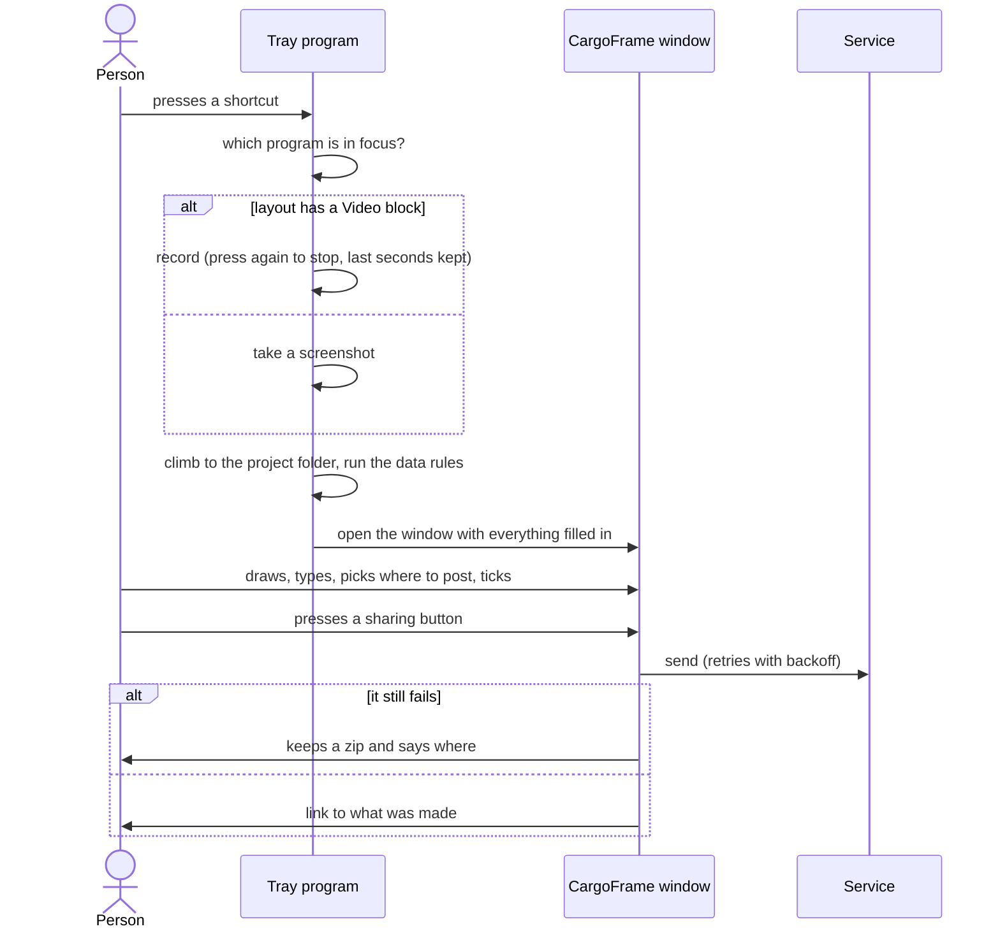

| Step | What happens | Code |
|------|--------------|------|
| Capture | Windows (a copy of the desktop, so menus are in the picture), X11, Wayland (see below). With no window in focus, the screen under the mouse. While recording, a red outline and a blinking dot say so (never in the recording itself), and a change of focus is followed: the program used longest names the capture | `core/capture`, `core/indicator`, `app/src/watch.rs` |
| Project folder | Climb the program's path to a folder with the program's name, else one folder above. Nothing outside it is read | `core/context` |
| Data parsing | If a file named like this is found (newest, or all): add it to the Files blocks, read values. A value is made by **selecting it in a file** (0.5.0, `Find::Pick`): in the lines with a text (the label just before the selection, or every line), right after it or from the start of the line, up to a text (the next sign, a space) or the end of the line; the most recent line, the first or all. Values from 0.4 (after a name, between two pieces, the line with a word; JSON, YAML, TOML, INI and XML read by key) keep working. **The same value in several files**: each file's rule reads it with the same key; the newest file (by its change time) wins, or every different value, the newest first; a value no file has is empty, or the text it says. A value can also be **made from other values**: choices tried from the top (`{stream}_{change}_{shelf}_{config}`, else without the shelf), with conditions when needed | `core/rules` |
| Window | One serializable view of the session; the web view only draws it | `core/window`, `ui/src/capture` |
| Share | The blocks the button says must be filled are checked first (the window greys the button and lists them; the share checks again). Then one `Payload` from the ticked blocks (picture, still, video, files zip, texts, choices, and for each field what it does to an issue that is there), handed to the connector | `app/src/share.rs` |
| Fallback | Retry with backoff; then a zip of everything is kept. A button with no connection is **Save locally** | `core/safe`, `core/bundle` |

### Where it sends

One connector per service in `core/connectors/src/<service>`, all answering the same questions (describe, status,
connect, test, list options, send), so the share flow never names a service.

| Service | Sign-in | What it sends | Video |
|---------|---------|---------------|:-----:|
| Jira Cloud / Server | E-mail and API token / personal access token | A new issue, or an update of one (each field as its mapping says, a comment, a vote), with the picture, still, video and files; people and teams searched by name | ✓ |
| GitHub / Enterprise Server | A fine-grained token for the repository | A new issue, or an update of one (each field as its mapping says, a comment, a 👍); the picture, video and zip go in a branch of the repository and are shown or linked in it, because GitHub's API cannot attach files | ✓ |
| Google | OAuth with the person's own Desktop client | A Drive upload, optional Sheets row | ✓ |
| Slack | Bot token (`xoxb-`) | A message with files, in a channel or thread | ✓ |
| Discord | A webhook link per channel (a bot token as a last resort) | A message, a new forum post, a reply in a thread | ✓ |
| Teams | OAuth through the person's own Entra app | A message | |
| Reddit | OAuth with the person's own app | A post with the picture | |
| Claude | None: opens a chat and pastes | The picture, files and prompt, into the desktop app or the browser | |
| X | OAuth (PKCE), the person's own Native App | Text (280 characters) and the screenshot, made smaller to fit | |
| Bluesky | Handle and an app password | Text (300 characters), the screenshot, links marked | |
| Instagram | Meta token; a picture server the person owns | A post with a caption; the picture is hosted first, because Instagram fetches from a web address | |
| Custom API | Header or token | Any HTTPS endpoint, with the fields you define | |

<details>
<summary><b>Creating or updating an issue (Jira, GitHub)</b></summary>

The `issue` field picks an issue that is there; left empty, a new one is made. For an update, each mapping of the
sharing button says what its value does (`InfoMapping.update`, set in the builder beside where the block goes):

| Choice | Does | Offered for |
|--------|------|-------------|
| Replace it | The field becomes the value | every field (the default) |
| Add below what is there | The value under the field's text, a blank line between (the title: after it) | text blocks |
| Add the first line below | Only the value's first line, the same way | text blocks |
| Add to the list | Keeps what is there and adds (labels, components, versions, assignees) | lists |
| Count up by the value | A number field plus the value (1 when empty) | text blocks on a custom field |
| Leave it as it is | The field is not touched | every field |

A `comment` field adds a comment, on the new issue or on the one updated. *Vote* (Jira) and *👍* (GitHub) can go
with an update; one the service refuses (Jira refuses a vote on your own issue) is said, not a failure. The connector
reads the issue once, and only the fields that are added to or counted, then sends one `PUT` (Jira, with `update`
operations for lists) or `PATCH` (GitHub, with the labels and assignees added by their own call); the share's
progress records it, so a retry does not add the text twice. A layout saved before 0.7.1 says none of this, and does
what it did: the description becomes a comment on the issue picked.

**What Jira requires** (0.7.3). For a new issue, the window asks Jira which fields its create screen requires for
the issue type picked in the project picked (`createmeta`, through the button: the list `required:PROJ/10001`),
less those with a default value and those a field fill sets. A required field no block sends, or sent by a block
still empty, is named beside the button, which stays grey until it is: *Jira needs "Component/s" for this issue
type, and no block sends it*. The summary is never missing (the window's title when nothing else). An issue picked
to update, or a Jira that cannot say, holds nothing back. The builder warns about a text, dropdown or tags block
that no sharing button sends, since what is put in it goes nowhere.

</details>

<details>
<summary><b>Lists the service searches (people, teams)</b></summary>

A list too long to send whole is one the connector marks as searched (`ListSpec::search`). The window's dropdown
asks again as the person types (after a quarter-second pause, as `<list>?<typed>`; those answers are not kept in the
list cache), shows what came back as it is (a person found by e-mail too), and keeps the choice listed while other
names are searched. Jira's: `users` (anyone, *Me* first: `@me`, the person signed in, put in when the ticket is made),
`assignable_users` (who can be assigned in a project; without a key, everyone), and `teams` (through the Team
field's own search: its value is the team's id). The builder's Assignee of the Jira templates starts on *Me* each
time.

</details>

<details>
<summary><b>Debug mode: CargoFrame reporting a problem in itself</b></summary>

Off by default (*System*). While it is on, each window says what it shows when something changes (a click, the
focus, the window coming forward), read from the page itself: its title, the tabs open, the section and the control
in focus, the guide and its step, the layout and the block (`ui/src/lib/debugView.ts`); nothing is sent while it is
off, and a window open when the mode changes follows at once (the `debug-changed` event). A capture whose program in
focus is this CargoFrame (its process, so the form of its path does not matter) gets `{cargoframe.where}` (window - page - tab - section,
as the issues are titled), `.window`, `.page`, `.tab`, `.section`, `.focus`, `.guide`, `.layout`, `.block`, `.rules`
and `.version` (a dash for what was not on screen), and its first Files block the layout on screen as saved, the data
rules, the settings and the last 256 KB of the log, ticked (`app/src/debug.rs`). The template *CargoFrame bug
report* (GitHub, offered in debug mode only) is the GitHub issue with its title, description and labels made from
them: a title that starts with `{cargoframe.where} - `, a description with *What happened* and *What was expected*,
the screenshot, and a table of where it was, what was in focus, the layout, the block, the guide, the data rules,
the system, processor, memory, graphics card and driver, and screens; labels `bug`, the program, the page and the
version. Setting it up is one button under the switch, *Set up the bug report*: the layout for the GitHub connection
(the only one, or the one chosen) and the shortcut *Report a CargoFrame problem* on Ctrl+Alt+Shift+F12 (F11, F10 when
another shortcut has it), both kept as they are when pressed again. `{system.…}` and `{cargoframe.…}` are written in
the short form like the capture's own values (`core/context/src/template.rs` lists the groups).

**Check this PC** (0.7.3), under the switch, tries on the PC itself what CI cannot: the computer's details, a
screenshot of every screen, the apps CargoFrame uses, a 3-second recording, the sign-in entry, the credential store
(a token kept and read back), the shortcuts, the settings folder and the web view, each timed, with a mark (works,
works with something to know, does not work). The report is kept in the log folder (`pc-check.md`), and the next bug
report attaches it (`app/src/pc_check.rs`).

</details>

<details>
<summary><b>Formatting, tables and pictures in the text</b></summary>

A Text block that is a service's message is written with a few marks (`**bold**`, `` `code` ``, `> quote`, `- list`,
code blocks between ```` ``` ```` and tables as `| a | b |`), and `core/connectors/src/richtext.rs` writes them the way
each service wants: Jira wiki markup, HTML for Teams, Slack's mrkdwn, Markdown for Discord, Reddit and GitHub. A table
becomes a Jira or HTML table, a Markdown one, or aligned lines in a code block where the service has no tables
(Slack, Discord). In the window and in the builder a table is a grid to type in, with ＋ for a row or a column and ×
to take one out: every column and every row has one, the header row too (the next row takes its place), and the last
one left takes the table out of the text. A table's cells are `tw-cell`, and only cells of the box's own tables count
as cells (the window's layout has cells of its own: taking one for a table cell swallowed Enter and wiped the block on
a paste before 0.7.2). A paste comes in as plain text, through the paste event.

**How a value is written.** `{name}` (0.5.0) or `{{name}}`: `{map}` is the value `map` read from files (`{{rule.map}}`
the older way), `{app.exe}` a value of the capture. Single braces stay as written when what is inside cannot be a value,
so Jira's own `{code}`, `{noformat}`, `{quote}`, `{color:red}`, `{panel}` and the like, numbers like `{0}`, JSON and
names with spaces are left alone; a value cannot be named like one of Jira's (`core/context/src/template.rs`). Values
are filled in once and never read again, so a value holding braces stays as it is. A custom API's body reads only
`{{name}}`, as JSON is full of braces. In the builder, typing `{` offers the values, and *Values* shows a text as the
last capture fills it in.

`{capture.screenshot}` and `{capture.recording}` put the picture or the recording **where they are in the text**
instead of as attachments at the end: Jira (`!name!`, the file attached once), GitHub (the picture shown from the
attachments branch) and Teams (the picture, inline). The builder offers a *Repro | Highlight* table with both. Other
services leave the two out of the text and attach the files as before.

</details>

<details>
<summary><b>Tags</b></summary>

A Tags block holds up to 25 tags (`core/layout` `split_tags`: commas, semicolons and new lines separate them, each is
kept once, case aside, at most 100 characters). It starts with the tags of its list in the layout, where an entry such
as `{gpu}` or `gpu-{gpu}` gives a tag only when the value is found and `{platforms}` gives one tag per part. The window
offers the last five used in the block and, when the block names a list of a connection (Jira's labels, components
or versions, a repository's labels; a list that needs a project key takes it in the builder), opens that list on a
click to pick several, narrowed while typing (0.7.2). Lists the service searches are not offered there. A sharing button sends them in a field, as several values: labels for Jira
and GitHub, `hashtags` for X, Bluesky and Instagram (added at the end of the post, the text cut first so they stay),
`tags` for Slack, Teams and Discord (a last line, `**Tags:**` followed by each in code marks). The Jira and GitHub
templates start with a Labels block. `cargoframe open --set labels=crash,gpu` fills it from another program.

</details>

<details>
<summary><b>How "where to post" works</b></summary>

One dropdown per connection, as a **path**: server, category (optional), channel or forum, then a **thread or post**
inside it (*New* first, then the ones used before, the listed ones, or a pasted link). Long lists are searched. The
window starts on the last path used and lists the last five (values and labels only, kept per layout and block).
Discord webhooks cannot list threads, so a thread reply goes through the webhook of the thread's own channel.

</details>

<details>
<summary><b>On Wayland</b></summary>

Wayland lets no program listen to keys, read the screen or ask which window is in focus, so CargoFrame goes through
the desktop for each. The program checks which desktop it is on and picks the way by itself.

| Desktop | Shortcut | Window in focus | Screenshot | Recording | Paste into Claude |
|---------|----------|-----------------|------------|-----------|-------------------|
| **GNOME** | Written into GNOME's keyboard settings (Custom Shortcuts) | XWayland programs only | Portal | Portal + GStreamer | Message left on the clipboard |
| **KDE Plasma** | The portal's shortcut service (KDE asks once) | A short KWin script | Portal | Portal + GStreamer | Message left on the clipboard |
| **sway** | Bound live over sway's IPC | sway's IPC | `grim`, else portal | Portal + GStreamer | `wtype` |
| **Hyprland** | Bound live over Hyprland's IPC | Hyprland's IPC | `grim`, else portal | Portal + GStreamer | `wtype` |
| **Others** | Settings shows the command to add | XWayland programs only | Portal | Portal + GStreamer | Message left on the clipboard |

- **Shortcut.** The desktop runs `cargoframe open --trigger <id>`, and the running copy takes it over. CargoFrame only
  changes the shortcuts it made (GNOME: the ones under `cargoframe-`); uninstalling removes them. A shortcut is what
  the desktop takes: modifiers and one key (a combination of more keys is refused with that reason).
- **Focus.** Window places are scaled from the desktop's logical pixels to the picture (scaled screens). Without a
  focused window the whole screen is captured, and the window says why.
- **Recording.** The portal shares a screen (the desktop may ask which, once: the choice is remembered), GStreamer reads
  it (`pipewiresrc`), and ffmpeg records it as on other systems. The window in focus is cut out when it is on that screen.
- **What it needs** is listed on the System page: the desktop portal (or `grim`), GStreamer with its PipeWire plugin
  for video, and `wtype` on sway and Hyprland.

</details>

<details>
<summary><b>Video</b></summary>

`core/video` runs **ffmpeg** (the one optional program) into a ring of short segments, so the last seconds are kept
(10 by default). **What it costs the program being recorded** is kept low by default: on Windows the graphics card's
copy of the screen (Desktop Duplication) is used for the main screen, and GDI (which copies the screen slowly through
the processor) only for what that copy cannot see (another screen, the whole desktop of several screens) or when it
fails; a hardware encoder (NVIDIA, Intel, AMD; VAAPI on Linux) is used when it encodes a test picture on this PC, x264
otherwise; the picture is converted once, to the format the encoder takes; ffmpeg runs below normal priority, so a
busy computer drops a frame of the clip rather than slowing the program. What ffmpeg refuses as it starts (a capture,
an encoder, a sound device) is swapped for GDI, software or no sound, and the recording goes on. What ffmpeg can do is
asked once per ffmpeg (and in the background after start when a shortcut records), so a recording starts at once. On
Wayland the shared screen is made smaller by GStreamer before it reaches ffmpeg. The window plays the clip, trims it, crops it (drag a frame, then *Confirm*, as for a screenshot)
and draws marks on it with the screenshot's tools (pen, square, circle, arrow, text; colour and size); ffmpeg cuts the
export and lays the marks over it.

While recording, a red outline around what is recorded and a red dot blinking once a second (in the corner chosen in
*Recording*) say so. They are drawn by the system itself, not a web page: on Windows they are left out of every screen
capture, on X11 they sit outside the recorded window; Wayland gives no way to draw them. If the focus moves to
another program during the recording, the program used longest names the capture and its project folder is the one
read; the window says which programs were used. Sound: on Linux PulseAudio's monitor of the default output; on Windows WASAPI loopback (everything played, or
only the program in focus) fed to ffmpeg locally. A missing device is left out and the notification says why.

**Continuous recording** (*Recording*, off by default): holding any shortcut for two seconds asks to record all the
time; holding one again stops. While it runs, a press of a video shortcut opens that shortcut's window with the last
seconds, copied from the ring while ffmpeg goes on, and the recording carries on; any other shortcut does what it
always does. The whole screen is recorded, so the focus can move: the red outline follows the window in focus, and a
layout that records the window in focus opens cropped to the one in focus the longest in the clip (the person can
change or remove the crop). With the setting on, a shortcut acts when it is let go, so a hold can be told from a
press; the tray menu starts and stops it too, which is the way on Wayland (the desktop does not say when a key is
let go).

**Keys pressed** (a switch on the Video block, off by default): while it records, the keyboard is asked fifty times a
second which keys are down (no hook into other programs), and the presses are kept in memory with their time. Keys
close together make one line ("hello ⏎", "Ctrl+S") shown from each press until 1.5 s after the last; the window plays
them over the clip where the person drags them, and the share lays them over the sent picture at the same times
(black letters, white outline). Not on Wayland, which does not show other programs' keys.

**The time** of each moment, on the computer's clock (2026-11-12 14:03:27), can be shown over a recording (*Time*
under it, or from the start when the Video block says), moved and taken off like the keys, and is sent the same way.
A **Log viewer** reads the time each line was written and can keep the lines written during the recording (a few
seconds either side), around a screenshot, or between two times (typed, or *Start here* and *End here* on a line
picked); times without a zone are the computer's, or UTC when the block says (Unreal Engine's logs). The time is found
by itself; for a log that writes it its own way, the person **selects the time in a line**, as with a value, and the
format is worked out from it (`2026.11.18-14.32.05:123` gives `YYYY.MM.DD-HH.mm.ss:SSS`; day and month in the order
they can only be in, or as the computer writes them) and checked against the selection. A format can also be written
(`[YYYY-MM-DD HH:mm]`, `MM_DD_HH_mm_ss`; `#` for a counter), set by a data rule for the file it finds ("if Game.log is
found, its times are `[YYYY_MM_DD] HH:mm -`") or by the block; the last one used for a file of that name comes back
next time. **While the clip plays**, the lines follow it: those written up to the moment shown, the newest coming in
at the bottom as it plays (a switch turns it off).

**Several screens** (0.7.2): a recording is kept to about the main screen's pixels (between 720p and 4K, 1440p
when the main screen is not known), at most 3840 × 2160, its shape kept, never enlarged, with the cheaper bilinear
scaler: one scale filter does the height setting and these limits (`recorder::fit_filter`). Three 1080p screens
(5760 × 1080) were more than every hardware encoder and Windows' own player take, and three times the work of one
screen; they are now recorded at about 3324 × 622, and a slow PC keeps up.

**A window that is moved** (*Recording*, off by default): a recorded region cannot move, so with this on the screen
the window is on is recorded and the window's place is noted ten times a second; the clip opens cropped to the window
and the crop slides with it, in the window and in the sent clip. A crop set by hand stays put; *Follow window* follows
again. The screens are read every five seconds, and the red outline is hidden while the window moves and drawn again
once it is still (a quarter of a second), so following costs little beyond the larger picture to encode.

**ffmpeg** can be downloaded from *System* (0.7.1): the build ffmpeg.org links to (BtbN on GitHub, GPL, the newest
release branch for Windows or Linux), checked against the checksums published beside it, unpacked into CargoFrame's
own folder (`tools/ffmpeg`, no administrator) and used before any other ffmpeg. The line offers the newer build when
there is one.

**Shortcuts of any keys** (0.7.1): the system shortcut library (`global-hotkey`) takes modifiers and one key it
knows; a shortcut it can take still goes through it. Any other (several keys, the number pad, `<>`, media and
browser keys…) is watched by CargoFrame: `core/keys` reads the keys' state every 25 ms (`GetAsyncKeyState`, or the X
keymap) on a thread that exists only while such a shortcut does, and fires once when the last key goes down with
the modifiers it does not name up.

</details>

---

## 3. How it is used

### From install to first share

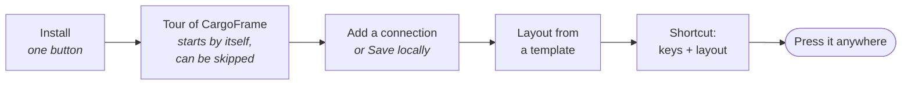

### The Settings window

The first start of a version (a new install, or an update) opens Settings on the **tour of CargoFrame**: one look at
each page, in the order a capture goes through them, then what can be turned on or off (the recording sign, the
notifications, the safe folder, export and import, the language, updates). *Skip the tour* ends it; *Guides* starts it
again. The window has a minimum size so a page never scrolls sideways (a long line of a file scrolls in its own box,
and names too long are cut with an ellipsis). Each page has an icon in the sidebar, so the sidebar can one day fold to
its icons (their names on hover).

The sidebar follows that order, under a **search** box (Ctrl+F): while it has words, the sidebar lists only the pages
and settings that have them (a click opens the page and lights the setting up), and the sections of the page shown
that do not are greyed out; × clears it. Each thing is set on one page only; **Guides** at the bottom walk through any setup by
opening the page, outlining the field and saying in one sentence what goes in it; the guides for connecting each
service are grouped under *Connect a service*, below the others.

| Group | Page | What it holds |
|-------|------|---------------|
| Get started | **Connections** | The services captures go to, each with its sign-in or token, a test, and *Add a connection*; Claude's pinned and recent chats |
| Captures | **Layouts** | The window a capture opens, block by block (Copy, Paste, Duplicate and Delete over the grid, or Ctrl+C, Ctrl+V, Ctrl+D and Delete; a copy can go in another layout while Settings is open; a tab locked in the Tabs block's properties (a lock beside each tab's name there) keeps its blocks where they are and takes none, and is greyed on the grid while still opening), on a grid of 12 columns or more (up to 24: *Columns ＋* adds one on the side and the window opens wider), and what each sharing button sends (for Jira and GitHub, what each block does to an issue that is there, and a vote or 👍; for every button, the blocks that must be filled before sharing), with a *Fill fields* tab (steps that fill a field of the service on each share); a Tabs block holds 2 to 5 tabs (its names stick out of the side chosen, a click opens one, a block dropped inside goes in the tab open, and the grip at its top right picks and moves it even when a block fills the tab); a Text block's starting text is written with every value listed on its right, searchable, the most used first |
| | **Shortcuts** | The keys and the layout each opens (held together in the box: Ctrl, Alt, Shift or Win with up to three others, any of them; the box says when a key cannot be used); what a press makes (a screenshot of the program, the screen or all screens, or a recording) |
| | **Data parsing** | Two tabs. *Values*: each value with where it is read, how, what the last capture gave and the layouts using it; *New value: select it in a file* shows the last capture's text files (or ones opened or dropped on it; a tab's × closes it, and what is opened or closed stays so until Settings closes), a search like Ctrl+F, and turns a click or a drag into a way to find it again (grips at the selection's ends widen or narrow it; *＋ Add a next part* joins a text found after it, such as a stream and its encoder a few lines below), with what each file gives (the panel beside the file always stays in sight); a value opens to its files (the newest or all; empty or a text when none has it), and values *made from other values*; *Filled in by CargoFrame* lists the capture's, the program's and the computer's values (`{system.os}`, `{system.gpu_driver}`…) with what they are here. *Files*: the files read (one dropped on the page starts a new value in it), each added to the window's files or not, with its lines' time format and its values |
| | **Recording** | What shows on screen while recording (the outline and dot), how long a clip is, continuous recording, following a window that is moved, where ffmpeg is, capture and compression (Automatic picks the cheapest that works), a 5-second test |
| CargoFrame | **Preferences** | Language (its dropdown on the title's line; the computer's by default; English, French, Spanish, Italian, German), appearance (theme, accent colour), notifications (each kind on or off, with a link to the recording sign), starting with the computer (the person's own sign-in entry; an older copy the machine starts instead is named, with *Stop the older copy*) |
| | **Files & backup** | When a share fails (the folder for saved zips, retries), export and import (and deleting the items ticked, after naming them and the shortcuts they leave with no layout), what is kept on this computer (clear each kind, forget the remembered choices) and *Reset CargoFrame* |
| | **System** | The apps CargoFrame uses on this computer (ffmpeg, sound output, Claude app, `xdotool`) with one install button (the sidebar shows how many are missing) and ffmpeg's own *Download* / *Update* button, updates and the version (checked against the installer under either of its names, once a day after a day has passed when that is on), windows kept ready, *Debug mode* (off: see *Debug mode* in §2; with it, *Set up the bug report* and *Check this PC*), speed and memory |

| Connections | Layout builder | Shortcut |
|:---:|:---:|:---:|
| 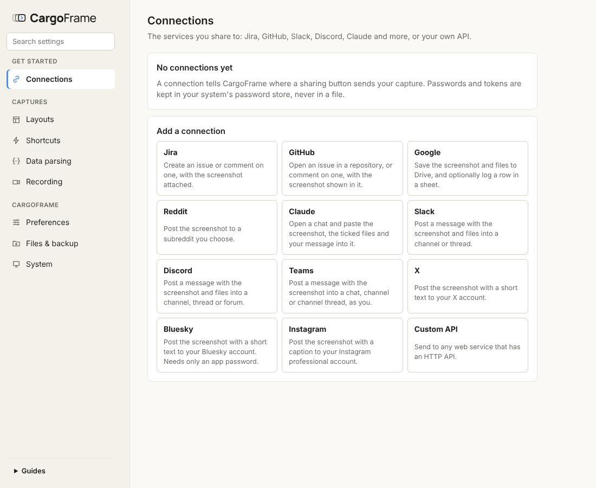 | 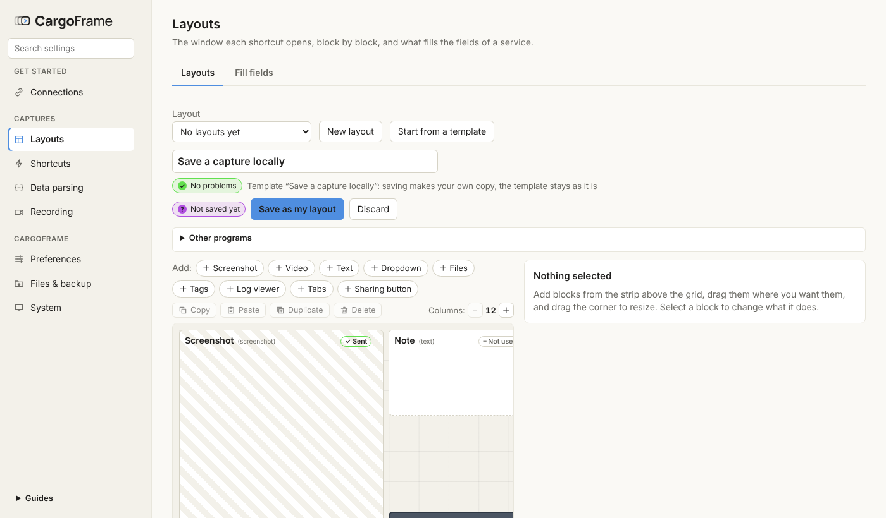 | 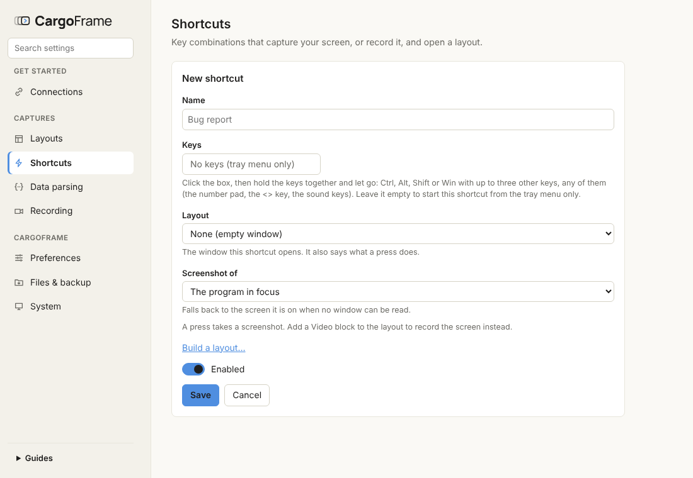 |

### The CargoFrame window

| Element | Behaviour |
|---------|-----------|
| **Screenshot** | Its tools are a row of icons above the picture: pen, square, circle, arrow, text (bold, italic, on a box; click a text to change it), crop; colour and size. *Read text*: drag over text on the picture, the lines found are marked; copy them all or click the ones to copy, or *Try again* to read it another way |
| **Video** | Its tools are a row of icons above the picture, like the screenshot's: crop (drag a frame, *Apply crop*), marks drawn with the screenshot's tools, the keys pressed (dragged where they go, × takes them off, the keyboard icon brings them back), the time of each moment (the clock), *Follow window* when the window was moved, *Take screenshot*, *Reset edits*; each icon is named on hover. Under the picture: the trim handles and what is kept. *Also take a screenshot when the recording ends* is set in the layout |
| **Text** | A box that is a service's message (set in the builder, *Sent in*) shows its formatting as it looks: bold, italic, underline, code, quote, lists, code blocks and tables as grids, with buttons and shortcuts limited to what those services show; values (`{map}`) filled in. The box keeps at least one line; *One line high* keeps it at that |
| **Dropdown** | Lists from the service, optional, remembers the last five; "where to post" is a path |
| **Files** | The project folder's files, or the subfolders of it the block names (several, separated by commas: `logs, build/out`); the ones matching the block's patterns (like `*.log`) are ticked in advance. **＋** adds files by hand: each is copied into the capture at once, listed under `added/` and ticked |
| **Tags** | Like Jira's labels: chips with ×, Enter or a comma adds one, at most 25. Started from the layout's list (each entry may use a value, left out when it is not found), the last five used offered under the box. With a list of the service (labels, components, versions), clicking the box opens it over the blocks below: several are picked one after the other (by name), typing narrows it, the arrows and Enter pick. Sent in a field that takes several values |
| **Log viewer** | A file the window offers, line by line: a search keeps the lines with its words (case aside, marked), a line picked is shown whole to copy, *Copy all* copies what is shown; the expand icon opens it large, in the middle of the window over a dimmed one (the cross, Escape or a click outside closes it). It has no background of its own until opened large. Large files show their last 4 MB. A button at the start of the search row turns it from the text search (shown first) to a time search (its icon is the search it turns to: a clock, then a magnifier) that keeps the lines written during the recording, around the capture, or between two times (typed, or set from a line picked: *Start here*, *End here*; UTC when the block says); the time of each line is found by itself, or read the way a time **selected in a line** is written (the format is worked out from it; selected in the text search, it is offered), or a format written by hand (behind the button that shows how times are read), set by a data rule for its file, by the block, or last used for a file of that name; both keep applying, and the button shows a dot while the other one is on. While the clip plays, the lines written up to the moment shown are shown, the newest coming in at the bottom. Nothing of it is sent |
| **Tabs** | Like a binder: the names on the top (or the bottom, left or right), the blocks of the open tab under them. A click (or the arrow keys) opens a tab; the blocks of the others are only hidden, so what is typed or edited in them stays and is sent. A tab's name lights up while a hovered button sends something in it |
| **Sharing buttons** | Up to five, in the service's colour; a button with blocks that must be filled stays grey and lists those still empty; a label too long for its button is cut with an ellipsis and is whole on hover. One dot per button at the end of each block's first row (its title, or its tools) says which button sends it: full = sent, an empty ring in the button's colour = left out (a click switches it), dashed = cannot take it, an outer ring = required, a number when two buttons go to the same kind of service. A block with no first row has them on its top edge. Hovering a button or a dot rings what each block it sends holds: the picture of a screenshot or a recording, the box of a text, not the block's title or tools |

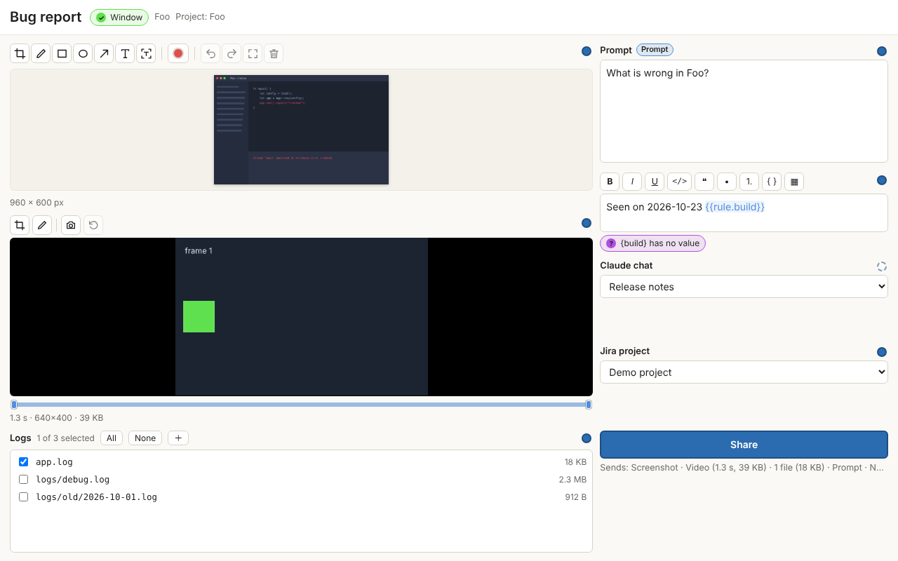

Pressing a shortcut while a window is open opens another one (up to ten). *Pause shortcuts* in the tray turns them all
off without deleting anything.

---

## 4. How it is built

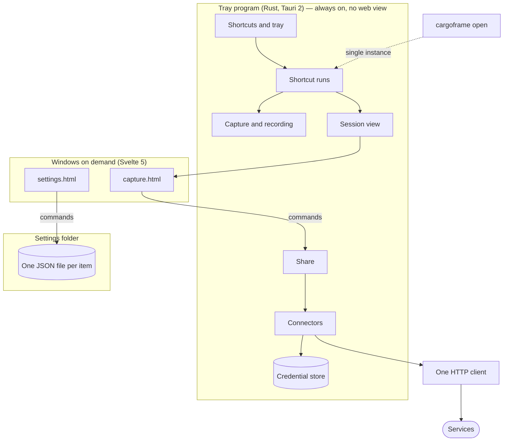

| Piece | Where | Job |
|-------|-------|-----|
| Tray program | `app/` | Tray, shortcuts, windows on demand, commands, secrets, `cargoframe open` |
| Windows | `ui/` | `settings.html` and `capture.html`, built once, loaded on demand |
| Logic | `core/*` (19 crates) | Everything testable without a display: capture rules, layout, config, rules, connectors, net, video, update… |
| Languages | `core/i18n`, `ui/src/lib/i18n` | English in the code; a pack per language (French, Spanish, Italian, German) mapping each English text to its translation, for the program and for the windows. `t()` in both, checked by `scripts/i18n/check.mjs` on every push ([languages](i18n.md)) |
| Installers | `installers/` | Windows NSIS (one button), Linux AppImage and `install.sh` |
| CI | `.github/` | Linux on pull requests; Windows and Linux on `main`; installers; release draft; security audit |

Side effects (files, secrets, network, clock) sit behind traits, so tests use a mock server and an in-memory secret
store. `unsafe` is forbidden in every crate. The full module list is in the [development plan](development-plan.md#4-modules).

<details>
<summary><b>Settings on disk</b></summary>

`%AppData%\CargoFrame` or `~/.config/CargoFrame`: `general.json`, `safe.json`, `video.json`, and the folders
`triggers/`, `connections/`, `rules/`, `infotypes/`, `layouts/`. Every file has a `schema_version`, is checked when read,
and is migrated with a backup. **Secrets are never in these files**: they are in the system credential store.
`app/src/cleanup.rs` is the only code that deletes, and only inside CargoFrame's own folders.

</details>

<details>
<summary><b>Safety, performance, testing</b></summary>

| Area | Short version | Detail |
|------|---------------|--------|
| Safety | No telemetry. Secrets only in the credential store. Files read only inside the project folder where a rule allows. Every request is HTTPS to an address the person set. Text from a screen or file never reaches a command line | [security.md](security.md) |
| Performance | Tray-only under 40 MB; capture under 150 ms; each window under 250 KB of script. Three memory modes: balanced, low memory, always warm | [performance.md](performance.md) |
| Testing | Rust unit and integration tests, connectors against mock servers; UI tests on an in-memory backend; every page and the CargoFrame window opened in Chrome, small and large, light and dark, failing when something sticks out of its box (the overflow check); the copies of Rust lists in the window compared; a real capture on a virtual X11 screen; installer install, upgrade, uninstall and click test; guides checked against real fields | [development plan](development-plan.md#7-testing-and-quality-gates) |

</details>

---

## 5. For companies

Meant for companies of thousands of people.

| Need | How | State |
|------|-----|-------|
| Only the services a company uses | One Cargo feature per connector; `set CF_SERVICES=jira,teams` before `scripts\windows\build.cmd`. The code is not in the program; forms, templates and guides are hidden; a saved connection of a missing kind shows "not in this copy" | Built |
| Other programs hand data in | `cargoframe open --trigger <id> --set <block>=<text>` reaches the running copy through the single-instance channel (same user, no network port), runs the shortcut and fills text boxes and dropdowns. Only layouts with *Other programs can fill this*; nothing is sent until the person presses a button. At most 50 values of 20,000 characters; the log records counts only | Built (text, dropdowns) |
| Install and update centrally | Silent per-user install (`/S`, `/NOSTARTUP`); the update check can be off | Built |
| The company's network | The system certificate store and proxy setting | Built |
| The company's sign-in | OAuth with the company's identity provider: Teams with Entra today; Jira OAuth and generic OAuth 2.0 for Custom API next | Partly built |
| Set up for everyone | A read-only managed folder (`%ProgramData%\CargoFrame\managed`, `/etc/cargoframe/managed`) with the same JSON files plus `policy.json`; managed items show a lock | Planned |
| Accessible without thinking | Labels on every control, full keyboard use, visible focus, reduced motion, checked contrast, one obvious button per screen | Built; screen-reader pass open |

---

## 6. Branding

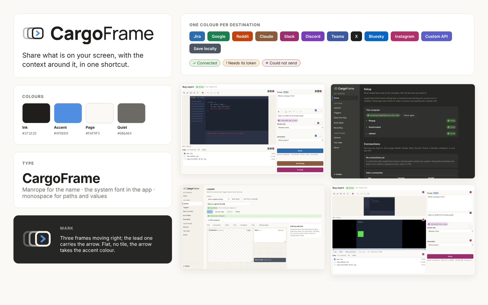

The mark is **Convoy**: three frames moving right, the lead one carrying an arrow. The frames are the captures, the
convoy is what travels with them, the arrow is the sharing.

| Element | Rule |
|---------|------|
| **Mark** | Flat shape and colour only: no tile, gradient or shadow. Light drawing on light surfaces, dark on dark. Below 48 px the small drawing, never the full one scaled down |
| **In the app** | Frames take the text colour, the arrow the **accent** colour, so the logo follows theme and accent |
| **Fixed surfaces** | Program icon and installer: grey frames `#8B8A84`, blue arrow `#4F8EE0`. The installer's icon is the same mark turned a quarter clockwise, so the arrow points down |
| **Name** | *Cargo* Manrope 800 + *Frame* Manrope 500, one word, letter-spacing -0.02em; outlined in the SVGs |
| **Colours** | Ink `#1F1E1D` / page `#F5F4EE` (light), reversed in dark; accent `#4F8EE0`, changeable with a contrast warning |
| **Destinations** | Each service has its own colour on its button and its dots, never the only signal: the label always says where, and a dot is full or empty |

| Icon | Small icon | Program icon | Installer icon | Tray |
|:---:|:---:|:---:|:---:|:---:|
|  |  |  | 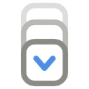 |   |

| Light | Dark |
|:---:|:---:|
| 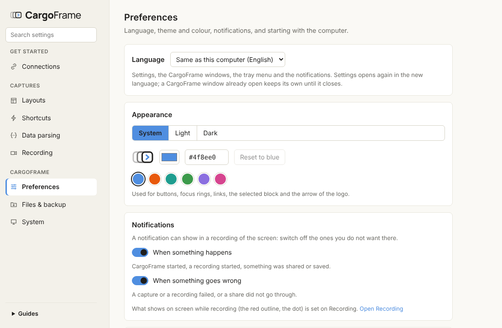 | 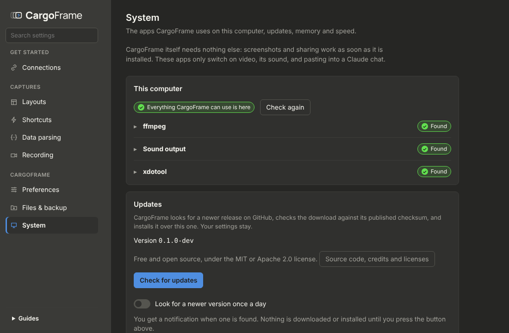 |
| 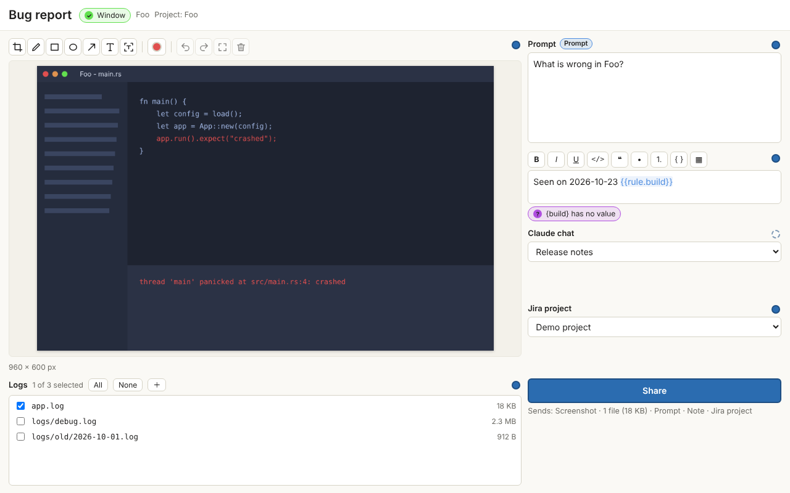 | 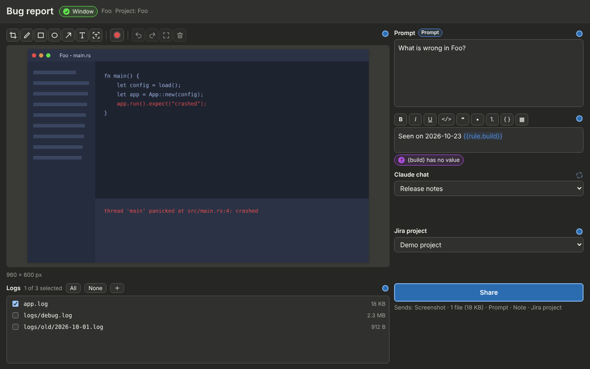 |

Sources: `assets/brand/` (SVG), `app/icons/` (drawn by `scripts/dev/render-icons.mjs`), `ui/src/lib/tokens.css`
(colours), `Logo.svelte` (the mark in the app). Screenshots come from the demo data (`npm run dev` in `ui/`).

---

## 7. Known limits

- Not yet run against every real account; the Windows sound capture and Discord threads need one run on a real PC.
  See [status.md](status.md).
- The installer and the program are not signed yet.
- Wayland: GNOME tells no program which Wayland window is in focus (XWayland programs are found), and GNOME and KDE
  let no program press keys, so a Claude message is left on the clipboard. Verified on a headless sway desktop (also
  run as a GNOME-like desktop); real GNOME, KDE and Hyprland sessions are still to be tried.
- X, Bluesky and Instagram take pictures and plain text, not video. Instagram needs a picture server the person owns.
- GitHub's API cannot attach a file to an issue: pictures and files go in a branch of the repository (or are left out),
  so the token needs Contents write as well as Issues.
- Text colour is not offered: only Jira and Teams could show it.
- *Read text* uses Windows' own reader (in the languages of the person's profile); on Linux it needs `tesseract`
  installed, and reads English unless more of its languages are installed.
- The recording sign cannot be drawn on Wayland; on X11 a full-screen recording can include it.
- Pictures in the text: Jira, GitHub and Teams (the recording in Jira and GitHub only).
- Tags: Jira and GitHub labels (Jira labels cannot hold spaces: a space becomes `-`), hashtags at the end of a post on
  X, Bluesky (marked as tags) and Instagram, a last *Tags:* line on Slack, Teams and Discord. Discord forum tags and
  Reddit flairs are not set from them.
- Tabs hold blocks one level deep (no tabs inside tabs), 2 to 5 of them; a tab that still holds blocks cannot be
  removed until they are moved out or removed.
- On Windows the graphics card's capture sees the main screen only: a window on another screen, or the whole desktop
  of several screens, is recorded with GDI, which costs the processor more. The speed numbers of each kind of PC are
  still to be measured on real machines.
- Continuous recording cannot tell a held shortcut on Wayland: the tray menu starts and stops it there. It stops by
  itself after 12 hours.
- The keys pressed and following a moved window: Windows and X11, not Wayland. A key tapped faster than the keyboard is
  looked at (20 ms) can be missed on X11. Every key typed while recording shows, passwords too.
- Shortcuts of more than one key besides the modifiers are watched by CargoFrame (Windows, X11): a key tapped faster
  than 25 ms can be missed, and the keys still reach the program in use. On Wayland a shortcut is modifiers and one key.
- Teams in Jira are found through the Team field's search (Jira's own suggestions): tried against a mock of Jira
  Cloud's answer, still to be tried on a real Jira Cloud and Data Center.
- The computer's details on Windows come from the registry as Device Manager shows them; a graphics card with no
  driver installed is listed by Windows' fallback name.
- Starting at sign-in is the person's own entry. A second entry that starts CargoFrame again hands over to the copy
  running, which opens nothing and names the other program in its log (0.7.3; before, Settings opened at each
  sign-in, and the copy that started first, maybe an older one, was the one used all day). An entry in the machine's list that starts an older copy is removed
  when Windows allows it; otherwise Preferences names it and *Stop the older copy* asks an administrator (tried on
  the CI's Windows build only, not yet on a real PC).
- An update of an issue changes the fields the layout maps; Jira fields with their own update operations beyond lists
  (worklogs, links) are not offered.
- Next for the connectors (required fields shown before sending for services beyond Jira, company sign-in):
  [connectors.md](connectors.md).
