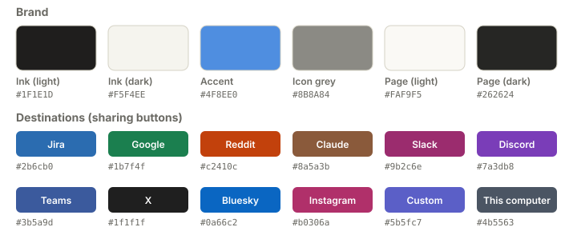
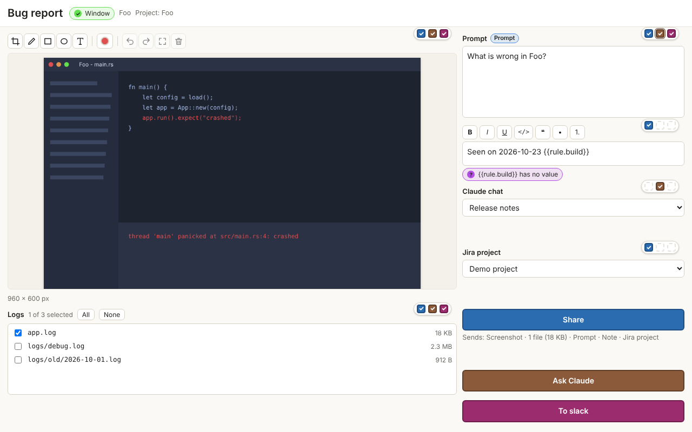

# Design

How CargoFrame is built today (version 0.2.0, 8 Nov 2026). It is a short map, not a manual: for why a choice was
made read [decisions.md](decisions.md), for what has been tried on real machines read [status.md](status.md).

## What it is

A tray program for Windows 11 and Linux. A shortcut captures the program in focus (a picture or a
recording), finds that program's project folder, reads the few values the person asked for, and opens one
window to check everything and send it to a web service with one button. Nothing is sent without that button.

Four rules shape everything else:

1. **Cheap while idle.** The always-on process is tray-only: no web view, a few megabytes.
2. **Easy for the person.** Every setup step has a button, a link or a short in-app guide. The person never edits a file
   and never has to think about where a setting lives: each thing is set in one place.
3. **Little to maintain.** One place for each thing: one list of templates, one list of "get a token" links,
   one file per setting, one HTTP client, one data-driven guide. A service that changes breaks one file.
4. **Fit for a large company.** It installs per user without an administrator, can be built without the services a
   company does not use, can be set up centrally, works behind the company's proxy and certificates, and other programs
   can hand it data. See *For companies* below.

## One press, from shortcut to sent

```
shortcut ─▶ which window is in focus? ─▶ its layout has a Video block? record (press to start, press to stop) : take a picture
         ─▶ climb from the program's path to its project folder
         ─▶ run the data rules on the allowed files in that folder
         ─▶ open the CargoFrame window (a layout: picture, texts, dropdowns, files, video, buttons)
         ─▶ the person edits, ticks and presses a sharing button
         ─▶ the connector sends (retry, then a kept zip if it still fails)
```

- **Capture** (`core/capture`, `core/window`): Windows (a copy of the desktop, so menus and pop-ups are in the picture), X11, and the Wayland portal. The
  program in focus gives its executable path; with no focus the screen under the mouse is used.
- **Project folder** (`core/context`): climb the path to a folder with the same name as the program, else one
  folder above. Only files a data rule allows are read, and never outside that folder.
- **Data rules** (`core/rules`): read a value from JSON, YAML, TOML, INI, CSV, XML, a regular expression, or a line
  of a text or log file. The value fills `{{variables}}` in text boxes and dropdowns. In Settings a text value is
  described as *Text before it, The value, Text after it*; the pattern is built from those two texts.
- **Sharing** (`app/src/share.rs`, `core/connectors`): builds one `Payload` (picture, optional still screenshot,
  video, files zip, texts, dropdown choices) from what each button's blocks are ticked to send, then hands it to the connector.
- **Safe fallback** (`core/safe`, `core/bundle`): a failed send is retried with backoff; if it still fails, a zip of
  everything is kept so nothing is lost. A button with no connection says *Save locally* and writes that zip.

## Pieces

| Piece | Where | Job |
|-------|-------|-----|
| Tray program | `app/` (Tauri 2) | Tray, shortcuts, windows on demand, Tauri commands, the secret store, installer hooks |
| Windows (UI) | `ui/` (Svelte 5) | `settings.html` and `capture.html`, one page each, built once, loaded on demand |
| Logic crates | `core/*` | Everything testable without a display: no Tauri, no window |
| Installers | `installers/` | Windows NSIS (one button), Linux AppImage and `install.sh` |
| CI | `.github/` | Linux CI on pull requests; Windows and Linux on `main`; installer build and click test; release draft |

Side effects (files, the secret store, the network, the clock) sit behind traits, so tests use a local mock
server and an in-memory secret store. `unsafe` code is forbidden in every crate.

## Settings are plain files

One JSON file per item under the settings folder (`%AppData%\CargoFrame`, `~/.config/CargoFrame`):
`general.json`, `safe.json`, `video.json`, and the folders `triggers/`, `connections/`, `rules/`,
`infotypes/`, `layouts/`. Every file carries `schema_version`, is checked when it is read, and is migrated with
a backup. Secrets (tokens, passwords, webhook links) are **not** in these files; they are in the system credential store.

**Last choices** in a dropdown (the last five, the newest first) are kept in the window's own local storage,
per layout and block: values and labels only, never secrets.

**Your data** (Settings, Your data) lists what the program keeps in its two folders (settings; work in progress, kept zips,
logs, updates), clears each kind, or resets everything (settings, connections, sign-ins, data; never the program or the
person's own folder for saved zips). `app/src/cleanup.rs` is the only code that deletes, and only inside those folders.

## The Settings window, by content

The sidebar is in three groups, in the order a new person sets things up. Each thing is set on one page only.

| Group | Page | What it holds |
|-------|------|---------------|
| Get started | **Setup** | What CargoFrame uses on this computer (ffmpeg, sound output, Claude app, `xdotool`) with the one install button; then **Connections**, the services you share to |
| Captures | **Layouts** | The window a capture opens, block by block, and what each sharing button sends |
| | **Triggers** | Shortcuts, and the layout each opens. The layout says whether a press records (it has a Video block) or takes a screenshot |
| | **Data from files** | Values read from files in the project folder |
| | **Extra fields** | Boxes on a service beyond where to post (Jira priority) |
| | **Recording** | Where ffmpeg is, capture and compression, a 5-second test |
| CargoFrame | **General** | Appearance, startup, notifications, what happens when a share fails, windows kept ready |
| | **Your data** | What is kept on this computer and a way to clear it or start again; export and import |
| | **About** | Version and updates; speed and memory numbers |

**Guides** sit at the bottom of the sidebar. Old addresses (`safe`, `connections`, `recording`, `updates`) still land on
the right page.

## The CargoFrame window and layouts

A **layout** is a grid of blocks: Screenshot, Video, Text, Dropdown, Files, and up to five sharing buttons. Ready-made
**templates** (`core/layout/src/templates.rs`) are offered for the services you have connected and are never stored
until you press *Save as my layout*.

- **Screenshot and Video can be in one layout.** The video block has *Also take a screenshot when the recording
  ends*; the screenshot block can stay empty until then, and the video block has a *Take screenshot* button.
  Services that take both (Jira, Slack, Discord, Google, and the local zip) get the video and the still; Teams, Reddit,
  Claude and Custom take pictures only, so there the screenshot is sent if the video box is unticked.
- **Tick boxes** on each block say which buttons send it. Dashed = this destination cannot take it; ring = required.
- **Where to post is one dropdown per connection.** It is a path: server, then category (optional), then channel or
  forum, and then, inside that, a **thread or post** (`deeper`: *New* first, the ones used before, the listed ones, a
  pasted link; long lists are searched and narrowed to titles like the Title text). The window starts on the last path
  used. Other dropdowns (Jira priority, ...) come from a destination too, can be **optional** and **remember** their
  last choices. A destination with no list takes a typed or pasted value. The builder refuses a second path dropdown for
  the same connection.
- **Text blocks** (plain text) have formatting buttons: bold, italic, underline, code, quote, bullets, numbers. The text
  is kept in one neutral markup and each connector converts it (`core/connectors/src/richtext.rs`); a box sent to
  several services offers only the buttons all of them can show, and a layout can switch the buttons off.

## Connections

One connector per service, in `core/connectors/src/<service>`. Each answers the same five questions
(what can I take, test, list the options, send, and what did the person get back), so the share flow never
names a service.

| Service | Sign-in | What it sends | Video |
|---------|---------|---------------|-------|
| Jira Cloud / Server | E-mail and API token / personal access token | An issue or a comment, with the picture, still, video and files | Yes |
| Google | OAuth, the person's own Desktop client | Drive upload, optional Sheets row | Yes |
| Slack | Bot token (`xoxb-`) | A message with files, in a channel | Yes |
| Discord | **A webhook link per channel (no bot)**, or a bot token as a last resort | A message with files; a new forum post; a reply in a thread (sent through the webhook of the thread's own channel) | Yes (size limit of the server) |
| Reddit | OAuth, the person's own app | A post with the picture | No |
| Teams | OAuth through the person's own Entra app (work or school) | A message | No |
| Claude | None: opens a chat by link and pastes | The picture, files and prompt, into the Claude desktop app or the browser | No |
| X | OAuth, the person's own Native App (no secret) | A post: text (280 characters) and the screenshot, made smaller to fit | No |
| Bluesky | Handle and an app password | A post: text (300 characters), the screenshot, links marked | No |
| Instagram | Token from the Meta app dashboard; a picture server the person owns | A post with a caption; the picture goes to the person's server first, because Instagram only fetches from a public address | No |
| Custom API | Header or token | Any HTTPS endpoint, with the fields you define | No |

- **Discord without a bot.** A webhook is made in the channel's settings and pasted once. It cannot list servers,
  channels or threads, so the channels are the links added, and threads are the ones posted to before or a pasted link
  (*Copy Link* in Discord). A forum is posted to by *thread name* (a title convention such as `[PROJ-123] short title`).
  A bot token lists servers, categories, channels and threads.
  Posting through the person's own Discord account is **not** built: it breaks Discord's terms and risks the account.
- **Get the token.** Next to each sign-in field a button opens the service's own page (`ui/src/lib/connectorHelp.ts`
  is the only place those addresses live).
- **A local program a connector needs** (the Claude desktop app) is checked on the Setup page; on Windows one button
  installs it with winget, and the download page is always one click away.
- **OAuth** (`core/connectors/src/oauth.rs`): PKCE on a loopback address, tokens kept in the credential store.
  Google, Reddit and Teams need the person's own app ID: CargoFrame does not ship one.
- **Network** (`core/net`): the one HTTP client. https only, checked redirects, a size cap, retries, multipart.

## Video

`core/video` runs **ffmpeg** (the one optional program) to keep a ring of short segments, so a press of the shortcut
keeps the last seconds (10 by default). The CargoFrame window plays the clip, trims it (timeline handles), crops it and
puts one ring with a text on it; the export is cut by ffmpeg. This editing lives in the CargoFrame window only: the
Recording page in Settings only checks ffmpeg and records a 5-second test. Sound of the computer and a microphone are optional; if
a sound device is missing the recording goes on without it and says why. On Linux ffmpeg reads PulseAudio's monitor of
the default output. On Windows ffmpeg cannot hear what the computer plays, so `core/video/src/loopback.rs` does (WASAPI
loopback): everything the computer plays, or only the program in focus, and passes the samples to ffmpeg through a local
feed (`pcm.rs`). No device has to be switched on.

## Setup, installer and updates

- **Installer:** a window with one button (*Install*, or *Update*), per user, no administrator password, and it
  opens CargoFrame on the Setup page.
- **Settings, Setup** (top half): what CargoFrame uses on this computer (ffmpeg, the sound output, the Claude
  app, `xdotool` on Linux), with one install button on Windows (winget, fixed arguments, one at a time). The checks
  run each time the page opens: a spinner on each row, then a tick or a warning; the details fold away until the row is
  opened. The **default sound output** is named from Windows. **Connections** are the lower half of the same page.
- **Notifications:** two switches in General (routine, problems), because a notice can end up inside a recording.
- **Updates (About):** a manual "check for updates" against GitHub (a read-only token while the repository is private); a
  daily check is off by default. An update notice opens the About page.

## The in-app guide

`ui/src/settings/guide/` is a small data-driven tour, opened from **Guides** in the Settings menu (there are no "show me
how" links on the pages): `tours.ts` lists, for each connector and for *first capture*,
*Data from files* and *Extra fields*, a few steps of `{page, field, one short sentence}`. The guide opens the
right page, scrolls to the field (found by its `data-tour` attribute), draws a box in the accent colour around it and
shows the sentence. A test fails if a step names a field that no longer exists, so the guides cannot silently go stale.

## Flow review (8 Nov 2026): what was set in two places

| Repeated | Now | State |
|----------|-----|-------|
| Trim, crop and mark in Settings, Video **and** in the CargoFrame window | Only in the CargoFrame window; Settings keeps a 5-second test | Done |
| Installing ffmpeg from Setup **and** a typed `winget` command on the Video page | Setup installs; Recording sends you there | Done |
| General holding eight topics, from colours to updates | General, Your data and About, each about one thing | Done |
| Memory setting and speed numbers in one "Performance" box | The setting in General, the numbers in About | Done |
| **Extra fields** describe a service field, its list, a default and "required", which a Dropdown block and a button's route already do | The route in the layout gets *required* and *if empty, use*; the Extra fields page goes, its files are folded into the layouts that use them | Planned (connector round) |
| Screenshot or recording chosen in the trigger (*Makes*) **and** implied by the layout (a Video block) | The layout decides: a Video block records, otherwise a screenshot. The trigger keeps only *Screenshot of* (window, screen, all screens) | Done in 0.2.0 |
| A Claude app install button on Setup **and** on the Claude form | Kept: one backend, two doors where people look for it | Kept on purpose |

## For companies

CargoFrame is meant to be used by companies of thousands of people. What that needs, and how it is (or will be) met:

| Need | How | State |
|------|-----|-------|
| Leave out services a company does not use | One Cargo feature per connector (`jira`, `slack`, `x`, ...); `set CF_SERVICES=jira,teams` before `scripts\windows\build.cmd`. The service's code is not in the program; its form, templates and guide are hidden; a saved connection of a missing kind shows "not in this copy" | Built in 0.2.0 (the Settings forms stay in the window's code, hidden) |
| Set up for everyone at once | A read-only *managed* folder (`%ProgramData%\CargoFrame\managed`, `/etc/cargoframe/managed`) with the same JSON files as the settings folder plus `policy.json` (which services, update check on or off, settings that are locked). Managed items show a lock and cannot be edited; each person still signs in for themselves | Planned |
| Other programs hand data to CargoFrame | `cargoframe open --trigger <id> --set <block>=<text>` reaches the running copy through the single-instance channel (same user only, no network port). It runs the trigger (so the calling program is captured), and fills text boxes and dropdowns. Only a layout with *Other programs can fill this* accepts values; nothing is sent until the person presses a button. At most 50 values of 20,000 characters; the log records how many, never what | Built in 0.2.0 (text and dropdowns; files and recording layouts next) |
| The company's sign-in | OAuth with the company's identity provider where the service allows it (Teams with Entra today; Jira OAuth and a generic OAuth 2.0 for Custom API next). Tokens stay in each person's credential store | Partly built |
| The company's network | The operating system's certificate store on Windows and Linux (a company root certificate just works); the Windows proxy setting, or the usual proxy variables on Linux | Built (Linux certificates since 8 Nov) |
| Install and update centrally | Silent per-user install (`/S`, `/NOSTARTUP`) for Intune or a login script; the update check can be turned off so IT pushes versions | Built; the policy switch is planned |
| Accessible without thinking | Every control has a label, the keyboard reaches everything (arrow keys in the sidebar), focus is always visible, motion is reduced when the system asks, colours are checked for contrast, and each screen has one obvious button | Built; a screen reader pass on a real PC is open |

## Branding

The mark is **Convoy**: three frames moving right, the lead one carrying a forward arrow. The frames are the captures,
the convoy is everything that travels with them, the arrow is the sharing.

<p>
  <picture>
    <source media="(prefers-color-scheme: dark)" srcset="../assets/brand/convoy-logo-dark.svg">
    
  </picture>
</p>

| Icon | Small icon (under 48 px) | Program icon | Tray |
|------|--------------------------|--------------|------|
|  |  |  |   |

**Rules.** Flat shape and colour only: no background tile, gradient or shadow. The light drawing on light surfaces,
the dark one on dark surfaces; in the app the frames take the theme's text colour and the arrow the **accent colour**
(Settings, General, Appearance), so the logo follows both. Below 48 px the small drawing is used, never the full one
scaled down. Surfaces that cannot follow the theme (program icon, installer) use mid-grey frames and the default blue arrow.

**The name.** *Cargo* in Manrope 800 and *Frame* in Manrope 500, one word, letter-spacing -0.02em. The SVGs have
the text as outlines, so no font is needed.

**Colours.** The accent is blue `#4F8EE0` by default and can be changed by the person (a warning appears when a colour
is hard to read on either theme). Each destination has its own colour, used on its sharing button and its tick boxes,
never as the only signal: the label always says where.



**How it looks.** Light and dark follow the system unless the person picks one.

| Settings (light) | Settings (dark) |
|------------------|-----------------|
|  |  |

| The CargoFrame window (light) | The CargoFrame window (dark, a Discord path) |
|-------------------------------|----------------------------------------------|
|  |  |

The files are in `assets/brand/` (SVG) and `app/icons/` (drawn from them by `scripts/dev/render-icons.mjs`); in the
app the mark is the `Logo.svelte` component. The screenshots are made from the demo data (`npm run dev` in `ui/`).

## Safety

Everything the program reads or sends is listed in [security.md](security.md). The short version: no telemetry; secrets
only in the credential store; files read only inside the project folder and only where a rule allows; every request
is https and to an address the person set; text from a screen or a file never reaches a command line; every outgoing
message is built from what is ticked, shown in the window first.

## Performance

Budgets, how each is checked and what was measured are in [performance.md](performance.md). In short: the tray-only
process stays under 40 MB, capture is ready in well under 150 ms, and each window loads under 250 KB of script.
The gate (`scripts/dev/check.sh all`) checks the size budgets and runs a real capture end to end.

## Testing

| Layer | How |
|-------|-----|
| Rust logic | Unit and integration tests per crate; connectors against local mock servers |
| Windows (UI) | vitest on an in-memory stand-in for the backend (`memoryApi`), plus browser demos (`?demo=...`) |
| Whole program | A fake program on a virtual X11 screen is captured by the real binary (`scripts/e2e/`) |
| Installers | Windows: silent install, upgrade, uninstall, and a click test of the real window |
| Guides | `tours.test.ts` (fields exist) and `walk.test.ts` (every step can be walked) |
| Commands | `shipped_config_tests` (every command is registered, listed in `build.rs` and given to a window) |

One command runs the local gate: `scripts/dev/check.sh quick|rust|all`. GitHub minutes are used in batches,
not on every change.

## Known limits

- Not yet run on a real Windows or Linux desktop, nor against real accounts; see [status.md](status.md). In
  particular the Windows sound capture (compiled on CI, tested on Linux with a fake source) and Discord threads
  (tested against a mock) need one run on a real PC.
- Text colour is not offered: only Jira and Teams could show it.
- Wayland "active window" may not be possible on some compositors (the fallback is the screen under the cursor).
- The installer and the program inside it are not signed yet.
- X, Bluesky and Instagram send pictures, not videos, and plain text. Instagram needs a picture server the person
  owns. Proposals for every connector: [connectors.md](connectors.md).
