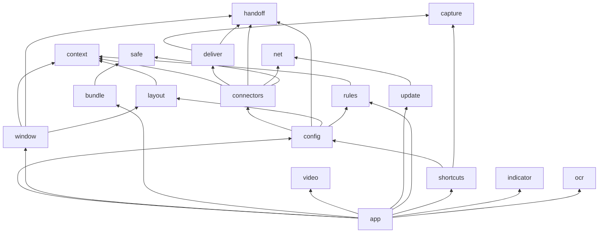

# Development plan

How to make CargoFrame as it is in version 0.7.2, written as if it were started today: what it must do, the stack,
the architecture, each module, the order to build them in, and the gates every change passes. The order is the one a
new team would follow, not the order the versions came in (that history is in [decisions](decisions.md)). For what
the app is and how it is used, read the [design](design.md).

**Contents:** [1. Goals](#1-goals) · [2. Stack](#2-stack) · [3. Architecture](#3-architecture) ·
[4. Modules](#4-modules) · [5. Build order](#5-build-order) · [6. Contracts](#6-contracts) ·
[7. Testing and quality gates](#7-testing-and-quality-gates) · [8. CI and release](#8-ci-and-release) ·
[9. Extending it](#9-extending-it) · [10. Next](#10-next)

---

## 1. Goals

### What it must do

| # | Requirement |
|---|-------------|
| F1 | Wait in the tray; run a **shortcut** (any key combination: modifiers with up to three other keys, whatever keys the keyboard has; or the tray menu) that opens a layout |
| F2 | Capture the program in focus, the screen, or all screens; or **record** the last seconds when the layout has a Video block, showing that it records (an outline, a blinking dot), following the focus and a window that is moved, with the keys pressed and the time over it; or record **continuously** and hand out the last seconds on each press. Recording costs the program being recorded as little as the PC allows: several screens are recorded at about the main screen's size, at most 4K |
| F3 | Find the program's **project folder** (same name as the program, else one folder above) |
| F4 | **Data parsing**: a value is made by selecting it in a file of a capture; CargoFrame finds it again in every capture, in one file or several (the newest, or all); files can be added to the window's files; values made from other values, with choices |
| F5 | Open a window built from a **layout** (a grid of 12 to 24 columns): Screenshot (with editor and text reading), Video (trim, crop, marks), Text (formatting, tables, pictures in the text), Dropdown, Files (and files added by hand), Tags, Log viewer (by words, by time read from a time selected in a line, following the clip as it plays), Tabs, sharing buttons |
| F6 | Fill dropdowns from the service's API, and search the long ones (people, teams) as the person types; "where to post" as one path that goes as deep as the service does; Tags picked, several, from a list of the service |
| F7 | Send to Jira, GitHub, Google, Slack, Discord, Teams, Reddit, Claude, X, Bluesky, Instagram, a custom API, or a local zip; **create or update** an issue (Jira, GitHub), each field doing what its mapping says, with a comment and a vote; a button waits for the blocks it says must be filled |
| F8 | Retry a failed send, then keep a zip in a safe folder, so nothing is lost |
| F9 | One Settings window, its pages in three groups with an icon each, a search, in-app guides and a **tour** that starts by itself after an install or an update; templates (a recording variant, of the window in focus, wherever the service takes a video; one Jira and one GitHub template, with or without a recording, that create or update with one *Send to* button); export, import, reset; ffmpeg downloaded and updated from System; updates checked and installed |
| F10 | Other programs fill a layout through `cargoframe open` |
| F11 | Speak English, French, Spanish, Italian and German, the computer's language by default |

### How well it must do it

| Quality | Target |
|---------|--------|
| Idle cost | Tray-only process under **40 MB**, about 0% CPU |
| Recording cost | The graphics card's copy of the screen and a hardware encoder where they work (tried on a test picture), software otherwise; ffmpeg below normal priority; nothing converted twice |
| Speed | Capture under **150 ms**; window usable under 250 ms warm, 700 ms cold; each window under **250 KB** of script |
| Safety | No telemetry; secrets only in the system credential store; HTTPS only; nothing sent without a button press |
| Reliability | Every send safe to repeat; every settings file versioned and migrated with a backup |
| Maintenance | One place for each thing; a service change touches one folder; `unsafe` forbidden |
| Companies | Per-user install, no administrator; services removable at build time; system certificates and proxy |
| Accessibility | Keyboard reaches everything, labels everywhere, visible focus, reduced motion, checked contrast |

---

## 2. Stack

| Layer | Choice | Why |
|-------|--------|-----|
| Language | **Rust** stable (at least 1.90, what Tauri 2.12 needs), edition 2021 | Small memory, no runtime, safe without `unsafe` |
| Shell | **Tauri 2** (tray-icon, global-shortcut, single-instance, autostart, opener, dialog) | Native tray without a web view; windows created only when needed |
| UI | **Svelte 5** + TypeScript, **Vite** | Tiny bundles, two pages (`settings.html`, `capture.html`) |
| Languages | Our own `t`/`msg` (Rust and TypeScript), English as the key, JSON packs embedded | No runtime library; a check script keeps every pack complete |
| UI tests | **vitest** + Testing Library, `svelte-check` | Fast tests against an in-memory backend |
| HTTP | **ureq** behind one `Http` trait | Blocking, small, easy to mock |
| Capture | Win32/GDI (`windows` crate), **x11rb**; on Wayland the desktop portal (**zbus**), `grim`, and the compositor's IPC for the focused window | No large capture libraries |
| Video | **ffmpeg** (external, optional); **wasapi** for Windows sound; on Wayland **GStreamer** (`pipewiresrc`) reads the portal's screen stream | Proven encoder; installed with one button |
| Secrets | **keyring** (Windows Credential Manager, Secret Service) | Never on disk in our files |
| Files | serde JSON, `serde_yaml_ng`, `toml`, `csv`, `roxmltree`, `regex`, `zip` | One crate per format, no custom parsers |
| Installers | **NSIS** (Windows), **AppImage** + `install.sh` (Linux) | Per user, no administrator |
| CI | GitHub Actions | Linux on pull requests, Windows on `main`, installers and releases |

---

## 3. Architecture

### Processes


Windows talk to the Rust side only through **Tauri commands**. Each command is listed in `app/build.rs` and each
window is granted only the commands it needs (`app/capabilities/`).

### Crates



Leaf crates have no CargoFrame dependencies and are built and tested first. `app` is the only crate that knows Tauri.

### Repository

| Path | Contents |
|------|----------|
| `core/*` | 17 library crates, testable without a display |
| `app/` | The program: tray, shortcuts, commands, sharing, secrets, setup checks, `cargoframe open` |
| `ui/src/settings` | Settings window: pages, layout builder, connections, guides |
| `ui/src/capture` | CargoFrame window: blocks, editor, tick boxes, sharing |
| `ui/src/lib` | IPC (`ipc.ts`; the in-memory backend for tests and demos in `memoryApi.ts`, loaded only outside the app), tokens, shared components; a list fixed to the screen under its box (`floating.ts`: the dropdown's and the Tags list); what a window shows, in debug mode (`debugView.ts`) |
| `installers/` | NSIS script and hooks; AppImage, `install.sh`, `uninstall.sh` |
| `scripts/` | `dev/check.sh` (the gate), `ci/` (budgets, names), `e2e/` (virtual-screen tests), `windows/build.cmd` |
| `assets/brand/` | Logo and icon SVGs |
| `docs/` | Design, this plan, decisions, status, security, performance, connectors |

---

## 4. Modules

| Crate | Job | Main items |
|-------|-----|------------|
| `context` | Climb to the project folder; `{name}` and `{{name}}` templates; the read allow-list | pure string logic |
| `safe` | What happens on failure: retry with backoff, failure classes, fallback ladder, zip names | `retry`, `FailureKind`, `SendError` |
| `handoff` | Claude chat links, clipboard plan, pinned and recent chats | |
| `capture` | Program in focus and its screenshot, per platform behind a `Backend` trait; where a window is (`WindowPlace`); the screens (Windows: what the graphics-card capture can see); Wayland focus, portal screenshot and screen sharing; what the computer is, for the `system.*` values (Windows: the registry and the system; Linux: `/proc`, `/sys`, `/etc/os-release`) | `capture_with`, `screens`, `wayland.rs`, `screencast.rs`, `system.rs`, `win_system.rs` |
| `video` | Ring of segments (and a copy of it while it goes on, for continuous recording), clip edits (trim, crop that may follow a window, marks laid over as a picture, keys laid over the sent picture), the ffmpeg command (one scale to the height setting, about the main screen's pixels and at most 3840 × 2160: `fit_filter`, `pixels_for`; each encoder's arguments and picture format in one place, a test picture that tells whether a hardware encoder works, ffmpeg run below normal priority); Windows loopback sound; a fed picture (Wayland, made smaller by GStreamer first) | `recorder.rs` (`Encoder::works`), `segments.rs`, `export.rs` (`keys_list`), `loopback.rs`, `pcm.rs`, `screenfeed.rs` |
| `keys` | The keys pressed while recording: the keyboard asked which keys are down (Windows `GetAsyncKeyState`, X11 `QueryKeymap`), each press with its time; lines of keys with when they show. Shortcuts the system library cannot take: each key by its place (`KeyA`, `IntlBackslash`, the number pad, media keys; Windows virtual key or scan code, Linux evdev code), held together with the modifiers not named up, watched every 25 ms on a thread that exists only while such a shortcut does | `Tracker`, `captions`, `combo.rs` (`Combo`, `Combos`, `Board`) |
| `indicator` | The sign shown while recording: a red outline and a blinking dot, as native windows (Win32, excluded from capture; X11 with the Shape extension); none on Wayland | `geometry.rs`, `win.rs`, `x11.rs` |
| `ocr` | Read the text in part of a screenshot on this computer: `Windows.Media.Ocr`, or the `tesseract` program on Linux; the picture is prepared first (grey, larger, light-on-dark turned), three ways to try | `read`, `prepare.rs` |
| `layout` | Blocks on a grid of 12 to 24 columns (`Layout::columns`), validation chips, templates (built from shared pieces: `capture_tabs`, `report`); tags kept clean and at most 25 (`split_tags`); Tabs blocks and the blocks they hold (`tab_of`, `may_share`); what a mapping does to an issue that is there (`UpdateMode`), the blocks a button waits for (`required`) and its vote (`react`) | `model.rs`, `templates.rs` |
| `rules` | Data rules: find a file, read values from it; values made from other values | `find.rs` (the three ways to find a value), `combine.rs`, one module per format |
| `window` | Everything the CargoFrame window shows for one capture, as one serializable view | `view::SessionView` |
| `bundle` | The fallback zip and the Files zip, with a manifest | |
| `net` | The one HTTP client: HTTPS only, checked redirects, size cap, multipart; a mock server | `Http`, `Request`, `mock::MockServer` |
| `deliver` | Paste into a chat window after checking it is the right window | |
| `connectors` | One folder per service behind the `Connector` trait; Jira and GitHub create or update (`build_update`, `Payload::update_of`); lists the service searches (`ListSpec::search`, asked as `<list>?<typed>`; Jira's people and teams); OAuth with PKCE; secret store trait; text converter (marks, code blocks, tables) and pictures placed in the text (`{{capture.screenshot}}`) | `Connector`, `Payload`, `oauth.rs`, `richtext.rs`, `payload.rs`, `media.rs` |
| `config` | One versioned JSON file per item; checks; migrations with backup | |
| `update` | Check GitHub releases (the installer under its versioned name or `CargoFrame-Setup.exe`; a token that no longer works left out for a public repository), download, verify SHA-256, run the installer. Its checked download also fetches ffmpeg | `check`, `fetch`, `install` |
| `shortcuts` | Wayland: hand each shortcut to the desktop (GNOME settings, sway and Hyprland IPC, the portal's GlobalShortcuts, or a command to copy) | `Route`, `gnome::sync`, `wlroots`, `portal::Portal` |
| `i18n` | The language in use and the packs (French, Spanish, Italian, German) embedded in the program: `t`, `tf`, `msg!`; the computer's language from the system | `lib.rs`, `packs/*.json` |
| `app` | Glue: tray, shortcuts, sessions, share, commands, secrets, setup checks, clean-up, CLI; starting at sign-in from the person's own entry, repaired when an older copy holds the machine's (`autostart.rs`); debug mode: what was on screen, as values and files of a capture of CargoFrame (`debug.rs`), and *Check this PC* (`pc_check.rs`); the log, with the key steps and a panic's backtrace (`logging.rs`) | `triggers.rs`, `session.rs`, `share.rs`, `cli.rs`, `autostart.rs`, `debug.rs` |

<details>
<summary><b>The app crate, file by file</b></summary>

| File | Job |
|------|-----|
| `lib.rs` | Start-up: plugins, tray, shortcuts, single instance, `cargoframe open` |
| `tray.rs`, `tray_host.rs` | Tray icon and menu (pause shortcuts, open settings, quit) |
| `triggers.rs` | Run a shortcut: capture or record, build the session, open a window |
| `watch.rs` | While recording: show the sign (following the window in focus in a continuous recording; hidden while a followed window moves), note which program has the focus and for how long, where a followed window is (the screens read every five seconds; `screen_of` gives the one to record), and the keys pressed; the crop that follows a window and the lines of keys for a clip |
| `hold.rs` | A shortcut held two seconds (continuous recording) told from a press |
| `desktop_keys.rs` | Wayland: hand the shortcuts to the desktop, and say how in Settings |
| `session.rs` | Build the `SessionView`; `records()` (layout has a Video block); apply values from `cargoframe open` |
| `share.rs` | Check the blocks the button waits for, build the `Payload` from ticked blocks (with each field's update mode), call the connector, fall back to a zip |
| `commands.rs` | The Tauri commands |
| `items.rs`, `connections.rs`, `registry.rs` | Settings items, connections, connector registry |
| `secrets.rs` | The credential store |
| `video.rs`, `audio.rs` | Recording sessions and sound sources; what ffmpeg can do (kept while the program file is the same, learnt in the background after start), the cheapest capture and encoder, and the fall back to GDI, software or no sound when ffmpeg refuses at once |
| `setup.rs`, `tools.rs` | What is installed (ffmpeg, Claude app, `xdotool`), winget installs; when the tour is due (`tour_due`) |
| `ffmpeg_get.rs` | ffmpeg from System: the newest release build for this computer (BtbN on GitHub), checked against its checksums, unpacked into `tools/ffmpeg`, used first (`video::set_own_ffmpeg_dir`) |
| `cleanup.rs`, `transfer.rs` | The only code that deletes; export and import |
| `warm.rs`, `windowing.rs`, `timing.rs` | Memory modes, window placement and width (wider for more columns), speed numbers |
| `updates.rs`, `notify.rs`, `logging.rs`, `cli.rs` | Updates (the daily check looks at the clock every hour), notifications, logs (no content), command line |
| `state.rs` | What the program holds while it runs; the shortcuts CargoFrame watches itself (`set_combos`) |

</details>

<details>
<summary><b>The UI, folder by folder</b></summary>

| Folder | Job |
|--------|-----|
| `settings/nav.ts` | The pages, their groups and icons, and the old addresses that lead to them |
| `settings/pages` | One component per page: Connections; Layouts (with Fill fields), Shortcuts (`Triggers.svelte`), Data parsing (`DataFields.svelte`: Values and Files), Recording; Preferences, Files & backup (`FilesPage.svelte`), System (`System.svelte`: the apps on this computer, updates, windows kept ready, speed) |
| `settings/layout` | The layout builder: grid (with its column count; copy, paste, duplicate and delete: `copyOf`, `pasteBlocks`, `clipboard.svelte.ts`; locked tabs: `lockTab`, `isLocked`), block inspector, the starting-text editor with its list of values (`TextAutomation.svelte`), sharing routes, what each block does to an issue that is there and the blocks a button waits for (`updates.ts`, `SharingPanel.svelte`) |
| `settings/connections` | The connection form (a section per service, shown only if the build has it), Discord and Custom API forms, secret inputs |
| `settings/guide` | Data-driven tours (`tours.ts`): `{page, field, sentence}` steps, found by `data-tour` attributes; the tour of CargoFrame (`basics`) starts when the program opens Settings with `&tour=basics` |
| `settings/search.ts` | What the settings search finds: each setting's page, section title or `data-tour` name, and the words it is found by (checked against the pages' code by `search.test.ts`) |
| `capture/blocks` | Screenshot, Video (trim strip, crop box, marks drawn with the editor's model: `MarkCanvas.svelte`; texts over the clip: `TextOverlay.svelte`, `keyLayer.ts`), Text (formatted box with table grids: `richtext.ts`, `RichBox.svelte`; a table's cells are `tw-cell`, only the box's own), Dropdown (path steps; a searched list asked again as one types), Files (＋ to add by hand), Tags (a list of the service to pick several from), Log viewer (`logLines.ts`, `logTimes.ts`, `logFormat.ts` for the formats people write, `logInfer.ts` for a format worked out from a time selected in a line, `logFormats.ts` for the ones kept; `../playhead.svelte.ts` is where the clip is, for the lines to follow it), Tabs (`TabsBlock.svelte`: the names; the window draws the page), Sharing |
| `capture/editor` | Picture editor: pen, square, circle, arrow, text with styles, crop, colour, size; *Read text* (`ocr.ts`) |
| `capture/*.ts` | Values, the sharing dots (`ticks.ts`), what each button will send and what it still waits for (`willSend.ts`: `missing`), remembered choices, row heights (`rows.ts`) |
| `settings/data` | Data parsing's file viewer (grips at a selection's ends) and value editor (parts found one after the other: `pick.ts` runs `Find::Pick` with its `then` as `find.rs` does); the files opened and closed kept until Settings closes (`files.ts`) |
| `lib/` | `ipc.ts` (the `Api` type and the real one), `memoryApi.ts` (the in-memory one, with the demo's data), `shortcut.ts` (keys held and let go, named by their place, and which ones CargoFrame watches), `tokens.css` (colours), `connectorHelp.ts` (the only "get a token" links), `icons.ts` with `Icon.svelte` (the line icons, the Settings pages' included), `tabs.ts` (which tab a block is in, shared by the builder and the window), `i18n/` (`t`, `tn`, `msg`, `Tr`, the packs) |

</details>

---

## 5. Build order

Each phase ends with something that runs and is tested. A phase only uses what earlier phases built. Texts are
marked for translation from the first line of the first phase, so languages are a matter of packs, not of rework.

```mermaid
flowchart LR
    P1[1 · Foundation] --> P2[2 · Capture]
    P2 --> P3[3 · Project and data]
    P3 --> P4[4 · Layouts and window]
    P4 --> P5[5 · Network and connectors]
    P5 --> P6[6 · Share and safety]
    P6 --> P7[7 · Settings]
    P7 --> P8[8 · Recording]
    P8 --> P9[9 · Logs and time]
    P9 --> P10[10 · Installers and updates]
    P10 --> P11[11 · Wayland]
    P11 --> P12[12 · Companies]
    P12 --> P13[13 · Languages]
```



| Phase | Build | Done when |
|-------|-------|-----------|
| **1 · Foundation** | Workspace, lints (`unsafe` forbidden, clippy `-D warnings`), `check.sh`, CI on Linux; `config` (one versioned file per item, migration with a backup); `i18n` (`t`, `tf`, `msg!` in Rust, `t`, `tn`, `msg`, `Tr` in the UI, English as the key) with `scripts/i18n/check.mjs` in the gate; a tray-only `app` with a shortcut | The tray starts, idles under 40 MB, a shortcut logs a press; a text left unmarked or missing from a pack fails the gate |
| **2 · Capture** | `capture` on Windows and X11: the program in focus, its path and its screenshot | A press yields a picture in under 150 ms, checked on a virtual screen |
| **3 · Project and data** | `context` (folder climb, `{name}` templates, read allow-list); `rules`: a value made by selecting it in a file (`Find::Pick`), read again in one file or several (newest, or all), each file format, values made from other values | `{version}` fills from a real project folder in tests; a pick made on one log reads the next one |
| **4 · Layouts and window** | `layout` (grid of 12 to 24 columns, checks, templates, Tabs), `window` (`SessionView`), `capture.html` with every block, the picture editor and *Read text* (`ocr`) | A press opens the window with the picture, texts, files and tabs |
| **5 · Network and connectors** | `net` and its mock server; `Connector` trait, OAuth with PKCE, the secret store; Jira first (densest), then the others; text converted per service, pictures in the text | Every connector passes its tests against a mock of its documented API |
| **6 · Share and safety** | `share.rs`, the sharing dots, `safe` (retry, fallback ladder), `bundle` (zip), Save locally | A failed send leaves a zip; a repeated send never posts twice |
| **7 · Settings** | `settings.html`: the pages in three groups with an icon each (Connections; Layouts, Shortcuts, Data parsing, Recording; Preferences, Files & backup, System), the layout builder, connection forms with their get-token links, the search, the guides and the tour that starts after an install or an update; a minimum window size, so no page scrolls sideways | A new person goes from empty to a first share without editing a file; every guide step is walked by a test |
| **8 · Recording** | `video` (ring of segments, edits, ffmpeg, and ffmpeg downloaded into CargoFrame's folder from System), the cheapest capture and encoder that work (Desktop Duplication then GDI, a hardware encoder tried on a test picture then x264, ffmpeg below normal priority, a fall back when ffmpeg refuses at once), sound (PulseAudio, WASAPI loopback), the sign (`indicator`), the keys and the time over a clip, continuous recording, a recording that follows a window | A layout with a Video block records, trims and sends; a refused graphics-card capture or encoder records with GDI or software; a continuous recording hands out two clips |
| **9 · Logs and time** | The Log viewer: lines by words, by time (during the recording, around the capture, between two times or from a line picked), a format worked out from a time the person selects (`logInfer.ts`) or written by hand or by a data rule, the lines following the clip as it plays | Each way of writing a time has a test; a selected time reads every line; the lines shown follow the playhead |
| **10 · Installers and updates** | NSIS one-button installer, AppImage, `update` with SHA-256, the release workflow (which uploads the installer under its fixed and its versioned name) | CI installs, upgrades, uninstalls and clicks the real installer; the update check finds a release's installer under either name |
| **11 · Wayland** | Compositor focus (sway, Hyprland, KWin script, XWayland), `grim` and portal screenshots, the `shortcuts` crate, screen sharing read by GStreamer (made smaller before it reaches ffmpeg), clipboard hand-over for Claude | The Wayland end-to-end test passes on headless sway |
| **12 · Companies** | A Cargo feature per connector and `CF_SERVICES`; `cargoframe open`; system certificates and proxy | A build with only `jira` has no other service's code; a script fills a layout |
| **13 · Languages** | French, Spanish, Italian and German packs for the UI and the program, with a glossary of modern technical terms (`docs/i18n.md`); Preferences › Language (the computer's by default); kept windows let go on a change | The check passes in every language; Rust and UI tests speak French, Spanish and German; every page looked at in each language |

---

## 6. Contracts

<details open>
<summary><b>Connector</b> (<code>core/connectors/src/lib.rs</code>)</summary>

```rust
pub trait Connector {
    fn describe(&self) -> Describe;                    // fields, lists, one-line summary
    fn status(&self, ctx: &Ctx) -> Status;            // signed in? (looks only at this computer)
    fn connect(&self, ctx: &Ctx) -> Result<String, SendError>;    // sign in, then test
    fn disconnect(&self, ctx: &Ctx);
    fn test(&self, ctx: &Ctx) -> Result<String, SendError>;       // "Signed in as …"
    fn options(&self, ctx: &Ctx, list: &str) -> Result<Vec<OptionItem>, SendError>;
    fn send(&self, ctx: &Ctx, payload: &Payload) -> Result<SendOutcome, SendError>;
}
```

- `send` must be **safe to call again**: what an attempt already did is recorded in `ctx.progress` (an uploaded
  picture is not uploaded twice; a post that may have gone through is never sent again).
- Errors are `SendError` with a `FailureKind` (timeout, auth expired, rejected…) and a sentence for the person.
- Pictures are fitted to each service's size limit (`media.rs`); formatting is converted per service (`richtext.rs`).

</details>

<details>
<summary><b>Payload</b>: what a sharing button hands to a connector</summary>

| Field | Holds |
|-------|-------|
| `title` | Window title, a default subject |
| `image` | The edited screenshot, or the recording |
| `still` | A screenshot that goes with a recording |
| `files_zip` | The ticked project files, zipped |
| `prompt` | The prompt, for services that use one |
| `fields` | Mapped block values, in layout order |
| `vars` | Every variable of the capture (`app.title`, `rule.version`, `system.gpu_driver`…) |
| `fields[].update` | What each field does to an issue that is there (replace, append, append a line, add, increment, skip); none for every field and no `comment`: a layout of 0.7.0 or before |
| `react` | Vote for (Jira) or 👍 (GitHub) an issue that is there |

</details>

<details>
<summary><b>Settings files</b></summary>

One JSON file per item, each with `schema_version`, checked when read and migrated with a backup:
`general.json`, `safe.json`, `video.json`, `triggers/` (the shortcuts), `connections/`, `rules/`, `infotypes/`, `layouts/`.
Secrets go only to the credential store, keyed by connection. The web view never reads files directly.

</details>

<details>
<summary><b>Commands and windows</b></summary>

About 80 Tauri commands (`app/build.rs`). `ui/src/lib/ipc.ts` has one `Api` type with two implementations: the real
one (Tauri `invoke`) and `memoryApi` (`memoryApi.ts`, in memory, for tests and the browser demos `?demo=…`; `getApi`
imports it only outside the app, so the windows do not load it). A test
(`shipped_config_tests`) fails if a command is not registered, not listed, or not granted to a window.

</details>

<details>
<summary><b>Command line</b>: <code>cargoframe open</code></summary>

`cargoframe open --trigger <id> --set <block>=<text> …` is passed to the running copy through the single-instance
plugin (same user, no network port). It runs the shortcut and fills text and dropdown blocks of a layout whose
`accepts_input` is true. At most 50 values of 20,000 characters each; logs record counts only; nothing is sent until
the person presses a button.

</details>

<details>
<summary><b>Build features</b></summary>

`core/connectors` and `app` have one Cargo feature per service (`jira google reddit claude slack discord teams custom
x bluesky instagram github`, all on by default). `cargoframe_connectors::available(kind)` tells the UI which forms, templates
and guides to show. `scripts\windows\build.cmd` turns `CF_SERVICES=jira,teams` into
`--no-default-features --features jira,teams`.

</details>

---

## 7. Testing and quality gates

One command runs the local gate. Run it before every push; GitHub minutes are spent in batches.

```sh
CARGO_INCREMENTAL=0 scripts/dev/check.sh quick   # fmt, clippy, cargo test, file names, svelte-check, vitest
CARGO_INCREMENTAL=0 scripts/dev/check.sh all     # + UI build, size budgets, overflow check, release build, end-to-end capture on Xvfb
```

| Layer | How it is tested |
|-------|------------------|
| Logic crates | Unit and integration tests; side effects behind traits (files, secrets, network, clock) |
| Connectors | Against `MockServer` following each service's documented API: sign-in, lists, send, retries, "never twice" |
| UI | vitest on `memoryApi`; whole windows rendered (`App.test.ts`) including recording and demo variants |
| How the windows look | The overflow check (0.7.3, `ui/scripts/overflow-check.mjs`): Chrome opens every Settings page, the states that make a page longest and the CargoFrame window with the demo data, at the smallest size the app allows and at 1440 × 900, light and dark, and fails when something sticks out of its box, a block of the window scrolls, or a page scrolls sideways. A view that brings up a new state gets its line there |
| Copies on both sides | `ui/src/lib/mirrors.test.ts` reads each Rust list and limit the window keeps a copy of (value groups, Jira's names, tag and tab limits, block kinds, the values CargoFrame fills) and compares; `core/rules/tests/pick_cases.json` holds the value-finding cases that `find.rs` and `pick.ts` both run. A new copy of a Rust list gets its line in `mirrors.test.ts` |
| A real PC | *Check this PC* (System, debug mode; `app/src/pc_check.rs`): the screenshot, a 3-second recording, the apps, the sign-in entry, the credential store, the shortcuts, the settings folder and the web view, tried on the owner's PC, the report attached to the next bug report |
| Guides | `tours.test.ts` (every field exists), `walk.test.ts` (every step can be walked) |
| Whole program | A fake program on a virtual X11 screen is captured by the real binary (`scripts/e2e/linux-capture.sh`); on a headless sway desktop with the portal, the shortcut, focus and capture of a Wayland and an XWayland program (`scripts/e2e/wayland-capture.sh`) |
| Budgets | Idle memory and CPU, capture and window times, script size per window (`scripts/ci/check-budgets.mjs`) |
| Installers | Windows: silent install, upgrade, uninstall, and a click on the real installer window; Linux: AppImage install and run |
| Security | `cargo audit` and `npm audit` on a schedule (`security.yml`) |

<details>
<summary><b>Budgets enforced</b> (+20% margin; CI timings doubled with <code>CARGOFRAME_PERF_SCALE=2</code>)</summary>

| What | Budget |
|------|--------|
| Tray-only memory | under 40 MB |
| Idle CPU | about 0% (≤ 2% over 10 s) |
| Shortcut to picture (4K) | under 150 ms |
| Crop of a 4K picture | under 20 ms |
| Usable window | under 250 ms warm, 700 ms cold |
| Settings window, cold | under 500 ms |
| Script per window | 250 KB gzip |

</details>

<details>
<summary><b>Security checklist for every change</b></summary>

- No secret in a settings file, a log, an error message or a URL.
- Files are read only inside the project folder and only where a rule allows.
- Requests go through `core/net` only: HTTPS, checked redirects, size cap.
- Text from a screen, a file or another program never reaches a command line.
- A new command is listed in `app/build.rs` and granted only to the window that needs it.
- Deletions go through `app/src/cleanup.rs`, inside CargoFrame's own folders only.
- Nothing is sent without the person pressing a button.

</details>

---

## 8. CI and release

| Workflow | Runs on | Does |
|----------|---------|------|
| `ci.yml` | Pull requests (Linux); `main` (Linux and Windows) | The gate: UI and Rust, budgets, end-to-end capture |
| `bundle.yml` | `main`, by hand | Windows installer (install, upgrade, uninstall, click test); Linux AppImage |
| `release.yml` | Tag `v*`, by hand | Check, build both platforms, `SHA256SUMS.txt`, a **draft** release |
| `security.yml` | Pushes, pull requests, weekly (Monday) | `cargo audit`, `npm audit` |

**Release:** set the version in `Cargo.toml` (workspace) and `ui/package.json`, merge to `main`, tag `vX.Y.Z`, check
the draft, publish. The app's update check reads the newest release and installs only an installer whose SHA-256 is
listed. Branches merge with a **merge commit**.

---

## 9. Extending it

<details>
<summary><b>Add a service</b></summary>

1. `core/connectors/src/<service>/mod.rs` implementing `Connector`, and `tests.rs` against `MockServer`.
2. Its settings in `model.rs`, a `Kind`, and a Cargo feature in `core/connectors` and `app`.
3. Its kind and settings in `ui/src/lib/types.ts` and `connector.ts`, its fields in `ConnectionForm.svelte` (with
   `tour` names), its get-token links in `ui/src/lib/connectorHelp.ts`, its colour in `tokens.css`.
4. A template in `core/layout/src/templates.rs`, a guide in `ui/src/settings/guide/tours.ts`, and its settings in
   `ui/src/settings/search.ts`.
5. A row in the design's service table and in the README.

</details>

<details>
<summary><b>Add a block type, a setting, or a data-rule format</b></summary>

- **Block:** the model and its checks in `core/layout`, its state in `core/window`, a component in `ui/src/capture/blocks`,
  an inspector in the layout builder, and what each connector does with it in `share.rs`.
- **Setting:** the field in `core/config` with a default (older files keep working), the control on one page only,
  and a guide step if it is not obvious.
- **A way to find a value:** a `Find` case in `core/rules/src/find.rs` with tests, and its option in the *Data from files* page.

</details>

---

## 10. Next

### 0.7.3: what the code review asked for (planned 25 Nov 2026)

The review of 0.7.2 scored the code **75 / 100**: reliable 80, optimized 78, easy to maintain 70, user friendly 74,
documented 72. Its weak points, the worst first, and what 0.7.3 does about each:

| # | Weak point | What 0.7.3 does | Needs the owner | State |
|---|------------|-----------------|-----------------|-------|
| 1 | Windows paths are tested by CI only; the owner's PC finds the bugs | *Check this PC* (System, debug mode): a screenshot of every screen, a 3-second recording, the apps (ffmpeg, the sound output…), the sign-in entry, the credential store, the shortcuts, the settings folder and the web view, run on the PC itself, written to a report the bug report attaches | One press on the PC, and the report sent | Done |
| 2 | Layout bugs (boxes overflowing, lists cut) reach the owner first | An overflow check: a real browser opens every Settings page and the CargoFrame window at a small and a large size, light and dark, and fails when something sticks out of its box or the page scrolls sideways; in `scripts/dev/check.sh` and CI | No | Done; it found the formatting toolbar wrapping onto a second row in a small window |
| 3 | Lists and rules written twice, in Rust and in TypeScript, kept the same by hand | Tests that read the Rust list and compare it with the TypeScript one, for every such pair (the value groups, the values CargoFrame fills, the debug names), and value-finding cases both sides run | No | Done |
| 4 | Too little logging to explain a crash | The key steps logged with their time: capture, recording (size, encoder, capture kind), share (service, result), window opened; errors always; a panic with its thread and backtrace | No | Done |
| 5 | Docs that pile up: the status page starts with a 5,000-character paragraph and a sentence no longer true | `CHANGELOG.md` for what each version changed; the status page says what is true today | No | Done |
| 6 | Files of 1,200 to 1,800 lines (`commands.rs`, `video.rs`, `share.rs`, `ipc.ts`) | Split by topic, starting with `ipc.ts` (the in-memory stand-in in its own file) | No | `ipc.ts` done (1,255 lines to 380; the code both windows load at start 48.5 KB gzip to 36.6 KB); `commands.rs`, `video.rs` and `share.rs` later |
| 7 | The window's types are written by hand from Rust's (132 types, 85 commands) | Generate them from Rust, so a changed field cannot go unnoticed. `specta`/`tauri-specta` are still release candidates (pinned exact versions, breaking changes between them): **`ts-rs`** instead, stable, a test-only dependency (`cargo test` writes `ui/src/lib/generated`, CI fails when it differs from the commit), nothing added to the program | The owner: yes, if it is the safest | Started: the settings files (`General`, `Video`, `Safe` and their parts) and their defaults (`defaults.json`); the other crates' types move one at a time |
| 8 | Required fields only found when Jira refuses the issue | Ask Jira which fields the project and type require (`createmeta`) and show them in the window before sending; the builder says when a block is sent by no button | A real Jira to confirm | Built, against Jira's documented answers; to try on the owner's Jira |

What only the owner can do stays as it was: real accounts (Jira, Google, Reddit, Claude), the signing certificate,
the company sign-in apps, and the spikes on real desktops (`docs/spikes.md`).

### Later

| Item | Why |
|------|-----|
| A sidebar folded to its icons | More room for the page on a small screen (the icons and their names on hover are there) |
| Managed settings folder and `policy.json` | Set up thousands of computers at once, with locked items |
| Company sign-in: Jira OAuth, generic OAuth 2.0 for Custom API | No personal tokens in large companies |
| Video for X, Bluesky, Instagram; Teams files through OneDrive | Recordings everywhere |
| `cargoframe open` for files and recording layouts | Other programs hand over more than text |
| Signed installer; a run on real PCs and accounts | Trust and verification |

Per-service proposals: [connectors.md](connectors.md).
