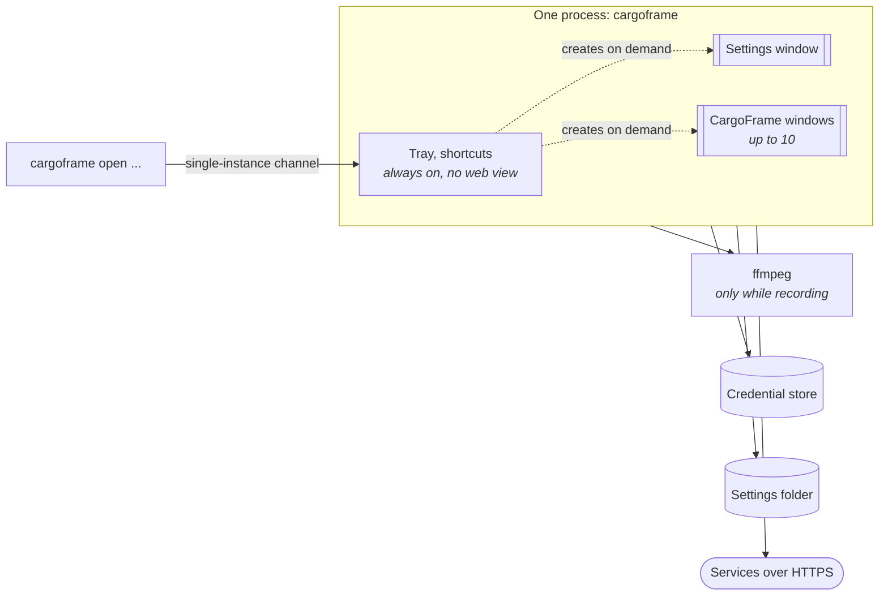
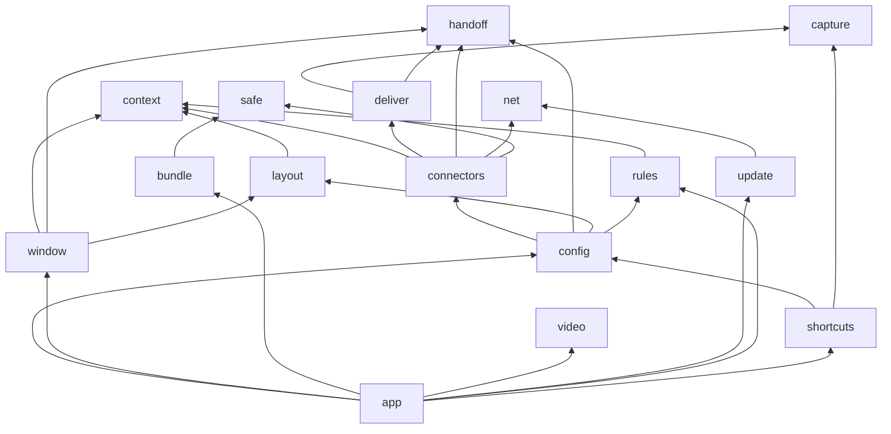

# Development plan

How to make CargoFrame as it is in version 0.2.0: what it must do, the stack, the architecture, each module, the
order to build them in, and the gates every change passes. For what the app is and how it is used, read the
[design](design.md).

**Contents:** [1. Goals](#1-goals) · [2. Stack](#2-stack) · [3. Architecture](#3-architecture) ·
[4. Modules](#4-modules) · [5. Build order](#5-build-order) · [6. Contracts](#6-contracts) ·
[7. Testing and quality gates](#7-testing-and-quality-gates) · [8. CI and release](#8-ci-and-release) ·
[9. Extending it](#9-extending-it) · [10. Next](#10-next)

---

## 1. Goals

### What it must do

| # | Requirement |
|---|-------------|
| F1 | Wait in the tray; run a **trigger** on a global shortcut (or from the tray menu) |
| F2 | Capture the program in focus, the screen, or all screens; or **record** the last seconds when the layout has a Video block |
| F3 | Find the program's **project folder** (same name as the program, else one folder above) |
| F4 | Read values from allowed files there with **data rules** (text line, JSON, YAML, TOML, INI, CSV, XML, regex) |
| F5 | Open a window built from a **layout**: Screenshot (with editor), Video (trim, crop, mark), Text, Dropdown, Files, sharing buttons |
| F6 | Fill dropdowns from the service's API; "where to post" as one path that goes as deep as the service does |
| F7 | Send to Jira, Google, Slack, Discord, Teams, Reddit, Claude, X, Bluesky, Instagram, a custom API, or a local zip |
| F8 | Retry a failed send, then keep a zip, so nothing is lost |
| F9 | Settings window for everything; in-app guides; templates; export, import, reset |
| F10 | Other programs fill a layout through `cargoframe open` |

### How well it must do it

| Quality | Target |
|---------|--------|
| Idle cost | Tray-only process under **40 MB**, about 0% CPU |
| Speed | Capture under **150 ms**; window usable under 250 ms warm, 700 ms cold; each window under **250 KB** of script |
| Safety | No telemetry; secrets only in the system credential store; HTTPS only; nothing sent without a button press |
| Reliability | Every send safe to repeat; every settings file versioned and migrated with a backup |
| Maintenance | One place for each thing; a service change touches one folder; `unsafe` forbidden |
| Companies | Per-user install, no administrator; services removable at build time; system certificates and proxy |
| Accessibility | Keyboard reaches everything, labels everywhere, visible focus, reduced motion, checked contrast |

---

## 2. Stack

| Layer | Choice | Why |
|-------|--------|-----|
| Language | **Rust** stable (MSRV 1.80), edition 2021 | Small memory, no runtime, safe without `unsafe` |
| Shell | **Tauri 2** (tray-icon, global-shortcut, single-instance, autostart, opener, dialog) | Native tray without a web view; windows created only when needed |
| UI | **Svelte 5** + TypeScript, **Vite** | Tiny bundles, two pages (`settings.html`, `capture.html`) |
| UI tests | **vitest** + Testing Library, `svelte-check` | Fast tests against an in-memory backend |
| HTTP | **ureq** behind one `Http` trait | Blocking, small, easy to mock |
| Capture | Win32/GDI (`windows` crate), **x11rb**; on Wayland the desktop portal (**zbus**), `grim`, and the compositor's IPC for the focused window | No large capture libraries |
| Video | **ffmpeg** (external, optional); **wasapi** for Windows sound; on Wayland **GStreamer** (`pipewiresrc`) reads the portal's screen stream | Proven encoder; installed with one button |
| Secrets | **keyring** (Windows Credential Manager, Secret Service) | Never on disk in our files |
| Files | serde JSON, `serde_yaml_ng`, `toml`, `csv`, `roxmltree`, `regex`, `zip` | One crate per format, no custom parsers |
| Installers | **NSIS** (Windows), **AppImage** + `install.sh` (Linux) | Per user, no administrator |
| CI | GitHub Actions | Linux on pull requests, Windows on `main`, installers and releases |

---

## 3. Architecture

### Processes



Windows talk to the Rust side only through **Tauri commands**. Each command is listed in `app/build.rs` and each
window is granted only the commands it needs (`app/capabilities/`).

### Crates



Leaf crates have no CargoFrame dependencies and are built and tested first. `app` is the only crate that knows Tauri.

### Repository

| Path | Contents |
|------|----------|
| `core/*` | 15 library crates, testable without a display |
| `app/` | The program: tray, triggers, commands, sharing, secrets, setup checks, `cargoframe open` |
| `ui/src/settings` | Settings window: pages, layout builder, connections, guides |
| `ui/src/capture` | CargoFrame window: blocks, editor, tick boxes, sharing |
| `ui/src/lib` | IPC (`ipc.ts`, with `memoryApi` for tests and demos), tokens, shared components |
| `installers/` | NSIS script and hooks; AppImage, `install.sh`, `uninstall.sh` |
| `scripts/` | `dev/check.sh` (the gate), `ci/` (budgets, names), `e2e/` (virtual-screen tests), `windows/build.cmd` |
| `assets/brand/` | Logo and icon SVGs |
| `docs/` | Design, this plan, decisions, status, security, performance, connectors |

---

## 4. Modules

| Crate | Job | Main items |
|-------|-----|------------|
| `context` | Climb to the project folder; `{{variable}}` templates; the read allow-list | pure string logic |
| `safe` | What happens on failure: retry with backoff, failure classes, fallback ladder, zip names | `retry`, `FailureKind`, `SendError` |
| `handoff` | Claude chat links, clipboard plan, pinned and recent chats | |
| `capture` | Program in focus and its screenshot, per platform behind a `Backend` trait; Wayland focus, portal screenshot and screen sharing | `capture_with`, `wayland.rs`, `screencast.rs` |
| `video` | Ring of segments, clip edits (trim, crop, mark), the ffmpeg command; Windows loopback sound; a fed picture (Wayland) | `loopback.rs`, `pcm.rs`, `screenfeed.rs` |
| `layout` | Blocks on a 12-column grid, validation chips, templates | `model.rs`, `templates.rs` |
| `rules` | Data rules: read one value from an allowed file | one module per format |
| `window` | Everything the CargoFrame window shows for one capture, as one serializable view | `view::SessionView` |
| `bundle` | The fallback zip and the Files zip, with a manifest | |
| `net` | The one HTTP client: HTTPS only, checked redirects, size cap, multipart; a mock server | `Http`, `Request`, `mock::MockServer` |
| `deliver` | Paste into a chat window after checking it is the right window | |
| `connectors` | One folder per service behind the `Connector` trait; OAuth with PKCE; secret store trait; text converter | `Connector`, `Payload`, `oauth.rs`, `richtext.rs`, `media.rs` |
| `config` | One versioned JSON file per item; checks; migrations with backup | |
| `update` | Check GitHub releases, download, verify SHA-256, run the installer | `check`, `fetch`, `install` |
| `shortcuts` | Wayland: hand each shortcut to the desktop (GNOME settings, sway and Hyprland IPC, the portal's GlobalShortcuts, or a command to copy) | `Route`, `gnome::sync`, `wlroots`, `portal::Portal` |
| `app` | Glue: tray, triggers, sessions, share, commands, secrets, setup checks, clean-up, CLI | `triggers.rs`, `session.rs`, `share.rs`, `cli.rs` |

<details>
<summary><b>The app crate, file by file</b></summary>

| File | Job |
|------|-----|
| `lib.rs` | Start-up: plugins, tray, shortcuts, single instance, `cargoframe open` |
| `tray.rs`, `tray_host.rs` | Tray icon and menu (pause triggers, open settings, quit) |
| `triggers.rs` | Run a trigger: capture or record, build the session, open a window |
| `desktop_keys.rs` | Wayland: hand the shortcuts to the desktop, and say how in Settings |
| `session.rs` | Build the `SessionView`; `records()` (layout has a Video block); apply values from `cargoframe open` |
| `share.rs` | Build the `Payload` from ticked blocks, call the connector, fall back to a zip |
| `commands.rs` | The Tauri commands |
| `items.rs`, `connections.rs`, `registry.rs` | Settings items, connections, connector registry |
| `secrets.rs` | The credential store |
| `video.rs`, `audio.rs` | Recording sessions and sound sources |
| `setup.rs`, `tools.rs` | What is installed (ffmpeg, Claude app, `xdotool`), winget installs |
| `cleanup.rs`, `transfer.rs` | The only code that deletes; export and import |
| `warm.rs`, `windowing.rs`, `timing.rs` | Memory modes, window placement, speed numbers |
| `updates.rs`, `notify.rs`, `logging.rs`, `cli.rs` | Updates, notifications, logs (no content), command line |

</details>

<details>
<summary><b>The UI, folder by folder</b></summary>

| Folder | Job |
|--------|-----|
| `settings/pages` | One component per page: Setup, Connections, Layouts, Triggers, Data from files, Extra fields, Recording, General, Your data, About |
| `settings/layout` | The layout builder: grid, block inspector, sharing routes |
| `settings/connections` | The connection form (a section per service, shown only if the build has it), Discord and Custom API forms, secret inputs |
| `settings/guide` | Data-driven tours (`tours.ts`): `{page, field, sentence}` steps, found by `data-tour` attributes |
| `capture/blocks` | Screenshot, Video (trim strip, crop box, mark layer), Text (formatting), Dropdown (path steps), Files, Sharing |
| `capture/editor` | Picture editor: pen, rectangle, ellipse, text, crop, colour, width |
| `capture/*.ts` | Values, tick boxes, what each button will send, remembered choices |
| `lib/` | `ipc.ts` (real and in-memory API), `tokens.css` (colours), `connectorHelp.ts` (the only "get a token" links) |

</details>

---

## 5. Build order

Each phase ends with something that runs and is tested. A phase only uses what earlier phases built.

```mermaid
flowchart LR
    P1[1 · Foundation] --> P2[2 · Capture]
    P2 --> P3[3 · Context and rules]
    P3 --> P4[4 · Layouts and window]
    P4 --> P5[5 · Network and connectors]
    P5 --> P6[6 · Share and safety]
    P6 --> P7[7 · Settings and guides]
    P7 --> P8[8 · Video]
    P8 --> P9[9 · Installers and updates]
    P9 --> P9b[9b · Wayland]
    P9b --> P10[10 · Company features]
```



| Phase | Build | Done when |
|-------|-------|-----------|
| **1 · Foundation** | Workspace, lints (`unsafe` forbidden, clippy `-D warnings`), `check.sh`, CI on Linux; `config` (versioned files, migration); tray-only `app` with a shortcut | The tray starts, idles under 40 MB, a shortcut logs a press |
| **2 · Capture** | `capture` on Windows, X11 and Wayland (portal or `grim`; focus from sway, Hyprland, KDE or XWayland); the program in focus and its path | A press yields a picture in under 150 ms, checked on a virtual screen |
| **3 · Context and rules** | `context` (folder climb, templates, allow-list), `rules` (each format) | `{{rule.version}}` fills from a real project folder in tests |
| **4 · Layouts and window** | `layout` (grid, validation, templates), `window` (`SessionView`), `capture.html` with all blocks and the picture editor | A press opens the window with picture, texts and files |
| **5 · Network and connectors** | `net` and its mock server; `Connector` trait, `oauth`, secret store; Jira first (densest), then the others | Every connector passes its tests against a mock of its documented API |
| **6 · Share and safety** | `share.rs`, tick boxes, `safe` (retry, fallback), `bundle` (zip), Save locally | A failed send leaves a zip; a repeated send never posts twice |
| **7 · Settings and guides** | `settings.html`: pages in sidebar groups, layout builder, connection forms with get-token buttons, guides, Your data, export and import | A new person goes from empty to first share without editing a file |
| **8 · Video** | `video` (ring of segments, edits, ffmpeg), sound (PulseAudio, WASAPI loopback), the Video block | A layout with a Video block records, trims and sends |
| **9 · Installers and updates** | NSIS one-button installer, AppImage, `update` with SHA-256, release workflow | CI installs, upgrades, uninstalls and clicks the real installer |
| **9b · Wayland** | Compositor focus (sway, Hyprland, KWin script, XWayland), `grim` and portal screenshots, `shortcuts` crate, screen sharing with GStreamer, clipboard hand-over for Claude | The Wayland end-to-end test passes on headless sway |
| **10 · Company features** | Cargo feature per connector and `CF_SERVICES`; `cargoframe open`; system certificates and proxy | A build with only `jira` has no other service's code; a script fills a layout |

---

## 6. Contracts

<details open>
<summary><b>Connector</b> (<code>core/connectors/src/lib.rs</code>)</summary>

```rust
pub trait Connector {
    fn describe(&self) -> Describe;                    // fields, lists, one-line summary
    fn status(&self, ctx: &Ctx) -> Status;            // signed in? (looks only at this computer)
    fn connect(&self, ctx: &Ctx) -> Result<String, SendError>;    // sign in, then test
    fn disconnect(&self, ctx: &Ctx);
    fn test(&self, ctx: &Ctx) -> Result<String, SendError>;       // "Signed in as …"
    fn options(&self, ctx: &Ctx, list: &str) -> Result<Vec<OptionItem>, SendError>;
    fn send(&self, ctx: &Ctx, payload: &Payload) -> Result<SendOutcome, SendError>;
}
```

- `send` must be **safe to call again**: what an attempt already did is recorded in `ctx.progress` (an uploaded
  picture is not uploaded twice; a post that may have gone through is never sent again).
- Errors are `SendError` with a `FailureKind` (timeout, auth expired, rejected…) and a sentence for the person.
- Pictures are fitted to each service's size limit (`media.rs`); formatting is converted per service (`richtext.rs`).

</details>

<details>
<summary><b>Payload</b>: what a sharing button hands to a connector</summary>

| Field | Holds |
|-------|-------|
| `title` | Window title, a default subject |
| `image` | The edited screenshot, or the recording |
| `still` | A screenshot that goes with a recording |
| `files_zip` | The ticked project files, zipped |
| `prompt` | The prompt, for services that use one |
| `fields` | Mapped block values, in layout order |
| `vars` | Every variable of the capture (`app.title`, `rule.version`…) |

</details>

<details>
<summary><b>Settings files</b></summary>

One JSON file per item, each with `schema_version`, checked when read and migrated with a backup:
`general.json`, `safe.json`, `video.json`, `triggers/`, `connections/`, `rules/`, `infotypes/`, `layouts/`.
Secrets go only to the credential store, keyed by connection. The web view never reads files directly.

</details>

<details>
<summary><b>Commands and windows</b></summary>

About 65 Tauri commands (`app/build.rs`). `ui/src/lib/ipc.ts` has one `Api` type with two implementations: the real
one (Tauri `invoke`) and `memoryApi` (in memory, for tests and the browser demos `?demo=…`). A test
(`shipped_config_tests`) fails if a command is not registered, not listed, or not granted to a window.

</details>

<details>
<summary><b>Command line</b>: <code>cargoframe open</code></summary>

`cargoframe open --trigger <id> --set <block>=<text> …` is passed to the running copy through the single-instance
plugin (same user, no network port). It runs the trigger and fills text and dropdown blocks of a layout whose
`accepts_input` is true. At most 50 values of 20,000 characters each; logs record counts only; nothing is sent until
the person presses a button.

</details>

<details>
<summary><b>Build features</b></summary>

`core/connectors` and `app` have one Cargo feature per service (`jira google reddit claude slack discord teams custom
x bluesky instagram`, all on by default). `cargoframe_connectors::available(kind)` tells the UI which forms, templates
and guides to show. `scripts\windows\build.cmd` turns `CF_SERVICES=jira,teams` into
`--no-default-features --features jira,teams`.

</details>

---

## 7. Testing and quality gates

One command runs the local gate. Run it before every push; GitHub minutes are spent in batches.

```sh
CARGO_INCREMENTAL=0 scripts/dev/check.sh quick   # fmt, clippy, cargo test, file names, svelte-check, vitest
CARGO_INCREMENTAL=0 scripts/dev/check.sh all     # + UI build, size budgets, release build, end-to-end capture on Xvfb
```

| Layer | How it is tested |
|-------|------------------|
| Logic crates | Unit and integration tests; side effects behind traits (files, secrets, network, clock) |
| Connectors | Against `MockServer` following each service's documented API: sign-in, lists, send, retries, "never twice" |
| UI | vitest on `memoryApi`; whole windows rendered (`App.test.ts`) including recording and demo variants |
| Guides | `tours.test.ts` (every field exists), `walk.test.ts` (every step can be walked) |
| Whole program | A fake program on a virtual X11 screen is captured by the real binary (`scripts/e2e/linux-capture.sh`); on a headless sway desktop with the portal, the shortcut, focus and capture of a Wayland and an XWayland program (`scripts/e2e/wayland-capture.sh`) |
| Budgets | Idle memory and CPU, capture and window times, script size per window (`scripts/ci/check-budgets.mjs`) |
| Installers | Windows: silent install, upgrade, uninstall, and a click on the real installer window; Linux: AppImage install and run |
| Security | `cargo audit` and `npm audit` on a schedule (`security.yml`) |

<details>
<summary><b>Budgets enforced</b> (+20% margin; CI timings doubled with <code>CARGOFRAME_PERF_SCALE=2</code>)</summary>

| What | Budget |
|------|--------|
| Tray-only memory | under 40 MB |
| Idle CPU | about 0% (≤ 2% over 10 s) |
| Shortcut to picture (4K) | under 150 ms |
| Crop of a 4K picture | under 20 ms |
| Usable window | under 250 ms warm, 700 ms cold |
| Settings window, cold | under 500 ms |
| Script per window | 250 KB gzip |

</details>

<details>
<summary><b>Security checklist for every change</b></summary>

- No secret in a settings file, a log, an error message or a URL.
- Files are read only inside the project folder and only where a rule allows.
- Requests go through `core/net` only: HTTPS, checked redirects, size cap.
- Text from a screen, a file or another program never reaches a command line.
- A new command is listed in `app/build.rs` and granted only to the window that needs it.
- Deletions go through `app/src/cleanup.rs`, inside CargoFrame's own folders only.
- Nothing is sent without the person pressing a button.

</details>

---

## 8. CI and release

| Workflow | Runs on | Does |
|----------|---------|------|
| `ci.yml` | Pull requests (Linux); `main` (Linux and Windows) | The gate: UI and Rust, budgets, end-to-end capture |
| `bundle.yml` | `main`, by hand | Windows installer (install, upgrade, uninstall, click test); Linux AppImage |
| `release.yml` | Tag `v*`, by hand | Check, build both platforms, `SHA256SUMS.txt`, a **draft** release |
| `security.yml` | Pushes, pull requests, weekly (Monday) | `cargo audit`, `npm audit` |

**Release:** set the version in `Cargo.toml` (workspace) and `ui/package.json`, merge to `main`, tag `vX.Y.Z`, check
the draft, publish. The app's update check reads the newest release and installs only an installer whose SHA-256 is
listed. Branches merge with a **merge commit**.

---

## 9. Extending it

<details>
<summary><b>Add a service</b></summary>

1. `core/connectors/src/<service>/mod.rs` implementing `Connector`, and `tests.rs` against `MockServer`.
2. Its settings in `model.rs`, a `Kind`, and a Cargo feature in `core/connectors` and `app`.
3. Its kind and settings in `ui/src/lib/types.ts` and `connector.ts`, its fields in `ConnectionForm.svelte` (with
   `tour` names), its get-token links in `ui/src/lib/connectorHelp.ts`, its colour in `tokens.css`.
4. A template in `core/layout/src/templates.rs` and a guide in `ui/src/settings/guide/tours.ts`.
5. A row in the design's service table and in the README.

</details>

<details>
<summary><b>Add a block type, a setting, or a data-rule format</b></summary>

- **Block:** the model and its checks in `core/layout`, its state in `core/window`, a component in `ui/src/capture/blocks`,
  an inspector in the layout builder, and what each connector does with it in `share.rs`.
- **Setting:** the field in `core/config` with a default (older files keep working), the control on one page only,
  and a guide step if it is not obvious.
- **Rule format:** a module in `core/rules` with tests, and its option in the *Data from files* page.

</details>

---

## 10. Next

| Item | Why |
|------|-----|
| Managed settings folder and `policy.json` | Set up thousands of computers at once, with locked items |
| Fold Extra fields into the layout (*required*, *if empty, use*) | One place to set a service field |
| Required fields from the service shown before sending (Jira first) | No "field is required" error after pressing the button |
| Company sign-in: Jira OAuth, generic OAuth 2.0 for Custom API | No personal tokens in large companies |
| Video for X, Bluesky, Instagram; Teams files through OneDrive | Recordings everywhere |
| `cargoframe open` for files and recording layouts | Other programs hand over more than text |
| Signed installer; a run on real PCs and accounts | Trust and verification |

Per-service proposals: [connectors.md](connectors.md).
