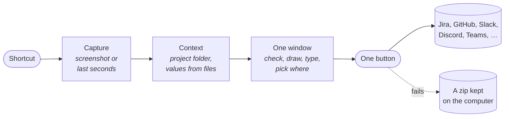
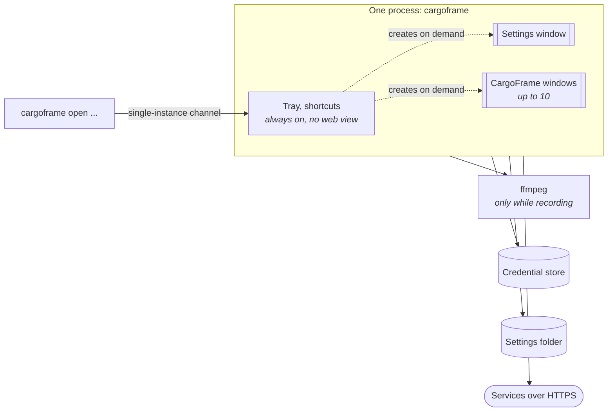
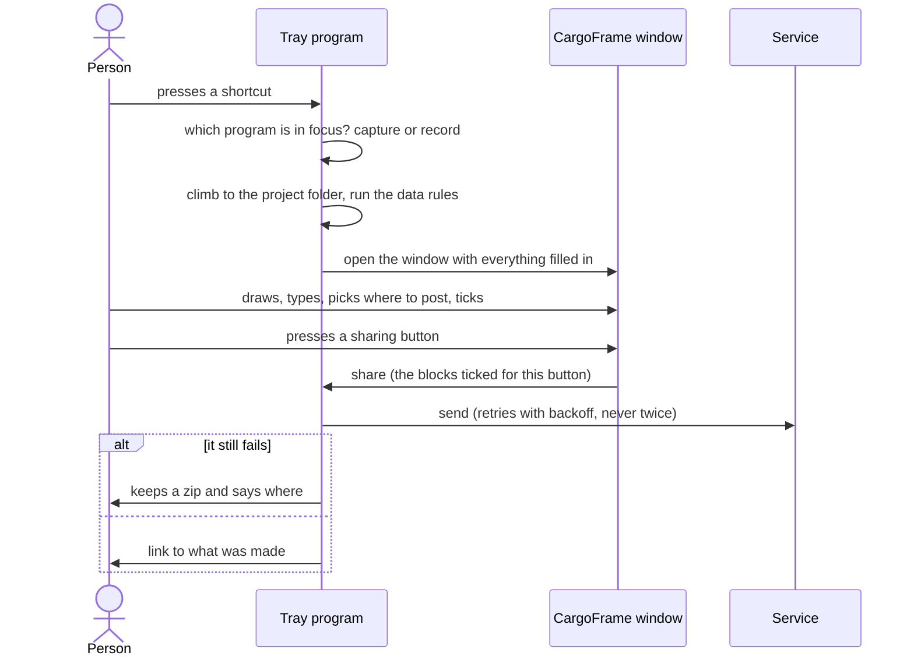
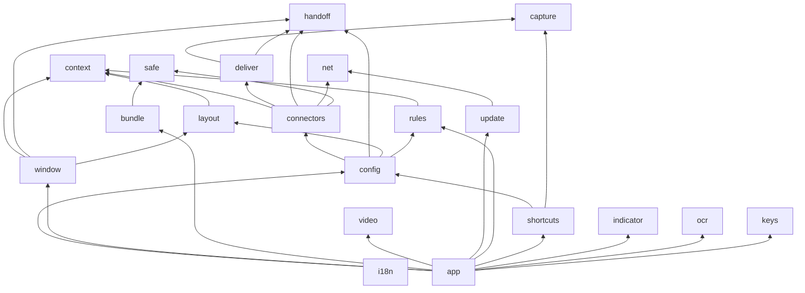
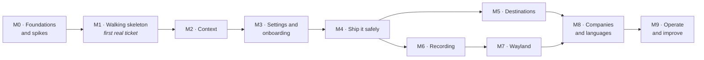

# Development plan

How to build a tool like CargoFrame from an empty repository, in the order a careful team would choose: what to
build first, why, how to know each step is done, and what it costs. It is written for an AI agent or an engineering
team that wants to make a similar tool (a tray program that captures what is on screen, gathers the context around it
and sends it to a service with one button). It describes the **end state of CargoFrame 0.7.3** as the target, but
not the path its versions took; that history is in the [changelog](changelog.md) and [decisions](decisions.md).

What the finished tool is and how people use it: [design](design.md). How to change it (remove a service, plug it
into another tool, add a sign-in, hide values, restyle it): [customizing](customizing.md).

**Contents:** [1. The target](#1-the-target) · [2. Principles](#2-principles) · [3. Requirements](#3-requirements) ·
[4. Decisions to make first](#4-decisions-to-make-first) · [5. Architecture](#5-architecture) ·
[6. Roadmap](#6-roadmap-in-order-of-priority) · [7. Modules](#7-modules) · [8. Contracts](#8-contracts) ·
[9. Quality](#9-quality-tests-gates-budgets) · [10. CI and release](#10-ci-and-release) · [11. Metrics](#11-metrics) ·
[12. Risks](#12-risks) · [13. Team and effort](#13-team-and-effort) · [14. Working with an AI agent](#14-working-with-an-ai-agent) ·
[15. Backlog](#15-backlog)

---

## 1. The target

One shortcut, anywhere on the computer, turns "something is wrong in this program" into a complete report in the
right place: the picture or the last seconds of video, the program's project folder, the values read from its logs,
the files that matter, and a ticket, a message or a post made with one button.



### Size of the finished tool

| Measure | CargoFrame 0.7.3 |
|---------|------------------|
| Platforms | Windows 11; Linux on X11 and Wayland (GNOME, KDE, sway, Hyprland) |
| Destinations | 12 services and a local zip: Jira, GitHub, Google, Slack, Discord, Teams, Reddit, Claude, X, Bluesky, Instagram, any HTTPS API |
| Languages | English, French, Spanish, Italian, German (about 1,800 window texts and 1,300 program texts) |
| Rust | 20 crates, about 77,000 lines, 1,128 tests |
| Windows (UI) | Svelte 5 and TypeScript, about 23,000 lines, 651 tests, 2 pages |
| Interface between them | 86 commands, each granted only to the window that needs it |
| Budgets enforced in CI | Idle under 40 MB; picture under 150 ms; window usable under 250 ms warm; 250 KB of script per window |
| Releases | Signed-ready per-user installers (NSIS, AppImage), SHA-256 checked updates |
| License | MIT OR Apache-2.0 |

---

## 2. Principles

These hold from the first commit. Each one is cheap to keep from the start and expensive to add later.

| # | Principle | In practice | Why first |
|---|-----------|-------------|-----------|
| P1 | **Cheap while idle** | The process that waits has no web view; windows are made when needed and let go by a memory mode | A tray tool that costs memory gets uninstalled; retrofitting it means re-architecting |
| P2 | **Nothing leaves without a press** | No telemetry; every send starts from a button the person pressed | Trust; and the whole security review rests on it |
| P3 | **Secrets in the system's store** | Windows Credential Manager, Secret Service; never in a settings file, a log or a URL | Moving secrets later means migrating every user |
| P4 | **Every send is safe to repeat** | What an attempt already did is recorded; a retry never posts twice | Retries and the fallback zip depend on it |
| P5 | **Testable without a screen** | Side effects (files, network, secrets, clock, capture) behind traits; logic in crates that know nothing of the UI | CI has no desktop; 90% of the bugs are logic |
| P6 | **One place for each thing** | One HTTP client, one list of templates, one file per setting, one folder per service | A service's API change touches one folder |
| P7 | **Translated from the first text** | Every text goes through `t()`/`msg!` and a check fails on an unmarked one | Marking 3,000 texts at the end costs weeks |
| P8 | **Easy without the docs** | Every setup step has a button, a link or a guide; nothing is edited by hand | The audience reports bugs, it does not read manuals |

---

## 3. Requirements

### Features, by priority

**Must** is the first useful version (it replaces "screenshot, paste, type the details by hand"); **Should** makes it
the tool people keep; **Could** widens who can use it.

| # | Feature | Priority | Milestone |
|---|---------|----------|-----------|
| F1 | Wait in the tray; a **shortcut** (or the tray menu) opens a layout | Must | M1 |
| F2 | **Screenshot** of the program in focus, the screen under the mouse or all screens | Must | M1 |
| F3 | Find the program's **project folder** (a folder with the program's name, else one above) | Must | M2 |
| F4 | One **window** built from a layout: picture with editor, text, dropdowns, files | Must | M1, M2 |
| F5 | **Send** to Jira (create an issue with the picture and files) | Must | M1 |
| F6 | **Never lose a capture**: retry, then keep a zip | Must | M1 |
| F7 | **Values read from files**: select a value once in a log, found again in every capture | Should | M2 |
| F8 | **Settings without files**: connections, layout builder, shortcuts, data rules, guides, tour | Should | M3 |
| F9 | Installers per user, **updates** checked against a published checksum | Should | M4 |
| F10 | More **destinations**: GitHub, Slack, Discord, Teams, Google, Reddit, Claude, X, Bluesky, Instagram, any API | Should | M5 |
| F11 | **Update an existing issue** (each field: replace, add below, add to the list, count up), comment, vote | Should | M5 |
| F12 | Lists from the service (projects, people searched as one types, "where to post" as one path); **required fields** named before sending | Should | M5 |
| F13 | **Recording**: the last seconds, trimmed, cropped, marked; sound; a visible sign while recording; continuous recording | Should | M6 |
| F14 | **Log viewer**: lines by words and by time, following the clip as it plays | Could | M6 |
| F15 | **Wayland** desktops | Could | M7 |
| F16 | **Companies**: builds without unused services, other programs fill a layout (`cargoframe open`), system certificates and proxy | Could | M8 |
| F17 | **Five languages** | Could | M8 |
| F18 | **Debug mode**: the tool reports its own bugs, *Check this PC* | Could | M9 |

### Qualities, with numbers

| Quality | Target | How it is checked |
|---------|--------|-------------------|
| Idle memory | Tray-only process under **40 MB** | CI measures the real binary on Linux and Windows |
| Idle CPU | About **0%** (≤ 2% over 10 s) | CI |
| Shortcut to picture | Under **150 ms** on a 4K screen | Timing test, release build |
| Window usable | Under **250 ms** warm, **700 ms** cold; Settings cold under **500 ms** | The windows report when they have painted |
| Script per window | Under **250 KB** gzip | Size budget on every build |
| Recording cost | Graphics-card capture and a hardware encoder when they work on this PC; several screens at about the main screen's size, at most 4K | A test picture tries each encoder; `fit_filter` tests |
| Reliability | Every send safe to repeat; every settings file versioned and migrated with a backup | Connector tests "never twice"; migration tests |
| Security | HTTPS only, checked redirects, size caps; files read only where a rule allows; no text reaches a command line | Security review and its regression tests |
| Accessibility | Keyboard reaches everything; labels, visible focus, reduced motion, checked contrast | Component tests; overflow check in light and dark |
| Install | Per user, no administrator, under a minute | Installer tests in CI |

---

## 4. Decisions to make first

Settle these before the first line of product code: each is hard to change later.

| Decision | Chosen | Considered | Why |
|----------|--------|-----------|-----|
| Desktop shell | **Tauri 2** (Rust, the system's web view) | Electron; native toolkits (Qt, WinUI + GTK) | A tray with no web view costs a few MB; windows are web pages, quick to build; one codebase for Windows and Linux |
| Language of the logic | **Rust** stable (at least 1.90), `unsafe` forbidden outside platform calls | C#, Go, TypeScript in Electron | Small memory, no runtime, the same code tested on both systems |
| Windows' UI | **Svelte 5** + TypeScript + Vite | React, Vue | Smallest bundles (P1: 250 KB budget), simple reactive state |
| Capture | Win32 (desktop copy, Desktop Duplication), **x11rb**, Wayland portal and compositor IPC | A cross-platform capture crate | Menus and tooltips in the picture; the program in focus known exactly |
| Video | **ffmpeg** as a separate program, downloaded with one button | Encoding in-process | Proven encoders and hardware support; nothing to ship under GPL |
| Network | One blocking client (`ureq`) behind an `Http` trait | `reqwest` + async | Simple to mock; each send runs off the UI thread anyway |
| Secrets | `keyring` | Encrypted file | The system's store is what security reviews expect |
| Settings | One versioned JSON file per item | One big file; SQLite | Exportable, diffable, a broken file breaks one item |
| Languages | Own `t()`/`msg!`, English text as the key, packs embedded | Fluent, i18next | No runtime library, a script finds every text in both codebases |
| Types between Rust and the windows | Generated from Rust by **ts-rs** (test-only) | `specta` (still a release candidate), hand-written | A changed field cannot go unnoticed; nothing added to the program |
| License | **MIT OR Apache-2.0** | MPL, GPL | What the Rust ecosystem uses; credit is the only condition |

---

## 5. Architecture

### One process, windows on demand



The windows talk to Rust only through **commands**. Each command is listed in `app/build.rs`, and each window is
granted only the commands it needs (`app/capabilities/`).

### One press, end to end



### Crates

Leaf crates know nothing of CargoFrame's other crates and are built and tested first; `app` is the only crate that
knows Tauri.



### Repository

| Path | Holds |
|------|-------|
| `core/*` | 19 library crates, testable without a display |
| `app/` | The program: tray, shortcuts, commands, sharing, secrets, setup checks, `cargoframe open` |
| `ui/src/settings` | The Settings window: pages, layout builder, connections, guides, search |
| `ui/src/capture` | The CargoFrame window: blocks, picture editor, sharing dots, what each button sends |
| `ui/src/lib` | The interface to Rust (`ipc.ts`), the in-memory backend for tests and demos (`memoryApi.ts`), shared components, colours, languages, the types generated from Rust (`generated/`) |
| `installers/` | NSIS script and hooks; `install.sh`, `uninstall.sh` and the tests of both |
| `scripts/` | `dev/check.sh` (the gate), `ci/` (budgets, file names, generated types), `e2e/` (virtual screens), `i18n/`, `licenses/`, `windows/build.cmd` |
| `assets/brand/` | The logo and icon drawings |
| `docs/` | Design, this plan, customizing, decisions, status, security, performance, connectors, languages, signing |

---

## 6. Roadmap, in order of priority

The order follows one rule: **each milestone ends with something a person can use**, and it only builds on what is
already proven. The riskiest unknowns (capture on each system, the installer, the first real service) come first;
breadth (more services, more systems, more languages) comes once the core is right.

```mermaid
gantt
    title Two engineers, weeks from the start (estimate)
    dateFormat X
    axisFormat %s
    section Core
    M0 Foundations and spikes     :m0, 0, 2
    M1 Walking skeleton           :m1, after m0, 3
    M2 Context                    :m2, after m1, 2
    M3 Settings and onboarding    :m3, after m2, 3
    M4 Ship it safely             :m4, after m3, 2
    section Breadth
    M5 Destinations               :m5, after m4, 4
    M6 Recording                  :m6, after m4, 4
    M7 Wayland                    :m7, after m6, 2
    M8 Companies and languages    :m8, after m5, 2
    section Quality
    M9 Operate and improve        :m9, after m8, 2
```





### Overview

| Milestone | Goal | Ends with | Effort (person-weeks, estimate) |
|-----------|------|-----------|-------------------------------|
| M0 | Answer the unknowns; set up the rails | Spikes answered; empty tray app passes the gate in CI | 3–4 |
| M1 | The smallest useful loop | A shortcut makes a real Jira ticket with the picture | 5–6 |
| M2 | The context that makes reports useful | The ticket holds the build number read from the program's log | 3–4 |
| M3 | Usable without editing a file | A new person reaches a first share in under 5 minutes | 5–6 |
| M4 | Safe to hand to others | Signed-ready installers, updates, security review | 3–4 |
| M5 | Every common destination | 12 services, issues created or updated, required fields named | 7–8 |
| M6 | Video | The last seconds recorded, trimmed and sent, cheaply | 7–8 |
| M7 | Wayland | Shortcut, focus and capture on GNOME, KDE, sway, Hyprland | 3–4 |
| M8 | Large organisations and other languages | Builds without unused services; other programs fill a layout; 5 languages | 3–4 |
| M9 | Run it and keep it healthy | Debug mode, overflow check, generated types, open source | 3–4 |
| | | **Total** | **42–52** |

### M0 · Foundations and spikes

**Why first:** every later milestone stands on the gate, the settings files and the language mechanism; and a
wrong answer to one spike (a capture that misses menus, an installer that needs an administrator) changes the plan.

| Build | Details |
|-------|---------|
| Workspace and lints | Cargo workspace; `unsafe_code = forbid`; clippy `-D warnings`; rustfmt; Svelte + Vite + vitest + `svelte-check` |
| The gate | `scripts/dev/check.sh quick` (format, lints, tests, type check) and `all` (+ build, budgets, end to end); run before every push |
| CI | GitHub Actions: Linux on pull requests; Linux and Windows on `main`, or on demand for a branch |
| `config` | One versioned JSON file per item (`schema_version`), checked when read, migrated with a backup |
| `i18n` | `t`, `tf`, `msg!` (Rust) and `t`, `tn`, `msg`, `Tr` (UI); English as the key; `scripts/i18n/check.mjs` fails on an unmarked or missing text |
| Tray skeleton | A tray-only process, one shortcut that writes to the log |

**Spikes**, each a day or two on a real machine, each changing a named setting if the answer differs:

| # | Question | Needs |
|---|----------|-------|
| S1 | Does the per-user installer install without an administrator, and upgrade in place? | A Windows 11 VM, a standard user |
| S2 | Can a click on a notification open the Settings window? | Windows 11, GNOME, KDE |
| S3 | Do global shortcuts and capture work on Wayland? | GNOME and KDE on Wayland |
| S4 | Does the tray icon show on GNOME and KDE? | Both desktops |
| S5 | How does Claude open from a link, and what does its composer do with a pasted picture? | The Claude app on Windows; Linux |
| S6 | Are the budgets reachable on a modest PC? | One reference machine |
| S7 | Is the name free (trademarks, other software), and does it borrow someone's mark? | Trademark databases (TMview, INPI, EUIPO) |
| S8 | What does recording cost, and which capture and encoder should be the default? | Windows and Linux, ffmpeg |

**Done when:** the tray starts and idles under 40 MB in CI; a text left unmarked fails the gate; every spike has an
answer written down.

### M1 · Walking skeleton: the first real ticket

**Why now:** it proves the whole chain on one platform and one service, so every later milestone is "more of the
same", not "will it work at all".

| Build | Details |
|-------|---------|
| `capture` | Windows (a copy of the desktop, so menus are in the picture) and X11: the program in focus, its path, its window; the screen under the mouse when nothing has the focus |
| `layout` | Blocks on a grid of 12 columns; checks with chips (overlap, missing connection) |
| `window` | Everything the window shows for one capture as one serializable view (`SessionView`) |
| `capture.html` | Screenshot (with a pen, shapes, text, crop), Text, a sharing button |
| `net` | One HTTP client: HTTPS only, checked redirects, a size cap, multipart; a mock server for tests |
| `connectors` | The `Connector` trait, the secret store, **Jira** (the densest service: if it fits, the others will) |
| `safe` and `bundle` | Retry with backoff, failure kinds, a zip of everything in a safe folder when it still fails |
| `share.rs` | One `Payload` from the window, handed to the connector |

**Done when:** a shortcut on a real Windows PC makes a Jira issue with the picture; with the network off, a zip is
kept and the window says where; a repeated send never makes two issues.

### M2 · Context

**Why now:** this is what makes the tool more than a screenshot tool; the earlier it reaches users, the earlier
their logs shape it.

| Build | Details |
|-------|---------|
| `context` | Climb the program's path to its project folder; templates `{name}`; files read only inside the folder where a rule allows |
| `rules` | A data rule: if a file is found (the newest, or all), add it to the files and read values. **A value is made by selecting it in a file**: in the lines with a label, after it or from the start of the line, up to a sign or the end; found again in every capture. Values made of parts, and values made from other values, with choices. JSON, YAML, TOML, INI and XML read by key |
| Values CargoFrame fills | The capture's (`app.exe`, `capture.date`…), the project's, the computer's (`system.os`, `system.gpu_driver`…) |
| Blocks | Files (the folder's files, patterns ticked in advance, files added by hand), Dropdown, Tags |
| Templates | A ready-made layout per service |

**Done when:** a value selected in one log is read from the next one; the ticket's text holds `{version}` and
`{system.gpu_driver}` filled in; the same value cases run in Rust and in the window (`pick_cases.json`).

### M3 · Settings and onboarding

**Why now:** until here a developer edits JSON; after this, anyone can set it up, and real users arrive.

| Build | Details |
|-------|---------|
| `settings.html` | Pages in three groups, each with an icon: Connections; Layouts, Shortcuts, Data parsing, Recording; Preferences, Files & backup, System |
| Layout builder | Drag blocks on the grid (12 to 24 columns); copy, paste, duplicate; properties beside it; what each sharing button sends and the blocks it waits for; a warning for a block no button sends |
| Connections | A form per service with its "get a token" links, a test, the status |
| Shortcuts | Any keys: modifiers with up to three others, named by their place on the keyboard |
| Data parsing | Select a value in a file; see what each file gives; values made from other values |
| Guides and tour | Data-driven steps (`{page, field, sentence}`), a tour that starts after an install or an update; every step walked by a test |
| Search | Every setting found by its words, checked against the pages' code |
| Export, import, reset | Items picked, the shortcuts they leave without a layout named |

**Done when:** a person who never saw the tool goes from install to a first share in under 5 minutes, without
reading a document; every guide step exists and can be walked.

### M4 · Ship it safely

**Why now:** before more people install it, the install, the updates and the security must be right; they are the
parts that cannot be fixed by an update if they are wrong.

| Build | Details |
|-------|---------|
| Installers | NSIS per user, one button, upgrade in place, uninstall that asks about settings; AppImage and `install.sh` |
| `update` | Check the newest release; download; compare SHA-256 with `SHA256SUMS.txt`; run the installer only then |
| Release workflow | On a tag: build both platforms, checksums, a **draft** release a person publishes |
| Signing | Ready for a certificate (`scripts/windows/sign.ps1`) |
| Security review | Secrets, network, files, command lines, logs, deletions; each finding a regression test |
| Budgets in CI | Memory, CPU, timings, script size |
| Licenses | `LICENSE-*`, `NOTICE`, third-party licenses in the installers |

**Done when:** CI installs, upgrades, uninstalls and clicks the real installer; a tampered download is refused; the
security checklist holds for every command.

### M5 · Destinations

**Why now:** the core is proven; each service is now a folder of its own, following the Jira pattern.

| Build | Details |
|-------|---------|
| Services | GitHub (pictures in a branch: its API cannot attach), Slack, Discord (webhooks, bot, forum posts, threads), Teams (OAuth with PKCE), Google (Drive, Sheets), Reddit, Claude (opens a chat and pastes), X, Bluesky, Instagram, any HTTPS API |
| Text per service | Bold, code, quotes, lists, tables written each service's way (Jira wiki, HTML, mrkdwn, Markdown); pictures and the recording placed in the text |
| Lists | Projects, issue types, labels; long lists searched as one types (people, teams); "where to post" as one path (server, category, channel, thread) |
| Issues | Create or update: each field replaced, added below, added to a list or counted up; a comment; a vote |
| Required fields | Jira's create metadata read for the project and issue type picked; a required field nobody sends named before sending |
| Sizes | Pictures fitted to each service's limit |

**Done when:** every connector passes its tests against a mock of its documented API (sign-in, lists, send, retry,
never twice); Jira and GitHub are tried with real accounts.

### M6 · Recording

**Why now:** a bug that happens over time needs a video; it is the largest feature, built on a proven share.

| Build | Details |
|-------|---------|
| `video` | ffmpeg into a ring of short segments, so the last seconds are kept; downloaded and updated from System, checked against its checksums |
| Cost | Desktop Duplication then GDI; a hardware encoder tried on a test picture, then x264; ffmpeg below normal priority; one scale filter; a fall back when ffmpeg refuses at once |
| Sound | PulseAudio's monitor; WASAPI loopback (everything, or only the program in focus) |
| The sign | A red outline and a blinking dot drawn by the system (`indicator`), left out of the recording |
| Edits | Trim, crop (following a window that moved), marks, the keys pressed and the time laid over the sent clip |
| Continuous | Hold a shortcut to record all the time; each press hands out the last seconds |
| Log viewer | Lines by words; by time read from each line (the format worked out from one time the person selects); the lines following the clip as it plays |

**Done when:** a layout with a Video block records, trims and sends; a PC whose graphics card refuses records with
GDI and software; recording three screens stays within what encoders accept.

### M7 · Wayland

**Why now:** a share of Linux users, and the system that breaks the most assumptions; done once the X11 and Windows
paths are solid.

| Build | Details |
|-------|---------|
| Focus | sway and Hyprland IPC, a KWin script, XWayland programs elsewhere |
| Capture | `grim`, else the desktop portal; screen sharing read by GStreamer and made smaller before ffmpeg |
| Shortcuts | `shortcuts` crate: GNOME custom shortcuts, sway and Hyprland IPC, the portal's GlobalShortcuts, or a command to copy |
| Claude | The message left on the clipboard where no program may press keys |

**Done when:** the Wayland end-to-end test passes on a headless sway desktop; GNOME and KDE tried by hand.

### M8 · Companies and languages

**Why now:** with the product complete, widen who can adopt it.

| Build | Details |
|-------|---------|
| Builds per company | One Cargo feature per service; `CF_SERVICES=jira,teams` builds a program without the others' code, forms, templates or guides |
| Other programs | `cargoframe open --trigger <id> --set <block>=<text> --file <path>` fills a layout that accepts it, through the single-instance channel (no network port) |
| Networks | The system's certificates and proxy |
| Languages | French, Spanish, Italian, German packs for both codebases, with a glossary; the computer's language by default |

**Done when:** a build with only `jira` contains no other service; a script fills a layout; every page is looked at
in each language and the check passes.

### M9 · Operate and improve

**Why now:** once people use it daily, bugs come from their PCs; the tool should report on itself and the codebase
should resist drift.

| Build | Details |
|-------|---------|
| Debug mode | A capture of the tool's own window fills where it was (page, tab, section, focus, guide) and attaches its layout, rules, settings and log; one button sets up the bug report |
| *Check this PC* | The real screenshot, a 3-second recording, the apps, the sign-in entry, the credential store and the shortcuts tried on the PC; the report goes with the next bug report |
| Overflow check | Chrome opens every page, small and large, light and dark, and fails on anything outside its box |
| Generated types | `ts-rs` writes the window's types and default settings from Rust; CI fails on drift |
| Logs | Key steps with their time, errors, a panic's backtrace; never content |
| Open source | License, notice, trademark policy, contribution terms |

**Done when:** a bug report from a user's PC holds enough to reproduce it without a call; CI fails when a Rust type
changes without its copy.

---

## 7. Modules

| Crate | Job | Main items |
|-------|-----|------------|
| `context` | Climb to the project folder; `{name}` and `{{name}}` templates; the read allow-list | `climb.rs`, `template.rs` |
| `safe` | Failure kinds, retry with backoff, the fallback ladder, zip names | `retry`, `FailureKind`, `SendError` |
| `handoff` | Claude chat links, clipboard plan, pinned and recent chats | |
| `capture` | The program in focus and its screenshot per platform behind a `Backend` trait; window places; the screens; Wayland focus, portal screenshot, screen sharing; the computer's details | `capture_with`, `screens`, `wayland.rs`, `screencast.rs`, `system.rs` |
| `video` | The ring of segments, clip edits, the ffmpeg command (`fit_filter`, each encoder's arguments, a test picture), Windows loopback sound, a fed picture for Wayland | `recorder.rs`, `segments.rs`, `export.rs`, `loopback.rs` |
| `keys` | The keys pressed while recording; shortcuts the system library cannot take, watched every 25 ms while one exists | `Tracker`, `combo.rs` |
| `indicator` | The recording sign as native windows (Win32, X11 shape) | `geometry.rs`, `win.rs`, `x11.rs` |
| `ocr` | Read text in part of a picture (`Windows.Media.Ocr`, `tesseract`), the picture prepared three ways | `read`, `prepare.rs` |
| `layout` | Blocks on a grid, checks, templates, Tabs, tags (`split_tags`), what each button reaches (`reach`), update modes, required blocks | `model.rs`, `validate.rs`, `reach.rs`, `templates.rs` |
| `rules` | Data rules: find files, read values (`Find::Pick`, formats by key), combine values | `find.rs`, `combine.rs` |
| `window` | The view of one capture; the values CargoFrame fills | `view.rs`, `vars.rs` |
| `bundle` | The fallback zip and the Files zip, with a manifest | |
| `net` | The one HTTP client and its mock server | `Http`, `Request`, `mock::MockServer` |
| `deliver` | Paste into a chat window after checking it is the right one | |
| `connectors` | One folder per service behind `Connector`; OAuth with PKCE; text per service; pictures fitted and placed | `lib.rs`, `oauth.rs`, `richtext.rs`, `media.rs`, `payload.rs` |
| `config` | The settings files, their checks and migrations | `models.rs`, `store.rs` |
| `update` | Releases, download, SHA-256, installer; also fetches ffmpeg | `check`, `fetch`, `install` |
| `shortcuts` | Hand each shortcut to a Wayland desktop | `Route`, `gnome`, `wlroots`, `portal` |
| `i18n` | The language in use and the embedded packs | `t`, `tf`, `msg!` |
| `app` | The program: tray, shortcuts, sessions, share, commands, secrets, setup, clean-up, updates, debug mode, logs | see below |

<details>
<summary><b>The app crate, file by file</b></summary>

| File | Job |
|------|-----|
| `lib.rs`, `cli.rs` | Start-up, plugins, the single instance and what a second launch means; the command line |
| `tray.rs`, `tray_host.rs`, `notify.rs` | Tray icon and menu; notifications |
| `triggers.rs`, `hold.rs`, `desktop_keys.rs` | Run a shortcut (capture or record, build the session, open a window); a held shortcut; Wayland's shortcuts |
| `watch.rs` | While recording: the sign, the program in focus over time, a moving window, the keys pressed |
| `session.rs` | Build the `SessionView`; apply values from `cargoframe open` |
| `share.rs` | The blocks a button waits for, the `Payload`, the connector, the zip |
| `commands.rs` | The commands the windows call |
| `items.rs`, `connections.rs`, `registry.rs`, `secrets.rs` | Settings items, connections, the connector registry, the credential store |
| `video.rs`, `audio.rs`, `ffmpeg_get.rs` | Recording sessions, sound sources, what ffmpeg can do, ffmpeg downloaded |
| `setup.rs`, `tools.rs`, `sysinfo.rs` | What is installed, winget installs, the tour; data-rule tools; the computer's details |
| `cleanup.rs`, `transfer.rs` | The only code that deletes; export and import |
| `warm.rs`, `windowing.rs`, `timing.rs` | Memory modes, windows, speed numbers |
| `updates.rs`, `autostart.rs`, `logging.rs` | Updates; starting at sign-in; the log |
| `debug.rs`, `pc_check.rs` | Debug mode; *Check this PC* |
| `state.rs` | What the program holds while it runs |

</details>

<details>
<summary><b>The windows, folder by folder</b></summary>

| Folder | Job |
|--------|-----|
| `settings/nav.ts`, `settings/pages` | The pages, their groups and icons; one component per page |
| `settings/layout` | The layout builder: grid, properties, starting text with its values, sharing routes, update modes, required blocks |
| `settings/connections` | The connection forms, secret inputs |
| `settings/data` | Data parsing: the file viewer with grips, the value editor |
| `settings/guide`, `settings/search.ts` | Guides and tour; the settings search |
| `capture/blocks` | One component per block: Screenshot, Video, Text, Dropdown, Files, Tags, Log viewer, Tabs, Sharing |
| `capture/editor` | The picture editor and *Read text* |
| `capture/*.ts` | Values, sharing dots, what a button sends and waits for (`willSend.ts`, `needs.ts`), row heights |
| `lib/` | `ipc.ts`, `memoryApi.ts`, `types.ts` and `generated/`, `defaults.ts`, colours (`tokens.css`), icons, `i18n/` |

</details>

---

## 8. Contracts

<details open>
<summary><b>Connector</b> (<code>core/connectors/src/lib.rs</code>)</summary>

```rust
pub trait Connector {
    fn describe(&self) -> Describe;                    // fields, lists, one-line summary
    fn status(&self, ctx: &Ctx) -> Status;            // signed in? (looks only at this computer)
    fn connect(&self, ctx: &Ctx) -> Result<String, SendError>;    // sign in, then test
    fn disconnect(&self, ctx: &Ctx);
    fn test(&self, ctx: &Ctx) -> Result<String, SendError>;       // "Signed in as …"
    fn options(&self, ctx: &Ctx, list: &str) -> Result<Vec<OptionItem>, SendError>;
    fn send(&self, ctx: &Ctx, payload: &Payload) -> Result<SendOutcome, SendError>;
}
```

- `send` is **safe to call again**: what an attempt did is recorded in `ctx.progress`.
- Errors are `SendError` with a `FailureKind` (timeout, sign-in expired, rejected…) and a sentence for the person.
- Lists may take a parameter (`components:PROJ`), a typed search (`users?ann`) or what a button asks (`required:PROJ/10001`).

</details>

<details>
<summary><b>Payload</b>: what a sharing button hands to a connector</summary>

| Field | Holds |
|-------|-------|
| `title` | The window's title, a default subject |
| `image`, `still` | The edited screenshot or the recording; a screenshot that goes with a recording |
| `files_zip`, `inline_files` | The ticked files, zipped; files placed in the text |
| `prompt` | The prompt, for services that use one |
| `fields` | The mapped values in layout order, each with what it does to an issue that is there |
| `vars` | Every value of the capture (`app.title`, `rule.version`, `system.gpu_driver`…) |
| `react` | Vote for (Jira) or 👍 (GitHub) an issue that is there |

</details>

<details>
<summary><b>Settings files</b></summary>

`%AppData%\CargoFrame` or `~/.config/CargoFrame`: `general.json`, `safe.json`, `video.json` and the folders
`triggers/`, `connections/`, `rules/`, `infotypes/` (field fills), `layouts/`. Each has a `schema_version`, is checked
when read and migrated with a backup. Secrets only in the credential store, keyed by connection.

</details>

<details>
<summary><b>Commands, types and the command line</b></summary>

- 86 commands (`app/build.rs`). `ui/src/lib/ipc.ts` has one `Api` type with two implementations: Tauri's `invoke`,
  and `memoryApi.ts` for tests and demos (loaded only outside the app). `shipped_config_tests` fails if a command is
  not registered, not listed, or not granted.
- The window's settings types and defaults come from Rust (`ui/src/lib/generated/`, written by `cargo test`).
- `cargoframe open --trigger <id> --set <block>=<text> --file <full path>` (at most 50 values of 20,000 characters and
  20 files; counts logged, never content; only layouts with *Other programs can fill this*; a layout that records is
  filled when the recording stops).
- Build features: one per service in `core/connectors` and `app` (`jira google reddit claude slack discord teams
  custom x bluesky instagram github`); `scripts\windows\build.cmd` reads `CF_SERVICES`.

</details>

---

## 9. Quality: tests, gates, budgets

```sh
CARGO_INCREMENTAL=0 scripts/dev/check.sh quick   # format, clippy, Rust tests, file names, languages, svelte-check, vitest
CARGO_INCREMENTAL=0 scripts/dev/check.sh all     # + UI build, size budgets, overflow check, release build, end to end on X11 and Wayland
```

| Layer | How it is tested | Tests |
|-------|------------------|-------|
| Logic crates and the program | Unit and integration tests; files, secrets, network and clock behind traits | 893 |
| Connectors | Against `MockServer` following each service's documented API: sign-in, lists, send, retries, never twice; real answers kept as cases | 235 |
| Windows | vitest on the in-memory backend; whole windows rendered with demo data | 651 |
| How the windows look | The overflow check: every page and the CargoFrame window in Chrome, smallest and large, light and dark | 15 views, 4 ways each |
| Copies on both sides | `mirrors.test.ts` compares each Rust list the window copies; `pick_cases.json` runs in Rust and TypeScript; generated types compared in CI | |
| Guides and search | Every guide field exists and every step can be walked; every search entry points at real code | |
| Whole program | The real binary captures a fake program on a virtual X11 screen and on headless sway; a second sign-in start is handed over; the log has no error | 2 scripts |
| Installers | Silent install, upgrade, uninstall and a click on the real installer window; AppImage install and run | |
| Security | `cargo audit`, `npm audit` on a schedule; accepted licenses (`scripts/licenses/about.toml`) | |
| A real PC | *Check this PC*, by the person who has it | |

<details>
<summary><b>Budgets enforced</b> (+20% margin; CI timings doubled)</summary>

| What | Budget |
|------|--------|
| Tray-only memory | under 40 MB |
| Idle CPU | about 0% (≤ 2% over 10 s) |
| Shortcut to picture (4K) | under 150 ms |
| Crop of a 4K picture | under 20 ms |
| Usable window | under 250 ms warm, 700 ms cold |
| Settings window, cold | under 500 ms |
| Script per window | 250 KB gzip |

</details>

<details>
<summary><b>Security checklist for every change</b></summary>

- No secret in a settings file, a log, an error message or a URL.
- Files are read only inside the project folder and only where a rule allows.
- Requests go through `core/net`: HTTPS, checked redirects, a size cap.
- Text from a screen, a file or another program never reaches a command line.
- A new command is listed in `app/build.rs` and granted only to the window that needs it.
- Deletions go through `app/src/cleanup.rs`, inside the tool's own folders.
- Nothing is sent without the person pressing a button.

</details>

---

## 10. CI and release

| Workflow | Runs on | Does |
|----------|---------|------|
| `ci.yml` | Pull requests (Linux); `main` and on demand (Linux and Windows) | The gate; generated types compared with the commit |
| `bundle.yml` | `main`, by hand | Windows installer (install, upgrade, uninstall, click test); AppImage |
| `release.yml` | Tag `v*`, by hand | Check, build both platforms, `SHA256SUMS.txt`, a **draft** release |
| `security.yml` | Dependency changes, weekly | `cargo audit`, `npm audit` |

**Release checklist:** set the version in `Cargo.toml` (workspace) and `ui/package.json`; date the changelog; when a
dependency changed, write the licenses again (`scripts/licenses/third-party.sh`); merge to `main`; run the release
workflow; read the draft; publish. The installers carry the licenses, `NOTICE` and the third-party licenses (`docs/third-party-licenses.md`).

---

## 11. Metrics

| Metric | Target | Where it is measured |
|--------|--------|---------------------|
| Tray-only memory | < 40 MB | CI, every push to `main` |
| Shortcut to usable window | < 250 ms warm | The program's own timings (System, Speed and memory) |
| Script per window | < 250 KB gzip | `check-budgets.mjs` |
| Time to a first share, new person | < 5 minutes, no document read | Watching a new person; the tour |
| Tests | Every module tested; every connector against its documented API | `check.sh` |
| Language completeness | 100% of texts in every pack | `scripts/i18n/check.mjs` |
| Layout defects reaching users | 0 (the overflow check) | Bug reports |
| Sends lost | 0 (a zip kept on every failure) | Bug reports; the log |
| Drift between Rust and the windows | 0 (generated types, mirror tests) | CI |

The tool sends no telemetry (P2): its metrics come from CI, the person's own *Speed and memory* page, and bug reports
made with debug mode.

---

## 12. Risks

| Risk | Likelihood | Impact | Mitigation |
|------|-----------|--------|-----------|
| A service changes its API | High | One service breaks | One folder per service; mock tests follow the documented API; real answers kept as test cases |
| Capture differs on a PC (GPU, remote session, several screens) | High | No picture or a black one | Fall backs (GDI, the screen under the mouse); *Check this PC*; screens capped in size |
| Wayland forbids what X11 allows | Certain | Features missing | The desktop does it (portal, compositor IPC); the window says what is not possible |
| A hardware encoder fails at runtime | Medium | Recording fails | A test picture per encoder; fall back to software at once |
| Secrets leak through logs or errors | Low | Severe | Secrets only in the store; logs never hold content; security checklist |
| An older copy keeps starting at sign-in | Medium | The update seems undone | One sign-in entry, repaired by the installed copy; Preferences names others |
| Layout bugs at small sizes | Medium | A poor first impression | The overflow check in CI |
| The name borrows a mark | Low | A forced rename | Spike S7; a non-affiliation note; ask the mark's owner before registering |
| Unsigned installer warnings | Certain until signed | People hesitate | Signing script ready; checksums published |

---

## 13. Team and effort

| Role | Load | Owns |
|------|------|------|
| Rust engineer | Full time | Capture, video, connectors, installers, security |
| UI engineer | Full time | Both windows, builder, guides, languages, budgets |
| Designer | About a quarter | Layout of the windows, icons, the tour's words |
| Tester with real PCs and accounts | A few days per milestone | Spikes, real services, *Check this PC* |

The estimates in §6 add up to **42–52 person-weeks**: about six months for two engineers, or less for one engineer
with an AI agent doing most of the writing and testing (CargoFrame reached 0.7.3 in five weeks that way). The real
costs are the parts no test can cover: real accounts, real desktops, certificates.

---

## 14. Working with an AI agent

The repository is set up so an agent can work safely; [AGENTS.md](../AGENTS.md) holds the rules it should read first.

- **One gate.** `scripts/dev/check.sh all` before every push; CI repeats it on Windows.
- **Small, checked steps.** One branch per change; a pull request with what changed and how it was checked.
- **What tests cannot see is said.** A change that needs a real PC, account or desktop says so in the pull request and
  in [status](status.md).
- **Drift is caught.** Generated types, mirror tests and the language check fail when one side changes alone.
- **Common changes have recipes:** [customizing](customizing.md).

---

## 15. Backlog

| Item | Why |
|------|-----|
| Managed settings folder and `policy.json` | Set up thousands of computers at once, with locked items |
| Company sign-in: Jira OAuth, OAuth 2.0 for the custom API | No personal tokens in large companies |
| The remaining types generated from Rust | No copy of a Rust type by hand |
| `commands.rs`, `video.rs`, `share.rs` split by topic | Files under 1,000 lines |
| A sidebar folded to its icons | More room on a small screen |
| A signed installer; runs on real GNOME, KDE and Hyprland sessions | Trust and verification |

Per-service proposals: [connectors.md](connectors.md).
